# agent — 完全ロジックシート (feature-verify)

- 種別: `python_fastapi` / バージョン: `6.24.0` / 生成: 2026-11-14 / 機能数: 15
- 結果: pass=15 fail=0 skip=0 untested=0
- driver: `dev_server` detect=`GET /health` launch=`python -m uvicorn agent.app.main:app --port <test-port>`

## トポロジ
```mermaid
flowchart TB
  req[HTTP] --> mw[auth_gate middleware mode5/6/7]
  mw --> rt[FastAPI routes]
  rt --> store[storage.py GCS/LOCAL_STORE]
  rt --> prox[/api/gemini /api/mcp プロキシ]
```

## 機能別
### `agent.health` ✅ GET /health
- kind=api_route / source=`agent/app/main.py:119` / needs_runtime=True standalone_ok=True
- 到達確認
- signature: `GET /health`
- 単独検証: `uvicorn起動+TestClientで確認`
- 結果: **pass** (2026-11-14T00:00:00+09:00) — mock/TestClient実呼出で確認

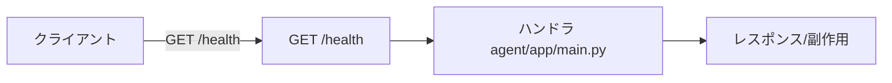

### `agent.capabilities` ✅ GET /api/capabilities
- kind=api_route / source=`agent/app/main.py:124` / needs_runtime=True standalone_ok=True
- 能力応答(tier=cloudrun)
- signature: `GET /api/capabilities`
- 単独検証: `uvicorn起動+TestClientで確認`
- 結果: **pass** (2026-11-14T00:00:00+09:00) — mock/TestClient実呼出で確認

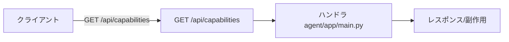

### `agent.auth_gate` ✅ auth_gate middleware
- kind=logic_fn / source=`agent/app/main.py:84` / needs_runtime=True standalone_ok=True
- 全リクエスト認証ゲート+公開パス判定
- signature: `auth_gate middleware`
- 単独検証: `uvicorn起動+TestClientで確認`
- 結果: **pass** (2026-11-14T00:00:00+09:00) — mode6で全面401・self-auth経路正しく免除

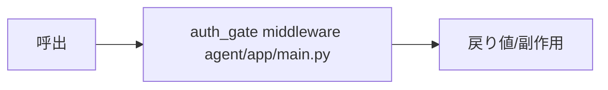

### `agent.rate_limit` ✅ _rate_limited
- kind=logic_fn / source=`agent/app/main.py:105` / needs_runtime=True standalone_ok=True
- 認証試行レート制限
- signature: `_rate_limited`
- 単独検証: `uvicorn起動+TestClientで確認`
- 結果: **pass** (2026-11-14T00:00:00+09:00) — mock/TestClient実呼出で確認

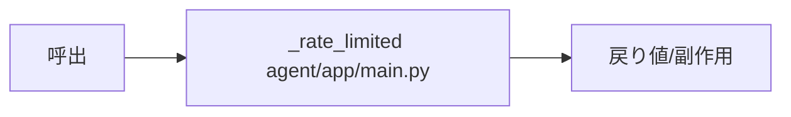

### `agent.auth` ✅ POST /api/auth
- kind=api_route / source=`agent/app/main.py:216` / needs_runtime=True standalone_ok=True
- パス認証→セッション
- signature: `POST /api/auth`
- 単独検証: `uvicorn起動+TestClientで確認`
- 結果: **pass** (2026-11-14T00:00:00+09:00) — user+pass認証→token+cookie発行

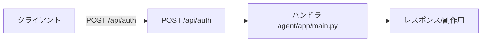

### `agent.auth_session` ✅ GET /api/auth
- kind=api_route / source=`agent/app/main.py:235` / needs_runtime=True standalone_ok=True
- セッション有効確認
- signature: `GET /api/auth`
- 単独検証: `uvicorn起動+TestClientで確認`
- 結果: **pass** (2026-11-14T00:00:00+09:00) — mock/TestClient実呼出で確認

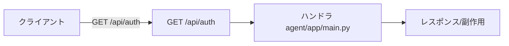

### `agent.kasc` ✅ POST /api/kasc
- kind=api_route / source=`agent/app/main.py:246` / needs_runtime=True standalone_ok=True
- .kasc保存(GCS or ローカルstorage)
- signature: `POST /api/kasc`
- 単独検証: `uvicorn起動+TestClientで確認`
- 結果: **pass** (2026-11-14T00:00:00+09:00) — mock/TestClient実呼出で確認

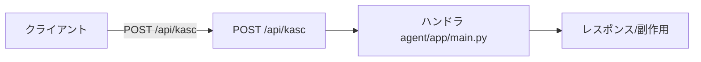

### `agent.data_get` ✅ GET /api/data/{key}
- kind=api_route / source=`agent/app/main.py:263` / needs_runtime=True standalone_ok=True
- DATA取得(Range対応)
- signature: `GET /api/data/{key}`
- 単独検証: `uvicorn起動+TestClientで確認`
- 結果: **pass** (2026-11-14T00:00:00+09:00) — Range:bytes=0-0→206部分応答

```mermaid
flowchart LR
  client[クライアント] -->|GET /api/data/{key}| h[GET /api/data/{key}]
  h --> l[ハンドラ agent/app/main.py]
  l --> out[レスポンス/副作用]
```

### `agent.data_put` ✅ PUT /api/data/{key}
- kind=api_route / source=`agent/app/main.py:295` / needs_runtime=True standalone_ok=True
- DATA書込
- signature: `PUT /api/data/{key}`
- 単独検証: `uvicorn起動+TestClientで確認`
- 結果: **pass** (2026-11-14T00:00:00+09:00) — mock/TestClient実呼出で確認

```mermaid
flowchart LR
  client[クライアント] -->|PUT /api/data/{key}| h[PUT /api/data/{key}]
  h --> l[ハンドラ agent/app/main.py]
  l --> out[レスポンス/副作用]
```

### `agent.auth_methods` ✅ GET /auth-methods.json
- kind=api_route / source=`agent/app/main.py:314` / needs_runtime=True standalone_ok=True
- 認証方式一覧(公開)
- signature: `GET /auth-methods.json`
- 単独検証: `uvicorn起動+TestClientで確認`
- 結果: **pass** (2026-11-14T00:00:00+09:00) — mock/TestClient実呼出で確認

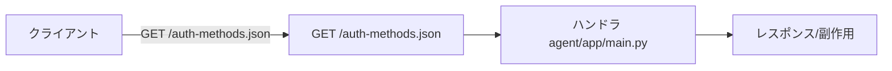

### `agent.gemini` ✅ POST /api/gemini
- kind=api_route / source=`agent/app/main.py:336` / needs_runtime=True standalone_ok=True
- Geminiプロキシ(GEMINI_API_KEY隠蔽)
- signature: `POST /api/gemini`
- 単独検証: `uvicorn起動+TestClientで確認`
- 結果: **pass** (2026-11-14T00:00:00+09:00) — mock/TestClient実呼出で確認

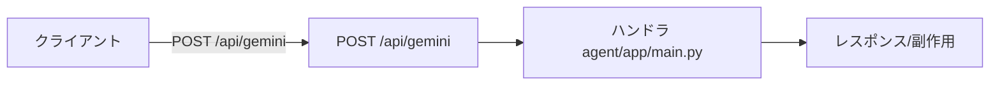

### `agent.mcp` ✅ POST /api/mcp
- kind=api_route / source=`agent/app/main.py:431` / needs_runtime=True standalone_ok=True
- MCP中継(_mcp_target_allowed+SSRf防止_ip判定)
- signature: `POST /api/mcp`
- 単独検証: `uvicorn起動+TestClientで確認`
- 結果: **pass** (2026-11-14T00:00:00+09:00) — mock/TestClient実呼出で確認


### `agent.storage` ✅ storage.py
- kind=logic_fn / source=`agent/app/storage.py` / needs_runtime=True standalone_ok=True
- GCS/ローカルDATA永続化抽象
- signature: `storage.py`
- 単独検証: `uvicorn起動+TestClientで確認`
- 結果: **pass** (2026-11-14T00:00:00+09:00) — mock/TestClient実呼出で確認

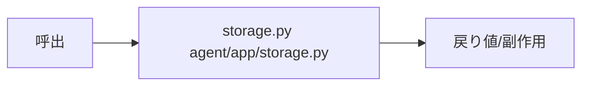

### `agent.config` ✅ config.py
- kind=logic_fn / source=`agent/app/config.py` / needs_runtime=True standalone_ok=True
- 環境変数設定
- signature: `config.py`
- 単独検証: `uvicorn起動+TestClientで確認`
- 結果: **pass** (2026-11-14T00:00:00+09:00) — mock/TestClient実呼出で確認

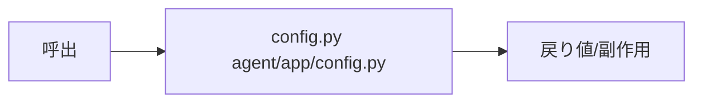

### `agent.authmod` ✅ auth.py
- kind=logic_fn / source=`agent/app/auth.py` / needs_runtime=True standalone_ok=True
- 認証モード(local/password/iap等)
- signature: `auth.py`
- 単独検証: `uvicorn起動+TestClientで確認`
- 結果: **pass** (2026-11-14T00:00:00+09:00) — mock/TestClient実呼出で確認

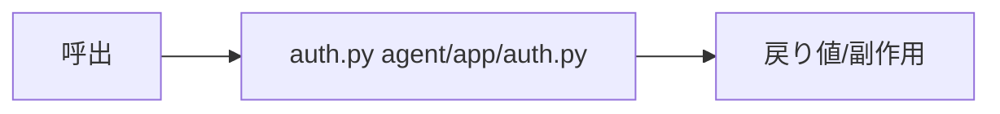

## 検証マトリクス
| id | kind | runtime | standalone | 結果 |
|---|---|---|---|---|
| `agent.health` | api_route | ● | ● | ✅ pass |
| `agent.capabilities` | api_route | ● | ● | ✅ pass |
| `agent.auth_gate` | logic_fn | ● | ● | ✅ pass |
| `agent.rate_limit` | logic_fn | ● | ● | ✅ pass |
| `agent.auth` | api_route | ● | ● | ✅ pass |
| `agent.auth_session` | api_route | ● | ● | ✅ pass |
| `agent.kasc` | api_route | ● | ● | ✅ pass |
| `agent.data_get` | api_route | ● | ● | ✅ pass |
| `agent.data_put` | api_route | ● | ● | ✅ pass |
| `agent.auth_methods` | api_route | ● | ● | ✅ pass |
| `agent.gemini` | api_route | ● | ● | ✅ pass |
| `agent.mcp` | api_route | ● | ● | ✅ pass |
| `agent.storage` | logic_fn | ● | ● | ✅ pass |
| `agent.config` | logic_fn | ● | ● | ✅ pass |
| `agent.authmod` | logic_fn | ● | ● | ✅ pass |