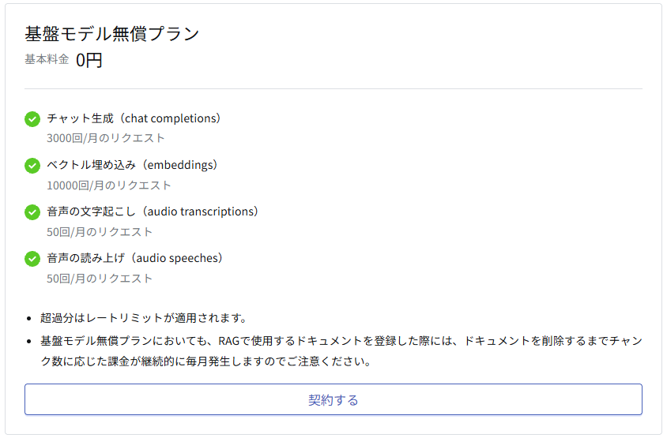
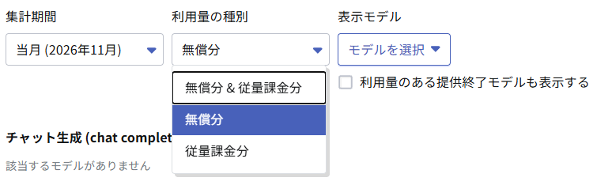
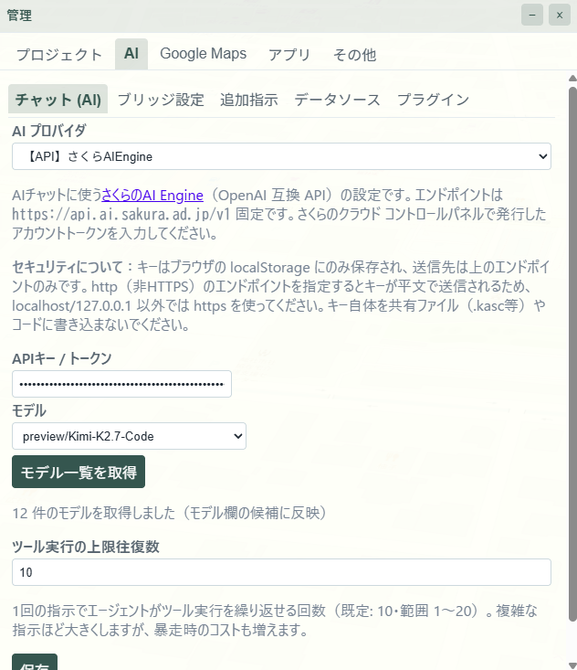
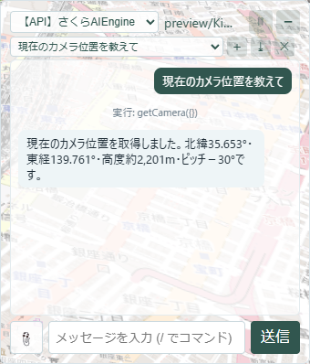

:::message
この記事は「[AIでつくる、公開する、動かし続ける。さくらのAIチャレンジ祭り](https://zenn.dev/contests/zennfes-autumn-2026-sakura)」（Zennfes Autumn 2026・さくらインターネット）への投稿記事です。
:::

## はじめに

「[さくらのAI Engine](https://ai.sakura.ad.jp/sakura-ai/ai-engine/)」は、さくらインターネットが提供する OpenAI・Anthropic 互換 API の AI サービスです。
無償プランでも Chat completions を月 3,000 リクエストまで使えます。

ブラウザで動く 2D/3D GIS「**KASUGAI Canvas**」は、内蔵 AI チャットが function calling で **62 種の GIS ツール**を呼び出して地図を操作します。
AI プロバイダには「OpenAI 互換」があり、ベース URL・キー・モデルを指定すれば chat/completions 互換の任意のエンドポイントを使えます。
この検証のために、さくらのAI Engine 向けの**専用プロバイダ「【API】さくらAIEngine」**を新たに実装しました。

つまり「さくらのAI Engine を Canvas の AI として繋いだら、GIS エージェントとしてどこまで実用になるか？」を検証できる題材が揃っています。
この記事では、その接続可否からツール実行精度までを系統的に検証した結果を報告します。

## 検証対象

### KASUGAI Canvas とは

CesiumJS + Three.js をメインエンジンとするブラウザ完結型の GIS 可視化システムです。
`?kasc=` でプロジェクトを開くサーバレス WebGIS として動作し、MapLibre / OpenLayers / Leaflet の互換プレイヤーも持つマルチエンジン構成です。

- GitHub: https://github.com/yamamoto-ryuzo/kasugai_canvas
- CDN ホスト版（インストール不要）: https://yamamoto-ryuzo.github.io/kasugai-canvas-web/

### 内蔵 AI のツール実行モデル

ユーザーの発言 → AI がツール呼び出しを返す → ブラウザが実行 → 結果を AI に返す、という **function calling ループ**をブラウザ内で回します。
OpenAI 互換プロバイダ選択時は、ツール宣言を OpenAI の `tools` 形式に変換して送信し、ツール結果は `tool` メッセージとして返送します。
ツール実行の上限往復数は既定 10 回（設定で 1〜20 まで変更可）です。

ツールは 62 種で、カメラ操作（`flyTo`・`zoomToExtent`）、レイヤー操作（`addLayer`・`setLayerVisible`・`focusLayer`）、ベースマップ・地形・効果（`setBasemap`・`setTerrain`・`setEffect`）、検索（`searchLocation`・`vectorSearch`）、フライパス（`flyRoute`・`playFlyPath`）、資料生成（`buildShareUrl`・`showReport`）、サンドボックス実行（`runCode`）などを網羅しています。

### さくらのAI Engine とは

OpenAI・Anthropic 互換 API で各種 AI モデルを提供するサービスです。
Zero Data Retention 対応で、入力データは学習・保存されません。
今回は「**基盤モデル無償プラン**」（基本料金 0 円）を申し込みました。
枠は Chat completions 月 3,000 リクエストのほか、Embeddings 月 10,000・Audio transcriptions/speeches 各月 50 リクエストが付きます。

重要なのは、**無償枠の超過分は課金ではなくレートリミットが適用される**点です。
3,000 リクエストを使い切っても請求は発生しないため、検証を安心して回せるありがたい設計です（なお無償プランでも RAG 用ドキュメント登録にはチャンク数に応じた継続課金が発生する旨の注意書きがあります）。

提供モデルは `gpt-oss-120b`・`llm-jp-3.1-8x13b-instruct4` の通常モデルに加え、パブリックプレビューモデルが順次追加されています。
本検証では最新（2026/07/28〜提供）の **Kimi-K2.7-Code** を対象にします。
コーディング特化モデルで、エージェント的なツール利用との相性が期待できる一方、GIS ドメインでの tool calling 精度は未知数です。

:::message
**Playground**（ブラウザ上で各モデルを試せる機能）は **GitHub アカウントでそのまま利用**でき、登録手続きなしにモデルの挙動を確認できました。
一方、API の利用（さくらのAI Engine 本体の申し込み）には、以下のステップが必要でした。

1. **[さくらのクラウドの会員登録](https://secure.sakura.ad.jp/signup3/member-register/input.html?redirect=https://secure.sakura.ad.jp/cloud)**
2. **電話番号による認証**（SMS/音声通話での確認）—— 完了しないと先へ進めないため、認証に使える電話番号の用意が前提です
3. **クレジットカードの登録** —— 無償プランの利用でも必要です。なお登録は「登録完了メール」が届くだけで 3D Secure 等の追加認証はなく、ここはワンランク上の認証確認が欲しかったところで、セキュリティ的には一世代前に感じられ、正直残念なポイントです
4. **さくらのAI Engine の申込** —— [コントロールパネル](https://secure.sakura.ad.jp/cloud/#/top) から「[さくらのAI Engine](https://secure.sakura.ad.jp/ai/?homeRoot=https%3A%2F%2Fsecure.sakura.ad.jp%2Fcloud)」へ「基盤モデル無償プラン」を申し込みます（パネル内の導線がやや分かりにくいので、トップから申込ページへ直接進むのが確実です）

   
   *▲ 申込画面。基本料金 0 円で chat completions 月 3,000 リクエスト等の枠が付く*

5. **アカウントトークンの作成** —— ここで重要なのが **利用量の種別**の選択で、「無償分＆従量課金分」「無償分」「従量課金分」から選べます。今回の検証は **「無償分」を選択** — このトークンは無償枠だけを消費するため、使い切っても課金側へは流れません（先述のレートリミットと合わせて、意図しない課金の心配がない構成にできます）

   
   *▲ アカウントトークン作成画面。利用量の種別は「無償分」を選択*
:::

## Canvas への追加開発 — 専用プロバイダ「【API】さくらAIEngine」

検証を再現可能な手順にするため、KASUGAI Canvas の内蔵 AI にさくらのAI Engine 向けの**専用プロバイダ**を追加しました（管理 → AI → チャット）。

もともと「OpenAI 互換」プロバイダの接続プリセットとしてさくらのAI Engine を選べる方針でしたが、トークン入力からモデル選択までを迷いなく完了できるよう、独立したプロバイダとして実装しています。

*▲ 管理 → AI → チャット の AI プロバイダに追加した「【API】さくらAIEngine」。アカウントトークンとモデルの 2 項目だけを設定する*

### 実装のポイント

- **プロバイダとして独立**：AI プロバイダの選択肢（Gemini・OpenAI互換・Anthropic・Azure OpenAI・ブリッジ系）に「【API】さくらAIEngine」を追加しました。チャット画面のクイック切替ドロップダウンにも現れます
- **エンドポイント固定**：ベース URL は `https://api.ai.sakura.ad.jp/v1` に固定し、入力項目をアカウントトークンとモデルの 2 つに絞りました。OpenAI 互換の汎用欄（ベース URL・プリセット選択）を触らせない分、手順が単純です
- **「モデル一覧を取得」ボタン**：`{ベースURL}/models` をブラウザから直接 GET し、接続・API キー・CORS の疎通確認と、取得したモデル ID のモデル欄への反映を行います。有効なモデル ID をこの場で確定できるため、検証のスモークテスト導線としても使います
- **モデル欄はドロップダウンに統一**：取得した全モデルが一覧できます。Gemini・ブリッジ系プロバイダと同じ単一コントロールで、一覧に無い保存値も選択肢として残します
- **旧設定の自動移行**：過去に OpenAI 互換側へさくらのエンドポイントを設定していた場合、初回起動時にキー・モデル・プロバイダ選択を専用プロバイダへ自動で移します

送信経路は既存の OpenAI 互換 function calling ループ（`chat/completions` + `tools` 宣言 + `tool` メッセージ往復）をそのまま使います。
今回の追加は設定層のみで、62 ツールの実行基盤には手を入れていません。

### 併せて実装：TTS 音声ガイドツール `speak`

さくらのAI Engine の無償枠には **音声読み上げ（audio speeches）月 50 回** もあり、こちらは VOICEVOX 系ボイス（ずんだもん・春日部つむぎ・冥鳴ひまり等）を提供します。
そこでチャットツール `speak` を新設し、AI が生成した案内文を音声で読み上げられるようにしました。

- チャットプロバイダが「【API】さくらAIEngine」でトークン設定済みなら `/v1/audio/speech` で音声生成して再生
- OpenAI 互換プロバイダのキーがあれば同様に `/audio/speech` へ送信
- **TTS キーが無い環境ではブラウザ内蔵の Web Speech API にフォールバック** — 無料・常時利用可能なため、音声ガイドデモを継続的に無料で動かせます

「フライパスに沿って各地の案内を読み上げて」という指示で、フライ再生と音声ガイドを組み合わせたデモが組めます（検証シナリオに追加）。

### 設定手順

1. 管理（⚙）→ AI → チャット を開く
2. AI プロバイダで「【API】さくらAIEngine」を選択
3. さくらのクラウド コントロールパネルで発行したアカウントトークンを入力
4. 「モデル一覧を取得」で接続確認し、モデルを選択（本検証では `preview/Kimi-K2.7-Code`）
5. 保存

## 検証環境

| 項目 | 値 |
|---|---|
| Canvas | CDN ホスト版（cesium エンジン）バージョン <!-- TODO: 検証時のバージョン --> |
| AI プロバイダ設定 | 【API】さくらAIEngine（専用プロバイダ） |
| ベース URL | `https://api.ai.sakura.ad.jp/v1` |
| 対象モデル | **`preview/Kimi-K2.7-Code`**（最新のパブリックプレビューモデル・2026/07/28〜提供。API で指定するモデル ID は `preview/` 接頭辞付き — `/models` で確認済み） |
| 比較ベースライン | Gemini（<!-- TODO: モデル名 -->、BYO キー・既定プロバイダ） |

## 検証方法

### 事前確認

まず接続の前提条件を確認しました。

#### Canvas 側の実装（本検証用に追加）

さくらのAI Engine 向けの専用プロバイダ「【API】さくらAIEngine」を Canvas に追加しました（前章「Canvas への追加開発」参照）。

#### 確認結果（11/02 時点）

| 確認項目 | 結果 |
|---|---|
| chat/completions 互換エンドポイントの疎通 | ○ `api.ai.sakura.ad.jp` が OpenAI 形式の応答を返すことを確認（無効キーでは `{"error":{"message":"Invalid token"}}` の 401） |
| `tools`（function calling）パラメータの受理 | ○ 実機のチャット送信で `tools` 宣言が受理され、function call（tool_calls）が返ることを確認 |
| `tool` メッセージの往復（多段ループ） | ○ ツール実行結果を `tool` メッセージで返送し、最終テキスト応答まで往復するループが完走することを確認 |
| CORS（ブラウザからの直接呼び出し可否） | ○ `access-control-allow-origin: *`、プリフライトが `authorization`/`content-type` ヘッダと GET を許可。**ブラウザからの実リクエストで 401 応答を取得でき、ブラウザ直叩きが可能なことを確認済み**（プロキシ不要） |
| 提供モデル一覧（`/models`） | ○ `GET /v1/models` は OpenAI 互換形式 `{object:"list",data:[{id,…}]}` を返す。有効キーでの一覧取得を「モデル一覧を取得」ボタンで実施し、**12 件のモデル**が返ることを確認。Kimi-K2.7-Code の正確なモデル ID は **`preview/Kimi-K2.7-Code`**（`preview/` 接頭辞付き）と確定 |

*▲ 「【API】さくらAIEngine」+ `preview/Kimi-K2.7-Code` でのチャット。日本語指示から `getCamera` が選ばれ、実行結果を返送して最終応答まで往復している*

### 評価プロンプト集

3 段構成で設計しました。
ツール 1 回で済む「単発」、ツール結果を見て次の操作を決める「多段」、実利用に近い「シナリオ」です。

**Tier 1：単発（ツール 1 回）**

| # | プロンプト | 期待ツール |
|---|---|---|
| T1-1 | 北緯35.6586・東経139.7454（東京タワー）に飛んで | `flyTo` / `flyToFeature` |
| T1-2 | レイヤー一覧を表示して | `listLayers` |
| T1-3 | ベースマップを航空写真に変えて | `setBasemap` |
| T1-4 | 地形表示を ON にして | `setTerrain` |
| T1-5 | 現在のカメラ位置を教えて | `getCamera` |
| T1-6 | この視点の共有 URL を発行して | `getShareUrl` / `buildShareUrl` |
| T1-7 | 「テスト」と音声で読み上げて | `speak` |

**Tier 2：多段（複数往復）**

| # | プロンプト | 期待シーケンス |
|---|---|---|
| T2-1 | 渋谷駅を検索して、その場所に飛んで | `searchLocation` → `flyTo` / `flyToFeature` |
| T2-2 | GeoJSON レイヤーを追加して、全体が見える位置に移動して | `addLayer` / `addGeoJsonLayer` → `focusLayer` |
| T2-3 | 今のカメラ位置の共有リンクを作って | `getCamera` → `buildShareUrl` |
| T2-4 | 表示中のレイヤーをすべて非表示にして | `listLayers` → `setLayerVisible`（複数回） |
| T2-5 | 東京タワーの見どころを 2〜3 文で説明して、それを音声で読み上げて | （説明文生成）→ `speak` |

**Tier 3：シナリオ（実利用に近い一連の依頼）**

| # | プロンプト | 期待シーケンス |
|---|---|---|
| T3-1 | 渋谷区内の公園を 5 か所、架空サンプルの点レイヤーとして追加して（サンプルデータと明記して） | GeoJSON 生成（出典スタンプ付き）→ `addDataLayer` |
| T3-2 | さっきの公園を順番に巡るフライパスを再生して | `vectorSearch` / `getLayerGeoJson` → `addFlyPath` or `flyRoute` → `playFlyPath` |
| T3-3 | この地域の見どころ資料を作って。各スポットへのパーマリンクを付けて | `buildShareUrl`（複数地点）→ `showReport` |
| T3-4 | 東京タワー・浅草寺・スカイツリー・明治神宮・皇居を巡る観光フライを組んで再生して | `flyRoute` / `addFlyPath` → `playFlyPath` |
| T3-5 | **（ゴールデモ）** 東京の観光地を数か所巡るフライを再生して。各地の見どころを音声で順に案内して | `flyRoute` / `addFlyPath` → `playFlyPath` → `speak`（各スポットで順次・観光地巡り SKILL の手順に従う） |

### 採点基準

各プロンプトをモデル×3 回試行し、以下の基準で採点します。

| 観点 | 基準 |
|---|---|
| ツール選択 | 期待ツール（または同等の代替）が選ばれたか |
| 引数適合 | JSON スキーマに適合し、内容が妥当か |
| 完走 | 依頼のゴールまで到達したか（途中で止まった・誤った場合は途中経過を記録） |
| 消費リクエスト | 完走までに使ったリクエスト数 |

同一プロンプト集を Gemini ベースラインにも適用し、相対評価とします。

## 結果

<!-- TODO: 実測後に記入 -->

### 事前確認の結果

<!-- TODO -->

### モデル別結果サマリ

| モデル | Tier 1 | Tier 2 | Tier 3 | 平均消費リクエスト |
|---|---|---|---|---|
| <!-- TODO --> | | | | |
| Gemini（ベースライン） | | | | |

### 詳細結果

<!-- TODO: プロンプト別の成否表・典型的な失敗パターン -->

## 考察

<!-- TODO: 実測後に記入。方針として以下を扱う -->
<!--
- tools 対応・引数精度の実用度（コーディング特化の Kimi-K2.7-Code が汎用エージェント指示にどこまで応えるか）
- 日本語指示での挙動
- Gemini との差・得意不得意
- 3,000 リクエストの無償枠でどこまで回るか
- GIS エージェントとしての実用ライン（単発操作は実用・多段は要工夫、等）
-->

## まとめ

<!-- TODO: 実測後に記入 -->

## 参考リンク

- [さくらのAIチャレンジ祭り（コンテストページ）](https://zenn.dev/contests/zennfes-autumn-2026-sakura)
- [さくらのAI Engine](https://ai.sakura.ad.jp/sakura-ai/ai-engine/)
- [KASUGAI Canvas（GitHub）](https://github.com/yamamoto-ryuzo/kasugai_canvas)
- [KASUGAI Canvas ドキュメント](https://yamamoto-ryuzo.github.io/kasugai_canvas/)
