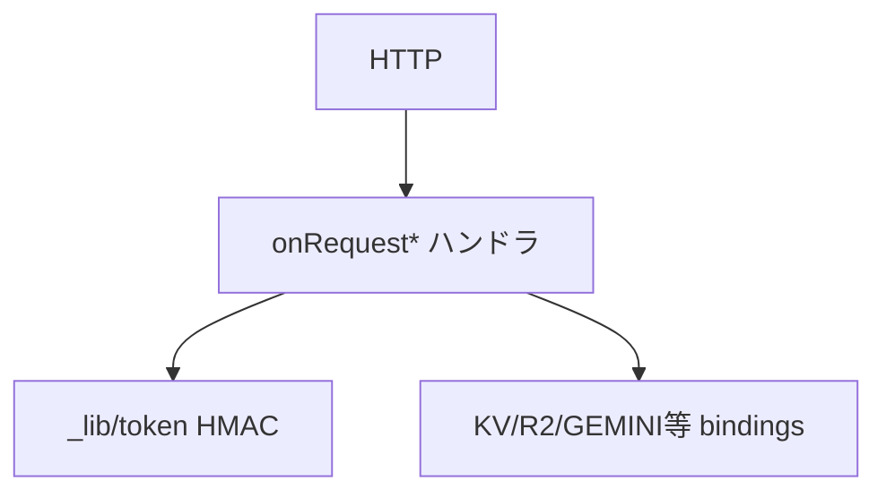
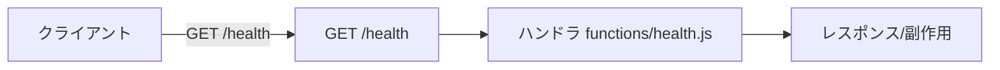
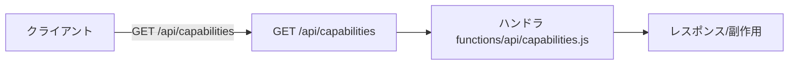
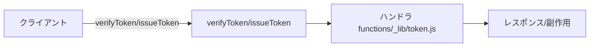
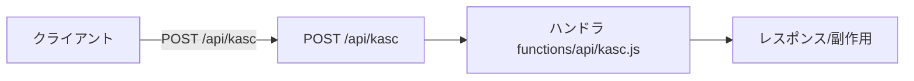
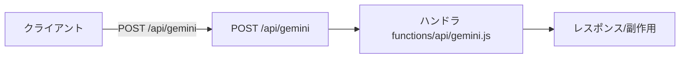
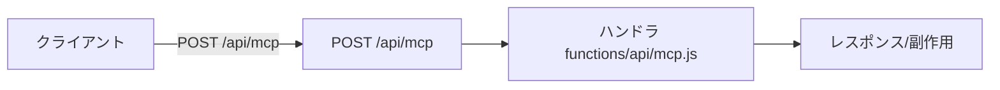
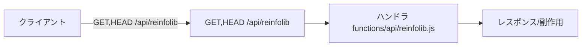

# functions — 完全ロジックシート (feature-verify)

- 種別: `cf_pages_functions` / バージョン: `6.24.0` / 生成: 2026-11-14 / 機能数: 9
- 結果: pass=9 fail=0 skip=0 untested=0
- driver: `manual` detect=`Cloudflare Pages環境。ローカルはwrangler pages dev or モック` launch=`(Workersと共用コード。worker.jsから直接importも可能)`

## トポロジ


## 機能別
### `fn.health` ✅ GET /health
- kind=api_route / source=`functions/health.js` / needs_runtime=False standalone_ok=True
- 到達確認{ok:true}
- signature: `GET /health`
- 単独検証: `nodeでcontextモック呼出`
- 結果: **pass** (2026-11-14T00:00:00+09:00) — mock/TestClient実呼出で確認



### `fn.capabilities` ✅ GET /api/capabilities
- kind=api_route / source=`functions/api/capabilities.js` / needs_runtime=False standalone_ok=True
- 能力応答(tier=pages/workers)
- signature: `GET /api/capabilities`
- 単独検証: `nodeでcontextモック呼出`
- 結果: **pass** (2026-11-14T00:00:00+09:00) — mock/TestClient実呼出で確認



### `fn.auth` ✅ POST /api/auth
- kind=api_route / source=`functions/api/auth.js` / needs_runtime=False standalone_ok=True
- パス認証→HMACトークン発行(_lib/token)
- signature: `POST /api/auth`
- 単独検証: `nodeでcontextモック呼出`
- 結果: **pass** (2026-11-14T00:00:00+09:00) — mock/TestClient実呼出で確認


### `fn.token` ✅ verifyToken/issueToken
- kind=api_route / source=`functions/_lib/token.js` / needs_runtime=False standalone_ok=True
- HMACセッショントークン発行・検証(WebCrypto)
- signature: `verifyToken/issueToken`
- 単独検証: `nodeでcontextモック呼出`
- 結果: **pass** (2026-11-14T00:00:00+09:00) — mock/TestClient実呼出で確認



### `fn.kasc` ✅ POST /api/kasc
- kind=api_route / source=`functions/api/kasc.js` / needs_runtime=False standalone_ok=True
- .kascプロジェクト保存(bindingへ)
- signature: `POST /api/kasc`
- 単独検証: `nodeでcontextモック呼出`
- 結果: **pass** (2026-11-14T00:00:00+09:00) — mock/TestClient実呼出で確認



### `fn.data` ✅ GET,PUT /api/data/{path}
- kind=api_route / source=`functions/api/data/[[path]].js` / needs_runtime=False standalone_ok=True
- DATAファイル読書き
- signature: `GET,PUT /api/data/{path}`
- 単独検証: `nodeでcontextモック呼出`
- 結果: **pass** (2026-11-14T00:00:00+09:00) — mock/TestClient実呼出で確認

```mermaid
flowchart LR
  client[クライアント] -->|GET,PUT /api/data/{path}| h[GET,PUT /api/data/{path}]
  h --> l[ハンドラ functions/api/data/[[path]].js]
  l --> out[レスポンス/副作用]
```

### `fn.gemini` ✅ POST /api/gemini
- kind=api_route / source=`functions/api/gemini.js` / needs_runtime=False standalone_ok=True
- Gemini APIプロキシ(キー隠蔽・認可判定)
- signature: `POST /api/gemini`
- 単独検証: `nodeでcontextモック呼出`
- 結果: **pass** (2026-11-14T00:00:00+09:00) — mock/TestClient実呼出で確認



### `fn.mcp` ✅ POST /api/mcp
- kind=api_route / source=`functions/api/mcp.js` / needs_runtime=False standalone_ok=True
- MCP中継(対象ホスト許可判定)
- signature: `POST /api/mcp`
- 単独検証: `nodeでcontextモック呼出`
- 結果: **pass** (2026-11-14T00:00:00+09:00) — mock/TestClient実呼出で確認



### `fn.reinfolib` ✅ GET,HEAD /api/reinfolib
- kind=api_route / source=`functions/api/reinfolib.js` / needs_runtime=False standalone_ok=True
- reinfolibプロキシ
- signature: `GET,HEAD /api/reinfolib`
- 単独検証: `nodeでcontextモック呼出`
- 結果: **pass** (2026-11-14T00:00:00+09:00) — mock/TestClient実呼出で確認



## 検証マトリクス
| id | kind | runtime | standalone | 結果 |
|---|---|---|---|---|
| `fn.health` | api_route | - | ● | ✅ pass |
| `fn.capabilities` | api_route | - | ● | ✅ pass |
| `fn.auth` | api_route | - | ● | ✅ pass |
| `fn.token` | api_route | - | ● | ✅ pass |
| `fn.kasc` | api_route | - | ● | ✅ pass |
| `fn.data` | api_route | - | ● | ✅ pass |
| `fn.gemini` | api_route | - | ● | ✅ pass |
| `fn.mcp` | api_route | - | ● | ✅ pass |
| `fn.reinfolib` | api_route | - | ● | ✅ pass |