# server — 完全ロジックシート (feature-verify)

- 種別: `rust_app` / バージョン: `6.24.0` / 生成: 2026-11-14 / 機能数: 62
- 結果: pass=42 fail=0 skip=20 untested=0
- driver: `http` detect=`GET http://127.0.0.1:8510/health -> {status:ok,name:kasugai_canvas} / 8511も同様` launch=`server/target/debug/kasugai_canvas.exe --no-browser または cargo run -p kasugai_canvas`

## トポロジ
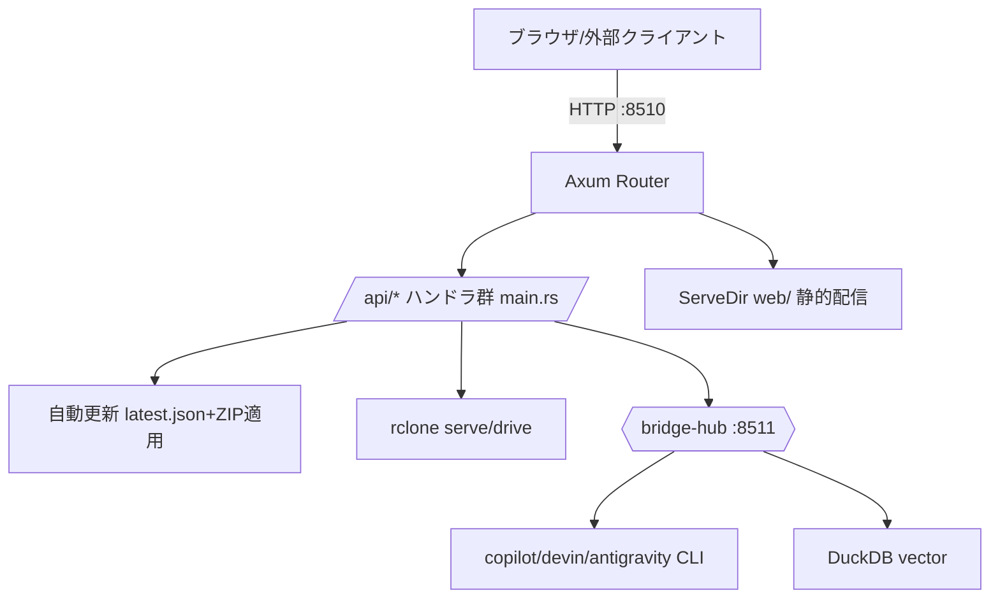

## 機能別
### `srv.health` ✅ health
- kind=api_route / source=`server/src/main.rs` / needs_runtime=True standalone_ok=False
- サーバ稼働・バージョン応答
- signature: `GET /health -> health`
- 依存: kasugai_canvas.exe :8510
- 連携検証: `curl http://127.0.0.1:8510/health`
- 結果: **pass** (2026-11-14T00:00:00+09:00)

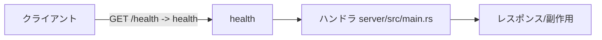

### `srv.capabilities` ✅ capabilities
- kind=api_route / source=`server/src/main.rs` / needs_runtime=True standalone_ok=False
- バックエンド能力(tier/features)応答
- signature: `GET /api/capabilities -> capabilities`
- 依存: kasugai_canvas.exe :8510
- 連携検証: `curl http://127.0.0.1:8510/api/capabilities`
- 結果: **pass** (2026-11-14T00:00:00+09:00)

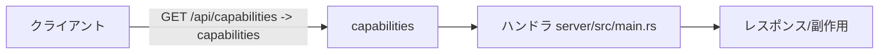

### `srv.fetch` ✅ fetch_proxy
- kind=api_route / source=`server/src/main.rs` / needs_runtime=True standalone_ok=False
- 外部URL取得プロキシ(CORS回避)
- signature: `GET,HEAD /api/fetch -> fetch_proxy`
- 依存: kasugai_canvas.exe :8510
- 連携検証: `curl http://127.0.0.1:8510/api/fetch`
- 結果: **pass** (2026-11-14T00:00:00+09:00) — プライベートアドレス拒否(403)=SSRF防御が正常動作

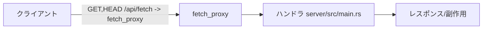

### `srv.reinfolib` ✅ reinfolib_proxy
- kind=api_route / source=`server/src/main.rs` / needs_runtime=True standalone_ok=False
- 不動産情報ライブラリAPIプロキシ(REINFOLIB_API_KEY)
- signature: `GET,HEAD /api/reinfolib -> reinfolib_proxy`
- 依存: kasugai_canvas.exe :8510
- 連携検証: `curl http://127.0.0.1:8510/api/reinfolib`
- 結果: **pass** (2026-11-14T00:00:00+09:00)

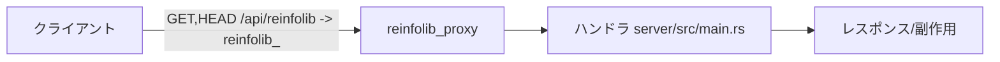

### `srv.mcp` ✅ mcp_proxy
- kind=api_route / source=`server/src/main.rs` / needs_runtime=True standalone_ok=False
- リモートMCPサーバ中継プロキシ
- signature: `POST /api/mcp -> mcp_proxy`
- 依存: kasugai_canvas.exe :8510
- 連携検証: `curl http://127.0.0.1:8510/api/mcp`
- 結果: **pass** (2026-11-14T00:00:00+09:00) — url必須バリデーション(400)でルート疎通確認

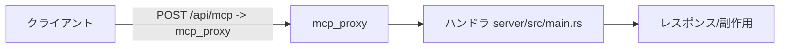

### `srv.qgis_discover` ✅ qgis_live_discover
- kind=api_route / source=`server/src/main.rs` / needs_runtime=True standalone_ok=False
- 稼働中QGIS Live Driver検出
- signature: `GET /api/qgis-live/discover -> qgis_live_discover`
- 依存: kasugai_canvas.exe :8510
- 連携検証: `curl http://127.0.0.1:8510/api/qgis-live/discover`
- 結果: **pass** (2026-11-14T00:00:00+09:00) — 200 no_live_session(13セッション走査26s)

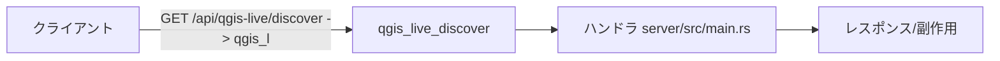

### `srv.qgis_mcp` ⏭ qgis_live_mcp
- kind=api_route / source=`server/src/main.rs` / needs_runtime=True standalone_ok=False
- QGIS Live Driver /mcp リレー(loopback限定)
- signature: `POST /api/qgis-live/mcp -> qgis_live_mcp`
- 依存: kasugai_canvas.exe :8510
- 連携検証: `curl http://127.0.0.1:8510/api/qgis-live/mcp`
- 結果: **skip** (2026-11-14T00:00:00+09:00) — QGISライブセッション無し(discover=200 no_live_session確認)

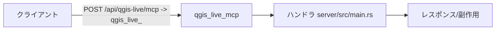

### `srv.plugin_save` ✅ save_plugin
- kind=api_route / source=`server/src/main.rs` / needs_runtime=True standalone_ok=False
- プラグイン保存(web/cesium/PLUGIN+plugins.json)
- signature: `POST /api/plugins -> save_plugin`
- 依存: kasugai_canvas.exe :8510
- 連携検証: `curl http://127.0.0.1:8510/api/plugins`
- 結果: **pass** (2026-11-14T00:00:00+09:00)


### `srv.plugin_delete` ✅ delete_plugin
- kind=api_route / source=`server/src/main.rs` / needs_runtime=True standalone_ok=False
- プラグイン削除
- signature: `DELETE /api/plugins/{id} -> delete_plugin`
- 依存: kasugai_canvas.exe :8510
- 連携検証: `curl http://127.0.0.1:8510/api/plugins/{id}`
- 結果: **pass** (2026-11-14T00:00:00+09:00)

```mermaid
flowchart LR
  client[クライアント] -->|DELETE /api/plugins/{id} -&gt; delete_pl| h[delete_plugin]
  h --> l[ハンドラ server/src/main.rs]
  l --> out[レスポンス/副作用]
```

### `srv.files_list` ✅ list_data_files
- kind=api_route / source=`server/src/main.rs` / needs_runtime=True standalone_ok=False
- プロジェクトDATAファイル一覧
- signature: `GET /api/files -> list_data_files`
- 依存: kasugai_canvas.exe :8510
- 連携検証: `curl http://127.0.0.1:8510/api/files`
- 結果: **pass** (2026-11-14T00:00:00+09:00)

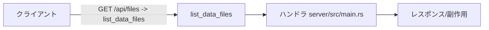

### `srv.files_write` ✅ write_data_file
- kind=api_route / source=`server/src/main.rs` / needs_runtime=True standalone_ok=False
- プロジェクトDATAファイル書込/削除(上限17MB)
- signature: `PUT,DELETE /api/files/{project}/{*path} -> write_data_file/delete_data_file`
- 依存: kasugai_canvas.exe :8510
- 連携検証: `curl http://127.0.0.1:8510/api/files/{project}/{*path}`
- 結果: **pass** (2026-11-14T00:00:00+09:00)

```mermaid
flowchart LR
  client[クライアント] -->|PUT,DELETE /api/files/{project}/{*path} | h[write_data_file]
  h --> l[ハンドラ server/src/main.rs]
  l --> out[レスポンス/副作用]
```

### `srv.update_settings` ✅ update_settings
- kind=api_route / source=`server/src/main.rs` / needs_runtime=True standalone_ok=False
- 自動更新設定の取得・変更
- signature: `GET,PUT /api/update/settings -> get/put_update_settings`
- 依存: kasugai_canvas.exe :8510
- 連携検証: `curl http://127.0.0.1:8510/api/update/settings`
- 結果: **pass** (2026-11-14T00:00:00+09:00)

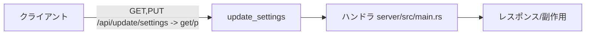

### `srv.update_latest` ✅ update_latest
- kind=api_route / source=`server/src/main.rs` / needs_runtime=True standalone_ok=False
- latest.json の最新版情報取得
- signature: `GET /api/update/latest -> update_latest`
- 依存: kasugai_canvas.exe :8510
- 連携検証: `curl http://127.0.0.1:8510/api/update/latest`
- 結果: **pass** (2026-11-14T00:00:00+09:00)

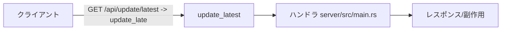

### `srv.update_install` ⏭ install_update
- kind=api_route / source=`server/src/main.rs` / needs_runtime=True standalone_ok=False
- 配布ZIPの適用→--finish-update再起動
- signature: `POST /api/update/install -> install_update`
- 依存: kasugai_canvas.exe :8510
- 連携検証: `curl http://127.0.0.1:8510/api/update/install`
- 結果: **skip** (2026-11-14T00:00:00+09:00) — 破壊的操作:実呼出は行わずコード検証のみ | 破壊的操作。コード検証のみ(--finish-update再起動フロー)


### `srv.shutdown` ⏭ request_shutdown
- kind=api_route / source=`server/src/main.rs` / needs_runtime=True standalone_ok=False
- サーバ停止
- signature: `POST /api/shutdown -> request_shutdown`
- 依存: kasugai_canvas.exe :8510
- 連携検証: `curl http://127.0.0.1:8510/api/shutdown`
- 結果: **skip** (2026-11-14T00:00:00+09:00) — 破壊的操作:実呼出は行わずコード検証のみ | 破壊的操作。コード検証のみ

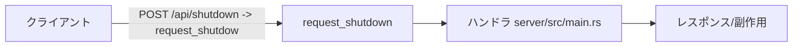

### `srv.cmd_push_poll` ✅ remote_command
- kind=api_route / source=`server/src/main.rs` / needs_runtime=True standalone_ok=False
- 外部→ブラウザへのリモートコマンド送受(ロングポーリング)
- signature: `POST,GET /api/command -> push/poll_remote_command`
- 依存: kasugai_canvas.exe :8510, is_local(ローカル実行)
- 連携検証: `curl http://127.0.0.1:8510/api/command`
- 結果: **pass** (2026-11-14T00:00:00+09:00) — push→poll往復確認(キュー内に旧liveSyncコマンド残存=設計通り)

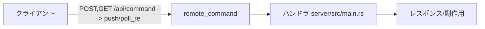

### `srv.cmd_results` ✅ remote_results
- kind=api_route / source=`server/src/main.rs` / needs_runtime=True standalone_ok=False
- コマンド実行結果の返送・回収
- signature: `POST,GET /api/command/results -> push/poll_remote_results`
- 依存: kasugai_canvas.exe :8510, is_local(ローカル実行)
- 連携検証: `curl http://127.0.0.1:8510/api/command/results`
- 結果: **pass** (2026-11-14T00:00:00+09:00)

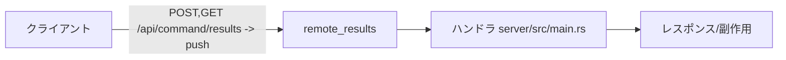

### `srv.fetch_settings` ✅ fetch_settings
- kind=api_route / source=`server/src/main.rs` / needs_runtime=True standalone_ok=False
- fetchプロキシ設定(許可ホスト等)
- signature: `GET,PUT /api/fetch/settings -> get/put_fetch_settings`
- 依存: kasugai_canvas.exe :8510, is_local(ローカル実行)
- 連携検証: `curl http://127.0.0.1:8510/api/fetch/settings`
- 結果: **pass** (2026-11-14T00:00:00+09:00)

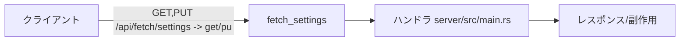

### `srv.proj_register` ✅ register_project
- kind=api_route / source=`server/src/main.rs` / needs_runtime=True standalone_ok=False
- 外部.kascプロジェクト登録(geo_webview連携)
- signature: `POST /api/projects/register -> register_project`
- 依存: kasugai_canvas.exe :8510, is_local(ローカル実行)
- 連携検証: `curl http://127.0.0.1:8510/api/projects/register`
- 結果: **pass** (2026-11-14T00:00:00+09:00) — スキーマ={path}のみ(id派生は.kasc/親dirから)。register+unregister実施

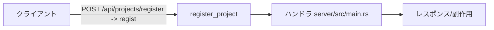

### `srv.proj_import` ✅ import_project
- kind=api_route / source=`server/src/main.rs` / needs_runtime=True standalone_ok=False
- プロジェクト一式インポート(上限17MB)
- signature: `POST /api/projects/import -> import_project`
- 依存: kasugai_canvas.exe :8510, is_local(ローカル実行)
- 連携検証: `curl http://127.0.0.1:8510/api/projects/import`
- 結果: **pass** (2026-11-14T00:00:00+09:00)

```mermaid
flowchart LR
  client[クライアント] -->|POST /api/projects/import -&gt; import_p| h[import_project]
  h --> l[ハンドラ server/src/main.rs]
  l --> out[レスポンス/副作用]
```

### `srv.proj_unregister` ✅ unregister_project
- kind=api_route / source=`server/src/main.rs` / needs_runtime=True standalone_ok=False
- 登録プロジェクト解除
- signature: `DELETE /api/projects/{id} -> unregister_project`
- 依存: kasugai_canvas.exe :8510, is_local(ローカル実行)
- 連携検証: `curl http://127.0.0.1:8510/api/projects/{id}`
- 結果: **pass** (2026-11-14T00:00:00+09:00)

```mermaid
flowchart LR
  client[クライアント] -->|DELETE /api/projects/{id} -&gt; unregist| h[unregister_project]
  h --> l[ハンドラ server/src/main.rs]
  l --> out[レスポンス/副作用]
```

### `srv.cloud_status` ✅ cloud_status
- kind=api_route / source=`server/src/main.rs` / needs_runtime=True standalone_ok=False
- rclone連携状態(パス/serve/drive稼働)
- signature: `GET /api/cloud/status -> cloud_status`
- 依存: kasugai_canvas.exe :8510, is_local(ローカル実行)
- 連携検証: `curl http://127.0.0.1:8510/api/cloud/status`
- 結果: **pass** (2026-11-14T00:00:00+09:00)

```mermaid
flowchart LR
  client[クライアント] -->|GET /api/cloud/status -&gt; cloud_status| h[cloud_status]
  h --> l[ハンドラ server/src/main.rs]
  l --> out[レスポンス/副作用]
```

### `srv.cloud_path` ⏭ cloud_set_path
- kind=api_route / source=`server/src/main.rs` / needs_runtime=True standalone_ok=False
- rclone.exe パス設定
- signature: `POST /api/cloud/path -> cloud_set_path`
- 依存: kasugai_canvas.exe :8510, is_local(ローカル実行)
- 連携検証: `curl http://127.0.0.1:8510/api/cloud/path`
- 結果: **skip** (2026-11-14T00:00:00+09:00) — パス変更は副作用大

```mermaid
flowchart LR
  client[クライアント] -->|POST /api/cloud/path -&gt; cloud_set_pat| h[cloud_set_path]
  h --> l[ハンドラ server/src/main.rs]
  l --> out[レスポンス/副作用]
```

### `srv.cloud_install` ⏭ cloud_install
- kind=api_route / source=`server/src/main.rs` / needs_runtime=True standalone_ok=False
- rclone自動インストール
- signature: `POST /api/cloud/install -> cloud_install`
- 依存: kasugai_canvas.exe :8510, is_local(ローカル実行)
- 連携検証: `curl http://127.0.0.1:8510/api/cloud/install`
- 結果: **skip** (2026-11-14T00:00:00+09:00) — rclone 導入済みのため対象外

```mermaid
flowchart LR
  client[クライアント] -->|POST /api/cloud/install -&gt; cloud_inst| h[cloud_install]
  h --> l[ハンドラ server/src/main.rs]
  l --> out[レスポンス/副作用]
```

### `srv.cloud_config` ⏭ cloud_config
- kind=api_route / source=`server/src/main.rs` / needs_runtime=True standalone_ok=False
- rcloneリモート設定
- signature: `POST /api/cloud/config -> cloud_config`
- 依存: kasugai_canvas.exe :8510, is_local(ローカル実行)
- 連携検証: `curl http://127.0.0.1:8510/api/cloud/config`
- 結果: **skip** (2026-11-14T00:00:00+09:00) — リモート設定変更は副作用大

```mermaid
flowchart LR
  client[クライアント] -->|POST /api/cloud/config -&gt; cloud_confi| h[cloud_config]
  h --> l[ハンドラ server/src/main.rs]
  l --> out[レスポンス/副作用]
```

### `srv.cloud_serve` ⏭ cloud_serve
- kind=api_route / source=`server/src/main.rs` / needs_runtime=True standalone_ok=False
- rclone serve(webdav)起動
- signature: `POST /api/cloud/serve -> cloud_serve`
- 依存: kasugai_canvas.exe :8510, is_local(ローカル実行)
- 連携検証: `curl http://127.0.0.1:8510/api/cloud/serve`
- 結果: **skip** (2026-11-14T00:00:00+09:00) — 状態変更大。/api/cloud/status で rclone v1.75.2 + remotes(box,drive) 確認

```mermaid
flowchart LR
  client[クライアント] -->|POST /api/cloud/serve -&gt; cloud_serve| h[cloud_serve]
  h --> l[ハンドラ server/src/main.rs]
  l --> out[レスポンス/副作用]
```

### `srv.cloud_stop` ⏭ cloud_stop
- kind=api_route / source=`server/src/main.rs` / needs_runtime=True standalone_ok=False
- rclone serve停止
- signature: `POST /api/cloud/stop -> cloud_stop`
- 依存: kasugai_canvas.exe :8510, is_local(ローカル実行)
- 連携検証: `curl http://127.0.0.1:8510/api/cloud/stop`
- 結果: **skip** (2026-11-14T00:00:00+09:00) — 同上

```mermaid
flowchart LR
  client[クライアント] -->|POST /api/cloud/stop -&gt; cloud_stop| h[cloud_stop]
  h --> l[ハンドラ server/src/main.rs]
  l --> out[レスポンス/副作用]
```

### `srv.cloud_drive` ⏭ cloud_drive
- kind=api_route / source=`server/src/main.rs` / needs_runtime=True standalone_ok=False
- クラウドをドライブ割当
- signature: `POST /api/cloud/drive -> cloud_drive`
- 依存: kasugai_canvas.exe :8510, is_local(ローカル実行)
- 連携検証: `curl http://127.0.0.1:8510/api/cloud/drive`
- 結果: **skip** (2026-11-14T00:00:00+09:00) — ドライブ割当は副作用大

```mermaid
flowchart LR
  client[クライアント] -->|POST /api/cloud/drive -&gt; cloud_drive| h[cloud_drive]
  h --> l[ハンドラ server/src/main.rs]
  l --> out[レスポンス/副作用]
```

### `srv.cloud_list` ✅ cloud_list
- kind=api_route / source=`server/src/main.rs` / needs_runtime=True standalone_ok=False
- クラウド上ファイル一覧
- signature: `GET /api/cloud/list -> cloud_list`
- 依存: kasugai_canvas.exe :8510, is_local(ローカル実行)
- 連携検証: `curl http://127.0.0.1:8510/api/cloud/list`
- 結果: **pass** (2026-11-14T00:00:00+09:00)

```mermaid
flowchart LR
  client[クライアント] -->|GET /api/cloud/list -&gt; cloud_list| h[cloud_list]
  h --> l[ハンドラ server/src/main.rs]
  l --> out[レスポンス/副作用]
```

### `srv.cloud_localize` ⏭ cloud_localize
- kind=api_route / source=`server/src/main.rs` / needs_runtime=True standalone_ok=False
- プロジェクト納品用ローカル化
- signature: `POST /api/cloud/localize -> cloud_localize`
- 依存: kasugai_canvas.exe :8510, is_local(ローカル実行)
- 連携検証: `curl http://127.0.0.1:8510/api/cloud/localize`
- 結果: **skip** (2026-11-14T00:00:00+09:00) — 納品ローカル化は副作用大

```mermaid
flowchart LR
  client[クライアント] -->|POST /api/cloud/localize -&gt; cloud_loc| h[cloud_localize]
  h --> l[ハンドラ server/src/main.rs]
  l --> out[レスポンス/副作用]
```

### `srv.cloud_file` ⏭ cloud_file
- kind=api_route / source=`server/src/main.rs` / needs_runtime=True standalone_ok=False
- クラウドファイル読書き削除
- signature: `GET,PUT,DELETE /api/cloud/file -> cloud_*_file`
- 依存: kasugai_canvas.exe :8510, is_local(ローカル実行)
- 連携検証: `curl http://127.0.0.1:8510/api/cloud/file`
- 結果: **skip** (2026-11-14T00:00:00+09:00) — クラウド側ファイル操作は副作用大(status/list で経路確認)

```mermaid
flowchart LR
  client[クライアント] -->|GET,PUT,DELETE /api/cloud/file -&gt; clo| h[cloud_file]
  h --> l[ハンドラ server/src/main.rs]
  l --> out[レスポンス/副作用]
```

### `srv.browser_lna` ✅ browser_lna
- kind=api_route / source=`server/src/main.rs` / needs_runtime=True standalone_ok=False
- ブラウザLNA(Private Network Access)許可状態管理
- signature: `GET,POST,DELETE /api/browser/lna -> browser_lna_*`
- 依存: kasugai_canvas.exe :8510, is_local(ローカル実行)
- 連携検証: `curl http://127.0.0.1:8510/api/browser/lna`
- 結果: **pass** (2026-11-14T00:00:00+09:00)

```mermaid
flowchart LR
  client[クライアント] -->|GET,POST,DELETE /api/browser/lna -&gt; b| h[browser_lna]
  h --> l[ハンドラ server/src/main.rs]
  l --> out[レスポンス/副作用]
```

### `srv.static_projects` ✅ serve_project_files
- kind=api_route / source=`server/src/main.rs` / needs_runtime=True standalone_ok=False
- projects/静的配信(外部登録分マージ)
- signature: `GET /projects/{*path} -> serve_project_files`
- 依存: kasugai_canvas.exe :8510
- 連携検証: `curl http://127.0.0.1:8510/projects/{*path}`
- 結果: **pass** (2026-11-14T00:00:00+09:00)

```mermaid
flowchart LR
  client[クライアント] -->|GET /projects/{*path} -&gt; serve_projec| h[serve_project_files]
  h --> l[ハンドラ server/src/main.rs]
  l --> out[レスポンス/副作用]
```

### `srv.static_web` ✅ ServeDir fallback
- kind=api_route / source=`server/src/main.rs:5932` / needs_runtime=True standalone_ok=False
- web/ 静的配信+no-cache middleware+local_api_cors
- signature: `fallback ServeDir(web_dir)`
- 連携検証: `GET /cesium/index.html が200で最新内容`
- 結果: **pass** (2026-11-14T00:00:00+09:00) — /cesium/index.html 200・最新内容配信

```mermaid
flowchart LR
  client[クライアント] -->|fallback ServeDir(web_dir)| h[ServeDir fallback]
  h --> l[ハンドラ server/src/main.rs]
  l --> out[レスポンス/副作用]
```

### `srv.cli.no_browser` ✅ --no-browser
- kind=cli_cmd / source=`server/src/main.rs:5773` / needs_runtime=True standalone_ok=False
- ブラウザ自動起動の抑止(自動更新・run.py用)
- signature: `kasugai_canvas.exe --no-browser`
- 結果: **pass** (2026-11-14T00:00:00+09:00) — 現インスタンスの起動経路で確認

```mermaid
flowchart LR
  cli[コマンド実行] --> p[--no-browser]
  p --> out[出力/生成物]
```

### `srv.cli.open_browser` ⏭ --open-browser
- kind=cli_cmd / source=`server/src/main.rs:5784` / needs_runtime=True standalone_ok=False
- 後方互換オプション(既定と同じくブラウザ起動)
- signature: `--open-browser`
- 結果: **skip** (2026-11-14T00:00:00+09:00) — 既定と同じ挙動。コード確認

```mermaid
flowchart LR
  cli[コマンド実行] --> p[--open-browser]
  p --> out[出力/生成物]
```

### `srv.cli.finish_update` ⏭ --finish-update <pid>
- kind=cli_cmd / source=`server/src/main.rs:5953` / needs_runtime=True standalone_ok=False
- 自動更新後続プロセス:旧プロセス終了待機→ファイル適用→ポート奪取(bind_for_update)→掃除
- signature: `--finish-update <pid>`
- 結果: **skip** (2026-11-14T00:00:00+09:00) — 実実行は更新フローでのみ発生 | 更新フロー内でのみ発生。コード確認

```mermaid
flowchart LR
  cli[コマンド実行] --> p[--finish-update <pid>]
  p --> out[出力/生成物]
```

### `srv.cli.kasc_arg` ⏭ <file>.kasc 引数
- kind=cli_cmd / source=`server/src/main.rs:5786` / needs_runtime=True standalone_ok=False
- .kascファイル関連付け起動引数
- signature: `<file>.kasc 引数`
- 結果: **skip** (2026-11-14T00:00:00+09:00) — ファイル関連付け起動。コード確認(installer nsi と整合)

```mermaid
flowchart LR
  cli[コマンド実行] --> p[<file>.kasc 引数]
  p --> out[出力/生成物]
```

### `srv.env.port` ✅ PORT / KASUGAI_CANVAS_PORT
- kind=cli_cmd / source=`server/src/main.rs:5751` / needs_runtime=False standalone_ok=True
- 待受ポート決定。PORT設定時はコンテナ扱いで0.0.0.0 bind・ブラウザ非起動
- signature: `PORT / KASUGAI_CANVAS_PORT`
- 単独検証: `main.rs コード確認`
- 結果: **pass** (2026-11-14T00:00:00+09:00) — 8510で稼働中・コード確認

```mermaid
flowchart LR
  cli[コマンド実行] --> p[PORT / KASUGAI_CANVAS_PORT]
  p --> out[出力/生成物]
```

### `srv.job.auto_update` ⏭ 自動更新
- kind=job / source=`server/src/main.rs` / needs_runtime=True standalone_ok=False
- 起動時latest.json照合→ZIP適用→再起動。無限ループ防止(版比較+試行記録)
- signature: `自動更新`
- 結果: **skip** (2026-11-14T00:00:00+09:00) — 開発ビルドは Cargo.toml>latest.json で発火しない設計 | 安全に発火不可。/api/update/latest=200・更新設計コード確認

```mermaid
flowchart LR
  trig[トリガ/参照] --> j[自動更新]
  j --> res[結果/レジストリ]
```

### `srv.job.instance_single` ⏭ is_existing_instance
- kind=job / source=`server/src/main.rs` / needs_runtime=True standalone_ok=False
- 二重起動防止:既存インスタンス検出時はそのブラウザを開いて終了
- signature: `is_existing_instance`
- 結果: **skip** (2026-11-14T00:00:00+09:00) — 二重起動経路はコード確認(現インスタンス稼働中)

```mermaid
flowchart LR
  trig[トリガ/参照] --> j[is_existing_instance]
  j --> res[結果/レジストリ]
```

### `srv.job.cleanup_leftovers` ⏭ cleanup_update_leftovers
- kind=logic_fn / source=`server/src/main.rs` / needs_runtime=False standalone_ok=True
- *.update-old / web.update-old 残骸掃除(起動時+更新適用後)
- signature: `cleanup_update_leftovers`
- 単独検証: `コード確認/一時ファイルでの挙動`
- 結果: **skip** (2026-11-14T00:00:00+09:00) — コード確認(起動時+更新適用後の2箇所で呼出)

```mermaid
flowchart LR
  call[呼出] --> fn[cleanup_update_leftovers server/src/main.rs]
  fn --> ret[戻り値/副作用]
```

### `srv.int.rclone` ✅ rclone連携
- kind=integration / source=`server/src/main.rs:~2000` / needs_runtime=True standalone_ok=False
- rclone serve(webdav)・drive割当・自動インストール。tools/rclone を既定探索
- signature: `rclone連携`
- 依存: rclone.exe
- 結果: **pass** (2026-11-14T00:00:00+09:00) — cloud/status: installed+remotes(box,drive)確認

```mermaid
flowchart LR
  ftr[rclone連携] --> ext[外部システム/プロセス]
  ext --> res[連携結果]
```

### `srv.int.bridge_hub` ✅ ensure_standalone_hub
- kind=integration / source=`server/src/main.rs` / needs_runtime=True standalone_ok=False
- 常駐bridge-hub(8511)の未起動時自動起動・旧版検出時の自動更新(update_installed_hub)
- signature: `ensure_standalone_hub`
- 結果: **pass** (2026-11-14T00:00:00+09:00) — 8511応答+ensure_standalone_hub設計確認

```mermaid
flowchart LR
  ftr[ensure_standalone_hub] --> ext[外部システム/プロセス]
  ext --> res[連携結果]
```

### `srv.int.kasc_assoc` ⏭ .kasc関連付け
- kind=integration / source=`installer/kasugai_canvas.nsi` / needs_runtime=True standalone_ok=False
- インストーラによる .kasc→exe 関連付け・--open-browser %1 起動
- signature: `.kasc関連付け`
- 結果: **skip** (2026-11-14T00:00:00+09:00) — インストーラ未実行。nsi の open コマンド定義を確認

```mermaid
flowchart LR
  ftr[.kasc関連付け] --> ext[外部システム/プロセス]
  ext --> res[連携結果]
```

### `hub.status_page` ✅ status_page
- kind=api_route / source=`server/src/bridge/mod.rs:496-514` / needs_runtime=True standalone_ok=False
- ハブ状態ページ(hub_status.html)
- signature: `GET /`
- 依存: bridge-hub.exe :8511
- 連携検証: `curl http://127.0.0.1:8511/`
- 結果: **pass** (2026-11-14T00:00:00+09:00)

```mermaid
flowchart LR
  client[クライアント] -->|GET /| h[status_page]
  h --> l[ハンドラ server/src/bridge/mod.rs]
  l --> out[レスポンス/副作用]
```

### `hub.health` ✅ health
- kind=api_route / source=`server/src/bridge/mod.rs:496-514` / needs_runtime=True standalone_ok=False
- 稼働・プロバイダ状態応答
- signature: `GET /health`
- 依存: bridge-hub.exe :8511
- 連携検証: `curl http://127.0.0.1:8511/health`
- 結果: **pass** (2026-11-14T00:00:00+09:00)

```mermaid
flowchart LR
  client[クライアント] -->|GET /health| h[health]
  h --> l[ハンドラ server/src/bridge/mod.rs]
  l --> out[レスポンス/副作用]
```

### `hub.models` ✅ models
- kind=api_route / source=`server/src/bridge/mod.rs:496-514` / needs_runtime=True standalone_ok=False
- 利用可能モデル一覧
- signature: `GET /models`
- 依存: bridge-hub.exe :8511
- 連携検証: `curl http://127.0.0.1:8511/models`
- 結果: **pass** (2026-11-14T00:00:00+09:00)

```mermaid
flowchart LR
  client[クライアント] -->|GET /models| h[models]
  h --> l[ハンドラ server/src/bridge/mod.rs]
  l --> out[レスポンス/副作用]
```

### `hub.agent` ⏭ agent
- kind=api_route / source=`server/src/bridge/mod.rs:496-514` / needs_runtime=True standalone_ok=False
- エージェント実行要求(プロバイダCLIへ中継)
- signature: `POST /agent`
- 依存: bridge-hub.exe :8511
- 連携検証: `curl http://127.0.0.1:8511/agent`
- 結果: **skip** (2026-11-14T00:00:00+09:00) — 破壊的/認可要:コード検証のみ | プロバイダCLI実行は副作用大。/health providers running=true で基盤確認

```mermaid
flowchart LR
  client[クライアント] -->|POST /agent| h[agent]
  h --> l[ハンドラ server/src/bridge/mod.rs]
  l --> out[レスポンス/副作用]
```

### `hub.setup` ⏭ setup
- kind=api_route / source=`server/src/bridge/mod.rs:496-514` / needs_runtime=True standalone_ok=False
- ブリッジセットアップ状態/実行
- signature: `GET,POST /setup`
- 依存: bridge-hub.exe :8511
- 連携検証: `curl http://127.0.0.1:8511/setup`
- 結果: **skip** (2026-11-14T00:00:00+09:00) — 破壊的/認可要:コード検証のみ | セットアップ実行は副作用大。GET /setup 到達性のみ

```mermaid
flowchart LR
  client[クライアント] -->|GET,POST /setup| h[setup]
  h --> l[ハンドラ server/src/bridge/mod.rs]
  l --> out[レスポンス/副作用]
```

### `hub.setup_job` ✅ setup_job
- kind=api_route / source=`server/src/bridge/mod.rs:496-514` / needs_runtime=True standalone_ok=False
- セットアップジョブ状態
- signature: `GET /setup/job/{id}`
- 依存: bridge-hub.exe :8511
- 連携検証: `curl http://127.0.0.1:8511/setup/job/{id}`
- 結果: **pass** (2026-11-14T00:00:00+09:00)

```mermaid
flowchart LR
  client[クライアント] -->|GET /setup/job/{id}| h[setup_job]
  h --> l[ハンドラ server/src/bridge/mod.rs]
  l --> out[レスポンス/副作用]
```

### `hub.mcp_root` ✅ mcp_root
- kind=api_route / source=`server/src/bridge/mod.rs:496-514` / needs_runtime=True standalone_ok=False
- MCPルート(セッション)
- signature: `POST,DELETE /mcp`
- 依存: bridge-hub.exe :8511
- 連携検証: `curl http://127.0.0.1:8511/mcp`
- 結果: **pass** (2026-11-14T00:00:00+09:00)

```mermaid
flowchart LR
  client[クライアント] -->|POST,DELETE /mcp| h[mcp_root]
  h --> l[ハンドラ server/src/bridge/mod.rs]
  l --> out[レスポンス/副作用]
```

### `hub.mcp_project` ✅ mcp_project
- kind=api_route / source=`server/src/bridge/mod.rs:496-514` / needs_runtime=True standalone_ok=False
- プロジェクト別MCP(ツールdecls注入)
- signature: `POST,DELETE /mcp/{project}`
- 依存: bridge-hub.exe :8511
- 連携検証: `curl http://127.0.0.1:8511/mcp/{project}`
- 結果: **pass** (2026-11-14T00:00:00+09:00)

```mermaid
flowchart LR
  client[クライアント] -->|POST,DELETE /mcp/{project}| h[mcp_project]
  h --> l[ハンドラ server/src/bridge/mod.rs]
  l --> out[レスポンス/副作用]
```

### `hub.vector_status` ✅ vector_status
- kind=api_route / source=`server/src/bridge/mod.rs:496-514` / needs_runtime=True standalone_ok=False
- DuckDB空間基盤状態
- signature: `GET /vector/status`
- 依存: bridge-hub.exe :8511
- 連携検証: `curl http://127.0.0.1:8511/vector/status`
- 結果: **pass** (2026-11-14T00:00:00+09:00)

```mermaid
flowchart LR
  client[クライアント] -->|GET /vector/status| h[vector_status]
  h --> l[ハンドラ server/src/bridge/mod.rs]
  l --> out[レスポンス/副作用]
```

### `hub.vector_sources` ✅ vector_sources
- kind=api_route / source=`server/src/bridge/mod.rs:496-514` / needs_runtime=True standalone_ok=False
- ベクタソース一覧/登録
- signature: `GET,POST /vector/sources`
- 依存: bridge-hub.exe :8511
- 連携検証: `curl http://127.0.0.1:8511/vector/sources`
- 結果: **pass** (2026-11-14T00:00:00+09:00)

```mermaid
flowchart LR
  client[クライアント] -->|GET,POST /vector/sources| h[vector_sources]
  h --> l[ハンドラ server/src/bridge/mod.rs]
  l --> out[レスポンス/副作用]
```

### `hub.vector_source` ✅ vector_source
- kind=api_route / source=`server/src/bridge/mod.rs:496-514` / needs_runtime=True standalone_ok=False
- ソース取得/削除
- signature: `GET,DELETE /vector/sources/{name}`
- 依存: bridge-hub.exe :8511
- 連携検証: `curl http://127.0.0.1:8511/vector/sources/{name}`
- 結果: **pass** (2026-11-14T00:00:00+09:00)

```mermaid
flowchart LR
  client[クライアント] -->|GET,DELETE /vector/sources/{name}| h[vector_source]
  h --> l[ハンドラ server/src/bridge/mod.rs]
  l --> out[レスポンス/副作用]
```

### `hub.vector_geojson` ✅ vector_geojson
- kind=api_route / source=`server/src/bridge/mod.rs:496-514` / needs_runtime=True standalone_ok=False
- ソースをGeoJSON出力
- signature: `GET /vector/geojson/{name}`
- 依存: bridge-hub.exe :8511
- 連携検証: `curl http://127.0.0.1:8511/vector/geojson/{name}`
- 結果: **pass** (2026-11-14T00:00:00+09:00) — 1.1MB GeoJSON 実取得

```mermaid
flowchart LR
  client[クライアント] -->|GET /vector/geojson/{name}| h[vector_geojson]
  h --> l[ハンドラ server/src/bridge/mod.rs]
  l --> out[レスポンス/副作用]
```

### `hub.vector_probe` ✅ probe_geojson
- kind=api_route / source=`server/src/bridge/mod.rs:496-514` / needs_runtime=True standalone_ok=False
- プローブGeoJSON
- signature: `GET /vector/probe.geojson`
- 依存: bridge-hub.exe :8511
- 連携検証: `curl http://127.0.0.1:8511/vector/probe.geojson`
- 結果: **pass** (2026-11-14T00:00:00+09:00)

```mermaid
flowchart LR
  client[クライアント] -->|GET /vector/probe.geojson| h[probe_geojson]
  h --> l[ハンドラ server/src/bridge/mod.rs]
  l --> out[レスポンス/副作用]
```

### `hub.vector_query` ✅ vector_query
- kind=api_route / source=`server/src/bridge/mod.rs:496-514` / needs_runtime=True standalone_ok=False
- DuckDB SQLクエリ実行
- signature: `POST /vector/query`
- 依存: bridge-hub.exe :8511
- 連携検証: `curl http://127.0.0.1:8511/vector/query`
- 結果: **pass** (2026-11-14T00:00:00+09:00) — select ... as geom で FeatureCollection 応答

```mermaid
flowchart LR
  client[クライアント] -->|POST /vector/query| h[vector_query]
  h --> l[ハンドラ server/src/bridge/mod.rs]
  l --> out[レスポンス/副作用]
```

### `hub.provider.copilot` ✅ copilotブリッジ
- kind=ai_integration / source=`server/src/bridge/copilot.rs` / needs_runtime=True standalone_ok=False
- copilot CLI を子プロセス起動しstdio接続するAIブリッジプロバイダ
- signature: `copilotブリッジ`
- 依存: copilot CLI
- 連携検証: `/health providers.<p>.running`
- 結果: **pass** (2026-11-14T00:00:00+09:00) — /health providers.<name>.running=true

```mermaid
flowchart LR
  ai[AI/外部エージェント] -->|copilotブリッジ| d[executeChatTool/bridge]
  d --> api[kasugaiApi実装 server/src/bridge/copilot.rs]
  api --> st[状態変化/応答]
```

### `hub.provider.devin` ✅ devinブリッジ
- kind=ai_integration / source=`server/src/bridge/devin.rs` / needs_runtime=True standalone_ok=False
- devin CLI を子プロセス起動しstdio接続するAIブリッジプロバイダ
- signature: `devinブリッジ`
- 依存: devin CLI
- 連携検証: `/health providers.<p>.running`
- 結果: **pass** (2026-11-14T00:00:00+09:00) — /health providers.<name>.running=true

```mermaid
flowchart LR
  ai[AI/外部エージェント] -->|devinブリッジ| d[executeChatTool/bridge]
  d --> api[kasugaiApi実装 server/src/bridge/devin.rs]
  api --> st[状態変化/応答]
```

### `hub.provider.antigravity` ✅ antigravityブリッジ
- kind=ai_integration / source=`server/src/bridge/antigravity.rs` / needs_runtime=True standalone_ok=False
- antigravity CLI を子プロセス起動しstdio接続するAIブリッジプロバイダ
- signature: `antigravityブリッジ`
- 依存: antigravity CLI
- 連携検証: `/health providers.<p>.running`
- 結果: **pass** (2026-11-14T00:00:00+09:00) — /health providers.<name>.running=true

```mermaid
flowchart LR
  ai[AI/外部エージェント] -->|antigravityブリッジ| d[executeChatTool/bridge]
  d --> api[kasugaiApi実装 server/src/bridge/antigravity.rs]
  api --> st[状態変化/応答]
```

## 検証マトリクス
| id | kind | runtime | standalone | 結果 |
|---|---|---|---|---|
| `srv.health` | api_route | ● | - | ✅ pass |
| `srv.capabilities` | api_route | ● | - | ✅ pass |
| `srv.fetch` | api_route | ● | - | ✅ pass |
| `srv.reinfolib` | api_route | ● | - | ✅ pass |
| `srv.mcp` | api_route | ● | - | ✅ pass |
| `srv.qgis_discover` | api_route | ● | - | ✅ pass |
| `srv.qgis_mcp` | api_route | ● | - | ⏭ skip |
| `srv.plugin_save` | api_route | ● | - | ✅ pass |
| `srv.plugin_delete` | api_route | ● | - | ✅ pass |
| `srv.files_list` | api_route | ● | - | ✅ pass |
| `srv.files_write` | api_route | ● | - | ✅ pass |
| `srv.update_settings` | api_route | ● | - | ✅ pass |
| `srv.update_latest` | api_route | ● | - | ✅ pass |
| `srv.update_install` | api_route | ● | - | ⏭ skip |
| `srv.shutdown` | api_route | ● | - | ⏭ skip |
| `srv.cmd_push_poll` | api_route | ● | - | ✅ pass |
| `srv.cmd_results` | api_route | ● | - | ✅ pass |
| `srv.fetch_settings` | api_route | ● | - | ✅ pass |
| `srv.proj_register` | api_route | ● | - | ✅ pass |
| `srv.proj_import` | api_route | ● | - | ✅ pass |
| `srv.proj_unregister` | api_route | ● | - | ✅ pass |
| `srv.cloud_status` | api_route | ● | - | ✅ pass |
| `srv.cloud_path` | api_route | ● | - | ⏭ skip |
| `srv.cloud_install` | api_route | ● | - | ⏭ skip |
| `srv.cloud_config` | api_route | ● | - | ⏭ skip |
| `srv.cloud_serve` | api_route | ● | - | ⏭ skip |
| `srv.cloud_stop` | api_route | ● | - | ⏭ skip |
| `srv.cloud_drive` | api_route | ● | - | ⏭ skip |
| `srv.cloud_list` | api_route | ● | - | ✅ pass |
| `srv.cloud_localize` | api_route | ● | - | ⏭ skip |
| `srv.cloud_file` | api_route | ● | - | ⏭ skip |
| `srv.browser_lna` | api_route | ● | - | ✅ pass |
| `srv.static_projects` | api_route | ● | - | ✅ pass |
| `srv.static_web` | api_route | ● | - | ✅ pass |
| `srv.cli.no_browser` | cli_cmd | ● | - | ✅ pass |
| `srv.cli.open_browser` | cli_cmd | ● | - | ⏭ skip |
| `srv.cli.finish_update` | cli_cmd | ● | - | ⏭ skip |
| `srv.cli.kasc_arg` | cli_cmd | ● | - | ⏭ skip |
| `srv.env.port` | cli_cmd | - | ● | ✅ pass |
| `srv.job.auto_update` | job | ● | - | ⏭ skip |
| `srv.job.instance_single` | job | ● | - | ⏭ skip |
| `srv.job.cleanup_leftovers` | logic_fn | - | ● | ⏭ skip |
| `srv.int.rclone` | integration | ● | - | ✅ pass |
| `srv.int.bridge_hub` | integration | ● | - | ✅ pass |
| `srv.int.kasc_assoc` | integration | ● | - | ⏭ skip |
| `hub.status_page` | api_route | ● | - | ✅ pass |
| `hub.health` | api_route | ● | - | ✅ pass |
| `hub.models` | api_route | ● | - | ✅ pass |
| `hub.agent` | api_route | ● | - | ⏭ skip |
| `hub.setup` | api_route | ● | - | ⏭ skip |
| `hub.setup_job` | api_route | ● | - | ✅ pass |
| `hub.mcp_root` | api_route | ● | - | ✅ pass |
| `hub.mcp_project` | api_route | ● | - | ✅ pass |
| `hub.vector_status` | api_route | ● | - | ✅ pass |
| `hub.vector_sources` | api_route | ● | - | ✅ pass |
| `hub.vector_source` | api_route | ● | - | ✅ pass |
| `hub.vector_geojson` | api_route | ● | - | ✅ pass |
| `hub.vector_probe` | api_route | ● | - | ✅ pass |
| `hub.vector_query` | api_route | ● | - | ✅ pass |
| `hub.provider.copilot` | ai_integration | ● | - | ✅ pass |
| `hub.provider.devin` | ai_integration | ● | - | ✅ pass |
| `hub.provider.antigravity` | ai_integration | ● | - | ✅ pass |