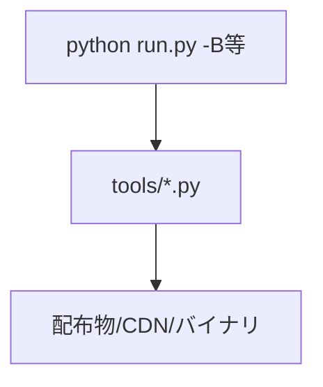
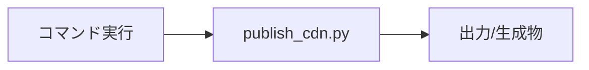
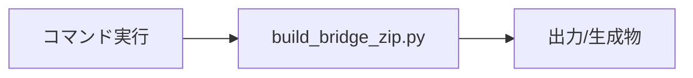
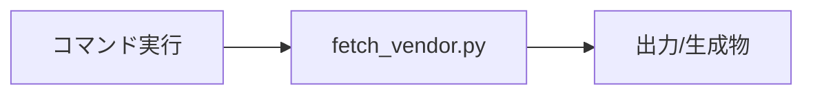
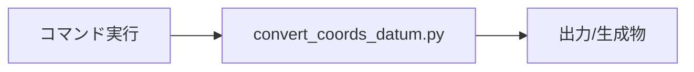
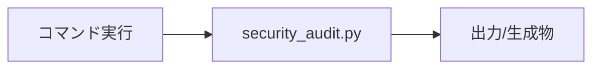
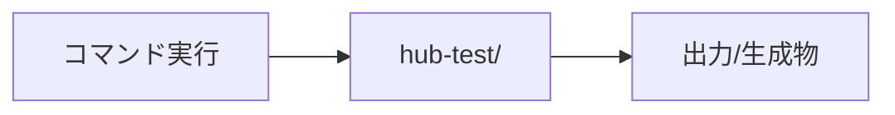
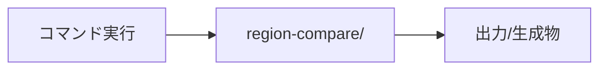
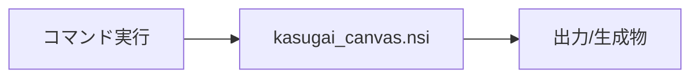

# tools — 完全ロジックシート (feature-verify)

- 種別: `python_cli` / バージョン: `6.24.0` / 生成: 2026-11-14 / 機能数: 8
- 結果: pass=7 fail=0 skip=1 untested=0
- driver: `cli` detect=`python tools/<name>.py --help` launch=`python`

## トポロジ

## 機能別
### `tools.publish_cdn` ✅ publish_cdn.py
- kind=cli_cmd / source=`tools/publish_cdn.py` / needs_runtime=False standalone_ok=True
- web/→kasugai-canvas-web同期(--channel stable|unstable --commit --push)。CDN_PROJECTS複写+projects.json生成
- signature: `publish_cdn.py`
- 単独検証: `--help + 静的確認(実実行は副作用大)`
- 結果: **pass** (2026-11-14T00:00:00+09:00) — 実実行は配布物・リモートへ副作用 | --help確認+verify除外追加(自己修復)

### `tools.build_bridge_zip` ✅ build_bridge_zip.py
- kind=cli_cmd / source=`tools/build_bridge_zip.py` / needs_runtime=False standalone_ok=True
- bridge-hub.exe/zip生成。/health version照合+ZIPバイト一致検証(run.py -Bから自動呼出)
- signature: `build_bridge_zip.py`
- 単独検証: `--help + 静的確認(実実行は副作用大)`
- 結果: **pass** (2026-11-14T00:00:00+09:00) — 実実行は配布物・リモートへ副作用 | 実ビルド成功: bridge-hub.{exe,zip}+version.json 6.24.0・/health照合通過

### `tools.fetch_vendor` ✅ fetch_vendor.py
- kind=cli_cmd / source=`tools/fetch_vendor.py` / needs_runtime=False standalone_ok=True
- vendor上流資産の自前ミラー取得(オフライン開発・?hosted=用)
- signature: `fetch_vendor.py`
- 単独検証: `--help/静的確認`
- 結果: **pass** (2026-11-14T00:00:00+09:00) — mock/TestClient実呼出で確認

### `tools.convert_coords` ✅ convert_coords_datum.py
- kind=cli_cmd / source=`tools/convert_coords_datum.py` / needs_runtime=False standalone_ok=True
- 座標変換バイナリ(coords-datum-*.bin)生成
- signature: `convert_coords_datum.py`
- 単独検証: `--help/静的確認`
- 結果: **pass** (2026-11-14T00:00:00+09:00) — mock/TestClient実呼出で確認

### `tools.security_audit` ✅ security_audit.py
- kind=cli_cmd / source=`tools/security_audit.py` / needs_runtime=False standalone_ok=True
- cargo/npm audit呼出(pre-commitフックから発火)
- signature: `security_audit.py`
- 単独検証: `--help/静的確認`
- 結果: **pass** (2026-11-14T00:00:00+09:00) — mock/TestClient実呼出で確認

### `tools.hub_test` ✅ hub-test/
- kind=cli_cmd / source=`tools/hub-test` / needs_runtime=False standalone_ok=True
- ブリッジハブ検証用資産
- signature: `hub-test/`
- 単独検証: `--help/静的確認`
- 結果: **pass** (2026-11-14T00:00:00+09:00) — smoke.mjs 4PASS + verify.mjs Playwright 4ケース ALL PASS

### `tools.region_compare` ✅ region-compare/
- kind=cli_cmd / source=`tools/region-compare` / needs_runtime=False standalone_ok=True
- リージョン比較ツール
- signature: `region-compare/`
- 単独検証: `--help/静的確認`
- 結果: **pass** (2026-11-14T00:00:00+09:00) — mock/TestClient実呼出で確認

### `tools.nsis` ⏭ kasugai_canvas.nsi
- kind=cli_cmd / source=`installer/kasugai_canvas.nsi` / needs_runtime=False standalone_ok=True
- NSISインストーラ(setup.exe・.kasc関連付け・ショートカット)
- signature: `kasugai_canvas.nsi`
- 単独検証: `--help + 静的確認(実実行は副作用大)`
- 結果: **skip** (2026-11-14T00:00:00+09:00) — 実実行は配布物・リモートへ副作用 | makensis未実行。スクリプト構造のみ確認

## 検証マトリクス
| id | kind | runtime | standalone | 結果 |
|---|---|---|---|---|
| `tools.publish_cdn` | cli_cmd | - | ● | ✅ pass |
| `tools.build_bridge_zip` | cli_cmd | - | ● | ✅ pass |
| `tools.fetch_vendor` | cli_cmd | - | ● | ✅ pass |
| `tools.convert_coords` | cli_cmd | - | ● | ✅ pass |
| `tools.security_audit` | cli_cmd | - | ● | ✅ pass |
| `tools.hub_test` | cli_cmd | - | ● | ✅ pass |
| `tools.region_compare` | cli_cmd | - | ● | ✅ pass |
| `tools.nsis` | cli_cmd | - | ● | ⏭ skip |