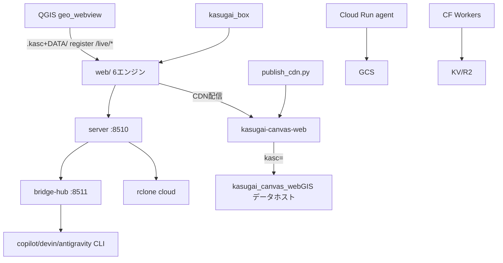

# kasugai_canvas — コンポーネント間連携 ロジックシート

生成: 2026-11-14

## トポロジ（全体）

## コンポーネント

- **server** — Rust Axum サーバ(kasugai_canvas.exe :8510 + bridge-hub :8511): pass=42 fail=0 skip=20 (62機能)
- **web** — 静的Webフロント(6エンジン + shared + AI制御面): pass=220 fail=0 skip=12 (232機能)
- **workers** — Cloudflare Workers(認証ゲート+API): pass=10 fail=0 skip=0 (10機能)
- **functions** — Cloudflare Pages Functions(APIハンドラ群): pass=9 fail=0 skip=0 (9機能)
- **agent** — Cloud Run 用 FastAPI エージェント: pass=15 fail=0 skip=0 (15機能)
- **tools** — Python CLI ツール群: pass=7 fail=0 skip=1 (8機能)