# web — 完全ロジックシート (feature-verify)

- 種別: `static_web` / バージョン: `6.24.0` / 生成: 2026-11-14 / 機能数: 247
- 結果: pass=235 fail=0 skip=12 untested=0
- driver: `dev_server` detect=`GET http://127.0.0.1:8510/health` launch=`kasugai_canvas.exe(8510でweb/を静的配信)。静的のみなら python -m http.server でも可`

## トポロジ
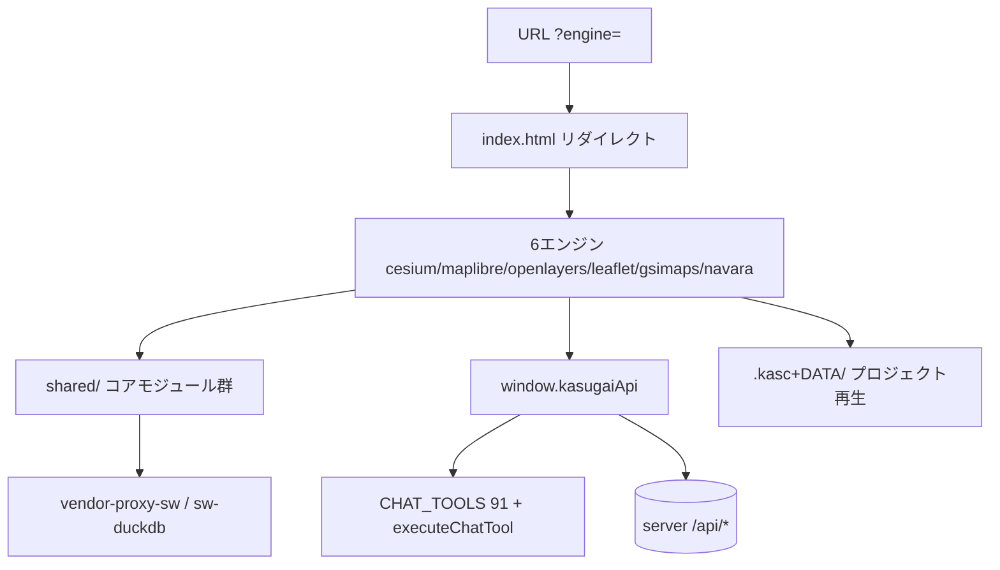

## 機能別
### `web.index.engine_redirect` ✅ engine選択リダイレクト
- kind=entry_point / source=`web/index.html` / needs_runtime=True standalone_ok=False
- ?engine=cesium|maplibre|openlayers|leaflet|gsimaps|navara へ転送(既定cesium)。engine以外のクエリ/ハッシュ引継ぎ
- signature: `engine選択リダイレクト`
- 連携検証: `GET /?engine=maplibre → maplibre/index.html へ遷移`
- 結果: **pass** (2026-11-14T00:00:00+09:00) — ?engine=leaflet→/leaflet/へクエリ引継ぎ

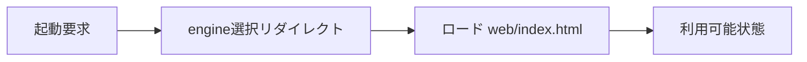

### `web.cesium.app` ✅ cesiumエンジン boot/.kasc再生
- kind=entry_point / source=`web/cesium/app.js` / needs_runtime=True standalone_ok=False
- メインエンジン(CesiumJS)。全機能・AI制御・プラグイン・フライ・3D。createPlayerApi+session-state+engine-switcherを組込み
- signature: `cesiumエンジン boot/.kasc再生`
- 依存: HTTPサーバ(8510または静的配信), SW(vendor依存時)
- 連携検証: `ブラウザで /cesium/ を開き kasugaiApi.listLayers() 実行`
- 結果: **pass** (2026-11-14T00:00:00+09:00) — default project・10レイヤー・カメラ正常

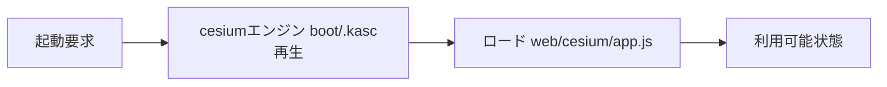

### `web.maplibre.app` ✅ maplibreエンジン boot/.kasc再生
- kind=entry_point / source=`web/maplibre/app.js` / needs_runtime=True standalone_ok=False
- MapLibre .kascプレイヤー(全ベクター行・QML・duckdb/sql・属性UI・6タブ)。createPlayerApi+session-state+engine-switcherを組込み
- signature: `maplibreエンジン boot/.kasc再生`
- 依存: HTTPサーバ(8510または静的配信), SW(vendor依存時)
- 連携検証: `ブラウザで /maplibre/ を開き kasugaiApi.listLayers() 実行`
- 結果: **pass** (2026-11-14T00:00:00+09:00)

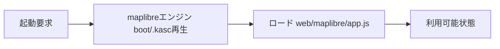

### `web.openlayers.app` ✅ openlayersエンジン boot/.kasc再生
- kind=entry_point / source=`web/openlayers/app.js` / needs_runtime=True standalone_ok=False
- OpenLayers .kascプレイヤー(同上互換実装)。createPlayerApi+session-state+engine-switcherを組込み
- signature: `openlayersエンジン boot/.kasc再生`
- 依存: HTTPサーバ(8510または静的配信), SW(vendor依存時)
- 連携検証: `ブラウザで /openlayers/ を開き kasugaiApi.listLayers() 実行`
- 結果: **pass** (2026-11-14T00:00:00+09:00)

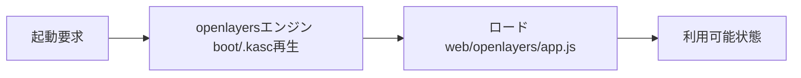

### `web.leaflet.app` ✅ leafletエンジン boot/.kasc再生
- kind=entry_point / source=`web/leaflet/app.js` / needs_runtime=True standalone_ok=False
- Leaflet .kascプレイヤー(専用paneで.kasc積み順再現)。createPlayerApi+session-state+engine-switcherを組込み
- signature: `leafletエンジン boot/.kasc再生`
- 依存: HTTPサーバ(8510または静的配信), SW(vendor依存時)
- 連携検証: `ブラウザで /leaflet/ を開き kasugaiApi.listLayers() 実行`
- 結果: **pass** (2026-11-14T00:00:00+09:00)

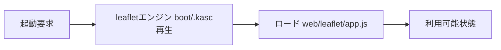

### `web.gsimaps.app` ✅ gsimapsエンジン boot/.kasc再生
- kind=entry_point / source=`web/gsimaps/app.js` / needs_runtime=True standalone_ok=False
- GSI Maps中間エンジン(vendored地理院地図をiframe組込・GSI.GLOBALS内部API)。createPlayerApi+session-state+engine-switcherを組込み
- signature: `gsimapsエンジン boot/.kasc再生`
- 依存: HTTPサーバ(8510または静的配信), SW(vendor依存時)
- 連携検証: `ブラウザで /gsimaps/ を開き kasugaiApi.listLayers() 実行`
- 結果: **pass** (2026-11-14T00:00:00+09:00) — vendor SW経由で起動・10レイヤー/basemaps正常(要~15s)

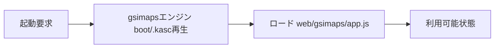

### `web.navara.app` ✅ navaraエンジン boot/.kasc再生
- kind=entry_point / source=`web/navara/app.js` / needs_runtime=True standalone_ok=False
- Navara写実3Dプレゼンエンジン(@navaramap/three WASM+Three.js)。createPlayerApi+session-state+engine-switcherを組込み
- signature: `navaraエンジン boot/.kasc再生`
- 依存: HTTPサーバ(8510または静的配信), SW(vendor依存時)
- 連携検証: `ブラウザで /navara/ を開き kasugaiApi.listLayers() 実行`
- 結果: **pass** (2026-11-14T00:00:00+09:00)

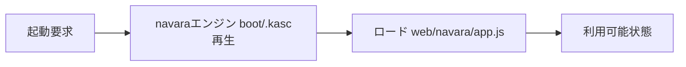

### `web.cesium.mod.app` ✅ app
- kind=logic_fn / source=`web/cesium/app.js` / needs_runtime=True standalone_ok=False
- Cesiumアプリ本体(初期化・レイヤ管理・パネル・kasugaiApi・全機能配線)
- signature: `app`
- 連携検証: `ブラウザで機能実行`
- 結果: **pass** (2026-11-14T00:00:00+09:00) — node --check OK

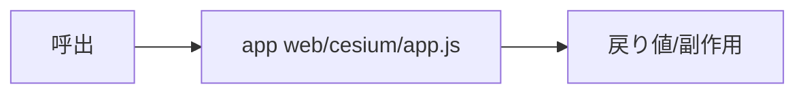

### `web.cesium.mod.geotiff-layer` ✅ geotiff-layer
- kind=logic_fn / source=`web/cesium/geotiff-layer.js` / needs_runtime=False standalone_ok=True
- GeoTIFFレイヤ(COG/terrain)
- signature: `geotiff-layer`
- 単独検証: `node --check / 静的import検証`
- 連携検証: `ページ経由で機能確認`
- 結果: **pass** (2026-11-14T00:00:00+09:00) — node --check OK


### `web.cesium.mod.geo-tools` ✅ geo-tools
- kind=logic_fn / source=`web/cesium/geo-tools.js` / needs_runtime=False standalone_ok=True
- 3D/2D計測・空間演算ツール群
- signature: `geo-tools`
- 単独検証: `node --check / 静的import検証`
- 連携検証: `ページ経由で機能確認`
- 結果: **pass** (2026-11-14T00:00:00+09:00) — node --check OK

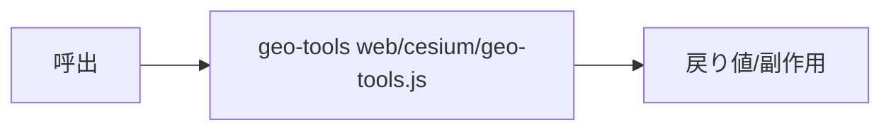

### `web.cesium.mod.plugin-loader` ✅ plugin-loader
- kind=logic_fn / source=`web/cesium/plugin-loader.js` / needs_runtime=False standalone_ok=True
- プラグイン動的ロード(plugins.json+PLUGIN/*/plugin.js)
- signature: `plugin-loader`
- 単独検証: `node --check / 静的import検証`
- 連携検証: `ページ経由で機能確認`
- 結果: **pass** (2026-11-14T00:00:00+09:00) — node --check OK

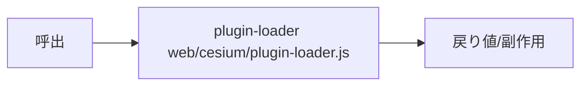

### `web.cesium.mod.qml-render` ✅ qml-render
- kind=logic_fn / source=`web/cesium/qml-render.js` / needs_runtime=False standalone_ok=True
- QMLスタイル→Cesiumエンティティレンダラ変換
- signature: `qml-render`
- 単独検証: `node --check / 静的import検証`
- 連携検証: `ページ経由で機能確認`
- 結果: **pass** (2026-11-14T00:00:00+09:00) — node --check OK

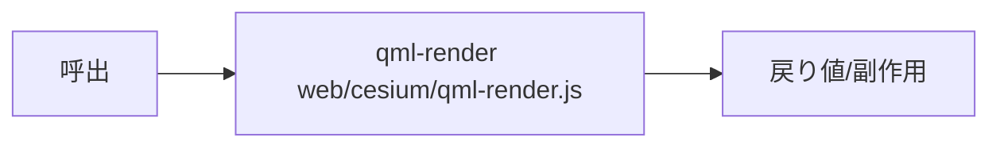

### `web.cesium.mod.auth-login-form` ✅ auth-login-form
- kind=logic_fn / source=`web/cesium/auth-login-form.js` / needs_runtime=False standalone_ok=True
- 認証ログインフォームUI
- signature: `auth-login-form`
- 単独検証: `node --check / 静的import検証`
- 連携検証: `ページ経由で機能確認`
- 結果: **pass** (2026-11-14T00:00:00+09:00) — node --check OK

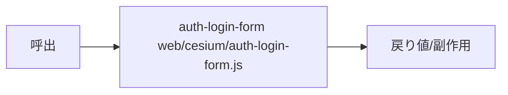

### `web.cesium.mod.auth-selector` ✅ auth-selector
- kind=logic_fn / source=`web/cesium/auth-selector.js` / needs_runtime=False standalone_ok=True
- 認証方式選択(auth-methods.json)
- signature: `auth-selector`
- 単独検証: `node --check / 静的import検証`
- 連携検証: `ページ経由で機能確認`
- 結果: **pass** (2026-11-14T00:00:00+09:00) — node --check OK


### `web.shared.ai-chat` ✅ ai-chat
- kind=logic_fn / source=`web/shared/ai-chat.js` / needs_runtime=False standalone_ok=True
- AIチャット(Gemini function calling・CHAT_TOOLS宣言・executeChatTool・リモートコマンドループ)
- signature: `ai-chat`
- 単独検証: `node --check + export存在確認`
- 連携検証: `エンジン経由で機能実行`
- 結果: **pass** (2026-11-14T00:00:00+09:00) — node --check OK + エンジン経由で利用

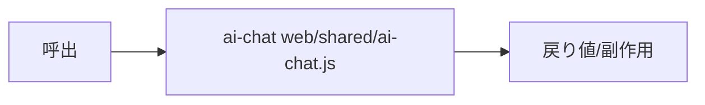

### `web.shared.attr-stats` ✅ attr-stats
- kind=logic_fn / source=`web/shared/attr-stats.js` / needs_runtime=False standalone_ok=True
- 属性統計・集計
- signature: `attr-stats`
- 単独検証: `node --check + export存在確認`
- 連携検証: `エンジン経由で機能実行`
- 結果: **pass** (2026-11-14T00:00:00+09:00) — node --check OK + エンジン経由で利用

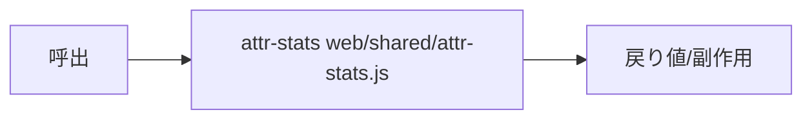

### `web.shared.attr-widget` ✅ attr-widget
- kind=logic_fn / source=`web/shared/attr-widget.js` / needs_runtime=False standalone_ok=True
- 属性テーブル/フィルタウィジェット
- signature: `attr-widget`
- 単独検証: `node --check + export存在確認`
- 連携検証: `エンジン経由で機能実行`
- 結果: **pass** (2026-11-14T00:00:00+09:00) — node --check OK + エンジン経由で利用

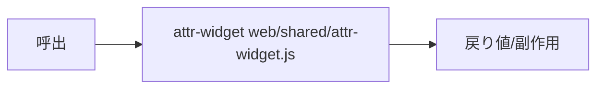

### `web.shared.backend` ✅ backend
- kind=logic_fn / source=`web/shared/backend.js` / needs_runtime=False standalone_ok=True
- バックエンド検出(detectBackend)・tier判定・APIラッパ
- signature: `backend`
- 単独検証: `node --check + export存在確認`
- 連携検証: `エンジン経由で機能実行`
- 結果: **pass** (2026-11-14T00:00:00+09:00) — node --check OK + エンジン経由で利用

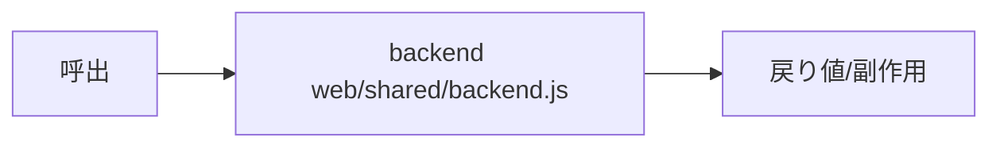

### `web.shared.box` ✅ box
- kind=logic_fn / source=`web/shared/box.js` / needs_runtime=False standalone_ok=True
- Box連携(kasugai_boxサイドカー)
- signature: `box`
- 単独検証: `node --check + export存在確認`
- 連携検証: `エンジン経由で機能実行`
- 結果: **pass** (2026-11-14T00:00:00+09:00) — node --check OK + エンジン経由で利用

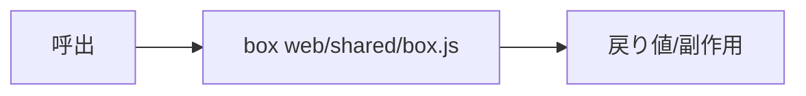

### `web.shared.coord-pins` ✅ coord-pins
- kind=logic_fn / source=`web/shared/coord-pins.js` / needs_runtime=False standalone_ok=True
- 座標ピン管理
- signature: `coord-pins`
- 単独検証: `node --check + export存在確認`
- 連携検証: `エンジン経由で機能実行`
- 結果: **pass** (2026-11-14T00:00:00+09:00) — node --check OK + エンジン経由で利用

```mermaid
flowchart LR
  call[呼出] --> fn[coord-pins web/shared/coord-pins.js]
  fn --> ret[戻り値/副作用]
```

### `web.shared.coords-format` ✅ coords-format
- kind=logic_fn / source=`web/shared/coords-format.js` / needs_runtime=False standalone_ok=True
- 座標フォーマット変換
- signature: `coords-format`
- 単独検証: `node --check + export存在確認`
- 連携検証: `エンジン経由で機能実行`
- 結果: **pass** (2026-11-14T00:00:00+09:00) — node --check OK + エンジン経由で利用

```mermaid
flowchart LR
  call[呼出] --> fn[coords-format web/shared/coords-format.js]
  fn --> ret[戻り値/副作用]
```

### `web.shared.coords-local` ✅ coords-local
- kind=logic_fn / source=`web/shared/coords-local.js` / needs_runtime=False standalone_ok=True
- ローカル平面直角座標系変換(JGD2000/TKYバイナリ)
- signature: `coords-local`
- 単独検証: `node --check + export存在確認`
- 連携検証: `エンジン経由で機能実行`
- 結果: **pass** (2026-11-14T00:00:00+09:00) — node --check OK + エンジン経由で利用

```mermaid
flowchart LR
  call[呼出] --> fn[coords-local web/shared/coords-local.js]
  fn --> ret[戻り値/副作用]
```

### `web.shared.deck-drape` ✅ deck-drape
- kind=logic_fn / source=`web/shared/deck-drape.js` / needs_runtime=False standalone_ok=True
- deck.glドレープ描画
- signature: `deck-drape`
- 単独検証: `node --check + export存在確認`
- 連携検証: `エンジン経由で機能実行`
- 結果: **pass** (2026-11-14T00:00:00+09:00) — node --check OK + エンジン経由で利用

```mermaid
flowchart LR
  call[呼出] --> fn[deck-drape web/shared/deck-drape.js]
  fn --> ret[戻り値/副作用]
```

### `web.shared.deck-ground` ✅ deck-ground
- kind=logic_fn / source=`web/shared/deck-ground.js` / needs_runtime=False standalone_ok=True
- deck.gl地面描画
- signature: `deck-ground`
- 単独検証: `node --check + export存在確認`
- 連携検証: `エンジン経由で機能実行`
- 結果: **pass** (2026-11-14T00:00:00+09:00) — node --check OK + エンジン経由で利用

```mermaid
flowchart LR
  call[呼出] --> fn[deck-ground web/shared/deck-ground.js]
  fn --> ret[戻り値/副作用]
```

### `web.shared.engine-switch` ✅ engine-switch
- kind=logic_fn / source=`web/shared/engine-switch.js` / needs_runtime=False standalone_ok=True
- エンジン切替UI+session-state引継ぎ
- signature: `engine-switch`
- 単独検証: `node --check + export存在確認`
- 連携検証: `エンジン経由で機能実行`
- 結果: **pass** (2026-11-14T00:00:00+09:00) — node --check OK + エンジン経由で利用

```mermaid
flowchart LR
  call[呼出] --> fn[engine-switch web/shared/engine-switch.js]
  fn --> ret[戻り値/副作用]
```

### `web.shared.export-formats` ✅ export-formats
- kind=logic_fn / source=`web/shared/export-formats.js` / needs_runtime=False standalone_ok=True
- エクスポート形式変換(GeoJSON等)
- signature: `export-formats`
- 単独検証: `node --check + export存在確認`
- 連携検証: `エンジン経由で機能実行`
- 結果: **pass** (2026-11-14T00:00:00+09:00) — node --check OK + エンジン経由で利用

```mermaid
flowchart LR
  call[呼出] --> fn[export-formats web/shared/export-formats.js]
  fn --> ret[戻り値/副作用]
```

### `web.shared.fly-kasc` ✅ fly-kasc
- kind=logic_fn / source=`web/shared/fly-kasc.js` / needs_runtime=False standalone_ok=True
- fly_geojson行のフライパス解釈・再生
- signature: `fly-kasc`
- 単独検証: `node --check + export存在確認`
- 連携検証: `エンジン経由で機能実行`
- 結果: **pass** (2026-11-14T00:00:00+09:00) — node --check OK + エンジン経由で利用

```mermaid
flowchart LR
  call[呼出] --> fn[fly-kasc web/shared/fly-kasc.js]
  fn --> ret[戻り値/副作用]
```

### `web.shared.geo-tools-2d` ✅ geo-tools-2d
- kind=logic_fn / source=`web/shared/geo-tools-2d.js` / needs_runtime=False standalone_ok=True
- 2D計測ツール
- signature: `geo-tools-2d`
- 単独検証: `node --check + export存在確認`
- 連携検証: `エンジン経由で機能実行`
- 結果: **pass** (2026-11-14T00:00:00+09:00) — node --check OK + エンジン経由で利用

```mermaid
flowchart LR
  call[呼出] --> fn[geo-tools-2d web/shared/geo-tools-2d.js]
  fn --> ret[戻り値/副作用]
```

### `web.shared.gpkg-worker` ✅ gpkg-worker
- kind=logic_fn / source=`web/shared/gpkg-worker.js` / needs_runtime=False standalone_ok=True
- GeoPackage読み込みWorker
- signature: `gpkg-worker`
- 単独検証: `node --check + export存在確認`
- 連携検証: `エンジン経由で機能実行`
- 結果: **pass** (2026-11-14T00:00:00+09:00) — node --check OK + エンジン経由で利用

```mermaid
flowchart LR
  call[呼出] --> fn[gpkg-worker web/shared/gpkg-worker.js]
  fn --> ret[戻り値/副作用]
```

### `web.shared.hub-diag` ✅ hub-diag
- kind=logic_fn / source=`web/shared/hub-diag.js` / needs_runtime=False standalone_ok=True
- ブリッジハブ診断UI
- signature: `hub-diag`
- 単独検証: `node --check + export存在確認`
- 連携検証: `エンジン経由で機能実行`
- 結果: **pass** (2026-11-14T00:00:00+09:00) — node --check OK + エンジン経由で利用

```mermaid
flowchart LR
  call[呼出] --> fn[hub-diag web/shared/hub-diag.js]
  fn --> ret[戻り値/副作用]
```

### `web.shared.i18n` ✅ i18n
- kind=logic_fn / source=`web/shared/i18n.js` / needs_runtime=False standalone_ok=True
- 多言語辞書(SUPPORTED_LANGUAGES=en,ja,zh,ko,es,fr,de,pt)
- signature: `i18n`
- 単独検証: `node --check + export存在確認`
- 連携検証: `エンジン経由で機能実行`
- 結果: **pass** (2026-11-14T00:00:00+09:00) — node --check OK + エンジン経由で利用

```mermaid
flowchart LR
  call[呼出] --> fn[i18n web/shared/i18n.js]
  fn --> ret[戻り値/副作用]
```

### `web.shared.kasc` ✅ kasc
- kind=logic_fn / source=`web/shared/kasc.js` / needs_runtime=False standalone_ok=True
- .kascパーサ(NON_LAYER_TYPES正典・行型解析)
- signature: `kasc`
- 単独検証: `node --check + export存在確認`
- 連携検証: `エンジン経由で機能実行`
- 結果: **pass** (2026-11-14T00:00:00+09:00) — node --check OK + エンジン経由で利用

```mermaid
flowchart LR
  call[呼出] --> fn[kasc web/shared/kasc.js]
  fn --> ret[戻り値/副作用]
```

### `web.shared.kasc_loader` ✅ kasc_loader
- kind=logic_fn / source=`web/shared/kasc_loader.js` / needs_runtime=False standalone_ok=True
- .kasc+DATA/ローダ(プロジェクト展開)
- signature: `kasc_loader`
- 単独検証: `node --check + export存在確認`
- 連携検証: `エンジン経由で機能実行`
- 結果: **pass** (2026-11-14T00:00:00+09:00) — node --check OK + エンジン経由で利用

```mermaid
flowchart LR
  call[呼出] --> fn[kasc_loader web/shared/kasc_loader.js]
  fn --> ret[戻り値/副作用]
```

### `web.shared.kasc-time` ✅ kasc-time
- kind=logic_fn / source=`web/shared/kasc-time.js` / needs_runtime=False standalone_ok=True
- .kasc時系列再生
- signature: `kasc-time`
- 単独検証: `node --check + export存在確認`
- 連携検証: `エンジン経由で機能実行`
- 結果: **pass** (2026-11-14T00:00:00+09:00) — node --check OK + エンジン経由で利用

```mermaid
flowchart LR
  call[呼出] --> fn[kasc-time web/shared/kasc-time.js]
  fn --> ret[戻り値/副作用]
```

### `web.shared.lazy-lib` ✅ lazy-lib
- kind=logic_fn / source=`web/shared/lazy-lib.js` / needs_runtime=False standalone_ok=True
- 遅延ライブラリロード
- signature: `lazy-lib`
- 単独検証: `node --check + export存在確認`
- 連携検証: `エンジン経由で機能実行`
- 結果: **pass** (2026-11-14T00:00:00+09:00) — node --check OK + エンジン経由で利用

```mermaid
flowchart LR
  call[呼出] --> fn[lazy-lib web/shared/lazy-lib.js]
  fn --> ret[戻り値/副作用]
```

### `web.shared.live` ✅ live
- kind=logic_fn / source=`web/shared/live.js` / needs_runtime=False standalone_ok=True
- QGIS Live連携(編集差分同期・camera/selection通知)
- signature: `live`
- 単独検証: `node --check + export存在確認`
- 連携検証: `エンジン経由で機能実行`
- 結果: **pass** (2026-11-14T00:00:00+09:00) — node --check OK + エンジン経由で利用

```mermaid
flowchart LR
  call[呼出] --> fn[live web/shared/live.js]
  fn --> ret[戻り値/副作用]
```

### `web.shared.live-panel` ✅ live-panel
- kind=logic_fn / source=`web/shared/live-panel.js` / needs_runtime=False standalone_ok=True
- Live連携パネルUI
- signature: `live-panel`
- 単独検証: `node --check + export存在確認`
- 連携検証: `エンジン経由で機能実行`
- 結果: **pass** (2026-11-14T00:00:00+09:00) — node --check OK + エンジン経由で利用

```mermaid
flowchart LR
  call[呼出] --> fn[live-panel web/shared/live-panel.js]
  fn --> ret[戻り値/副作用]
```

### `web.shared.localfs` ✅ localfs
- kind=logic_fn / source=`web/shared/localfs.js` / needs_runtime=False standalone_ok=True
- ローカルFS保存(File System Access API)
- signature: `localfs`
- 単独検証: `node --check + export存在確認`
- 連携検証: `エンジン経由で機能実行`
- 結果: **pass** (2026-11-14T00:00:00+09:00) — node --check OK + エンジン経由で利用

```mermaid
flowchart LR
  call[呼出] --> fn[localfs web/shared/localfs.js]
  fn --> ret[戻り値/副作用]
```

### `web.shared.mcp` ✅ mcp
- kind=logic_fn / source=`web/shared/mcp.js` / needs_runtime=False standalone_ok=True
- MCPクライアント(外部MCPサーバ接続・ツール呼出)
- signature: `mcp`
- 単独検証: `node --check + export存在確認`
- 連携検証: `エンジン経由で機能実行`
- 結果: **pass** (2026-11-14T00:00:00+09:00) — node --check OK + エンジン経由で利用

```mermaid
flowchart LR
  call[呼出] --> fn[mcp web/shared/mcp.js]
  fn --> ret[戻り値/副作用]
```

### `web.shared.minimap` ✅ minimap
- kind=logic_fn / source=`web/shared/minimap.js` / needs_runtime=False standalone_ok=True
- ミニマップ表示
- signature: `minimap`
- 単独検証: `node --check + export存在確認`
- 連携検証: `エンジン経由で機能実行`
- 結果: **pass** (2026-11-14T00:00:00+09:00) — node --check OK + エンジン経由で利用

```mermaid
flowchart LR
  call[呼出] --> fn[minimap web/shared/minimap.js]
  fn --> ret[戻り値/副作用]
```

### `web.shared.mvt` ✅ mvt
- kind=logic_fn / source=`web/shared/mvt.js` / needs_runtime=False standalone_ok=True
- MVTベクタタイルデコード
- signature: `mvt`
- 単独検証: `node --check + export存在確認`
- 連携検証: `エンジン経由で機能実行`
- 結果: **pass** (2026-11-14T00:00:00+09:00) — node --check OK + エンジン経由で利用

```mermaid
flowchart LR
  call[呼出] --> fn[mvt web/shared/mvt.js]
  fn --> ret[戻り値/副作用]
```

### `web.shared.nav-tools` ✅ nav-tools
- kind=logic_fn / source=`web/shared/nav-tools.js` / needs_runtime=False standalone_ok=True
- ナビゲーションツール
- signature: `nav-tools`
- 単独検証: `node --check + export存在確認`
- 連携検証: `エンジン経由で機能実行`
- 結果: **pass** (2026-11-14T00:00:00+09:00) — node --check OK + エンジン経由で利用

```mermaid
flowchart LR
  call[呼出] --> fn[nav-tools web/shared/nav-tools.js]
  fn --> ret[戻り値/副作用]
```

### `web.shared.player-api` ✅ player-api
- kind=logic_fn / source=`web/shared/player-api.js` / needs_runtime=False standalone_ok=True
- 2Dプレイヤー用kasugaiApiアダプタ生成(createPlayerApi)
- signature: `player-api`
- 単独検証: `node --check + export存在確認`
- 連携検証: `エンジン経由で機能実行`
- 結果: **pass** (2026-11-14T00:00:00+09:00) — node --check OK + エンジン経由で利用

```mermaid
flowchart LR
  call[呼出] --> fn[player-api web/shared/player-api.js]
  fn --> ret[戻り値/副作用]
```

### `web.shared.print` ✅ print
- kind=logic_fn / source=`web/shared/print.js` / needs_runtime=False standalone_ok=True
- 印刷出力
- signature: `print`
- 単独検証: `node --check + export存在確認`
- 連携検証: `エンジン経由で機能実行`
- 結果: **pass** (2026-11-14T00:00:00+09:00) — node --check OK + エンジン経由で利用

```mermaid
flowchart LR
  call[呼出] --> fn[print web/shared/print.js]
  fn --> ret[戻り値/副作用]
```

### `web.shared.qml-2d` ✅ qml-2d
- kind=logic_fn / source=`web/shared/qml-2d.js` / needs_runtime=False standalone_ok=True
- QMLスタイル→2Dエンジン変換
- signature: `qml-2d`
- 単独検証: `node --check + export存在確認`
- 連携検証: `エンジン経由で機能実行`
- 結果: **pass** (2026-11-14T00:00:00+09:00) — node --check OK + エンジン経由で利用

```mermaid
flowchart LR
  call[呼出] --> fn[qml-2d web/shared/qml-2d.js]
  fn --> ret[戻り値/副作用]
```

### `web.shared.qml-style` ✅ qml-style
- kind=logic_fn / source=`web/shared/qml-style.js` / needs_runtime=False standalone_ok=True
- QMLスタイルコンパイラ(エンジン非依存コア)
- signature: `qml-style`
- 単独検証: `node --check + export存在確認`
- 連携検証: `エンジン経由で機能実行`
- 結果: **pass** (2026-11-14T00:00:00+09:00) — node --check OK + エンジン経由で利用

```mermaid
flowchart LR
  call[呼出] --> fn[qml-style web/shared/qml-style.js]
  fn --> ret[戻り値/副作用]
```

### `web.shared.report` ✅ report
- kind=logic_fn / source=`web/shared/report.js` / needs_runtime=False standalone_ok=True
- 資料生成(showReport・帳票HTML/PDF)
- signature: `report`
- 単独検証: `node --check + export存在確認`
- 連携検証: `エンジン経由で機能実行`
- 結果: **pass** (2026-11-14T00:00:00+09:00) — node --check OK + エンジン経由で利用

```mermaid
flowchart LR
  call[呼出] --> fn[report web/shared/report.js]
  fn --> ret[戻り値/副作用]
```

### `web.shared.session-state` ✅ session-state
- kind=logic_fn / source=`web/shared/session-state.js` / needs_runtime=False standalone_ok=True
- カレント状態ファイル正典(bindSessionState/applySessionState/matchSessionState)
- signature: `session-state`
- 単独検証: `node --check + export存在確認`
- 連携検証: `エンジン経由で機能実行`
- 結果: **pass** (2026-11-14T00:00:00+09:00) — node --check OK + エンジン経由で利用

```mermaid
flowchart LR
  call[呼出] --> fn[session-state web/shared/session-state.js]
  fn --> ret[戻り値/副作用]
```

### `web.shared.spatial-ops` ✅ spatial-ops
- kind=logic_fn / source=`web/shared/spatial-ops.js` / needs_runtime=False standalone_ok=True
- ブラウザ内空間演算(spatialSelect/aggregateWithin/createBuffer/DuckDB-WASM)
- signature: `spatial-ops`
- 単独検証: `node --check + export存在確認`
- 連携検証: `エンジン経由で機能実行`
- 結果: **pass** (2026-11-14T00:00:00+09:00) — node --check OK + エンジン経由で利用

```mermaid
flowchart LR
  call[呼出] --> fn[spatial-ops web/shared/spatial-ops.js]
  fn --> ret[戻り値/副作用]
```

### `web.shared.sun-time` ✅ sun-time
- kind=logic_fn / source=`web/shared/sun-time.js` / needs_runtime=False standalone_ok=True
- 日照・時刻シミュレーション
- signature: `sun-time`
- 単独検証: `node --check + export存在確認`
- 連携検証: `エンジン経由で機能実行`
- 結果: **pass** (2026-11-14T00:00:00+09:00) — node --check OK + エンジン経由で利用

```mermaid
flowchart LR
  call[呼出] --> fn[sun-time web/shared/sun-time.js]
  fn --> ret[戻り値/副作用]
```

### `web.shared.tools-dock-ux` ✅ tools-dock-ux
- kind=logic_fn / source=`web/shared/tools-dock-ux.js` / needs_runtime=False standalone_ok=True
- ツールドックUX配置
- signature: `tools-dock-ux`
- 単独検証: `node --check + export存在確認`
- 連携検証: `エンジン経由で機能実行`
- 結果: **pass** (2026-11-14T00:00:00+09:00) — node --check OK + エンジン経由で利用

```mermaid
flowchart LR
  call[呼出] --> fn[tools-dock-ux web/shared/tools-dock-ux.js]
  fn --> ret[戻り値/副作用]
```

### `web.shared.vector-decode` ✅ vector-decode
- kind=logic_fn / source=`web/shared/vector-decode.js` / needs_runtime=False standalone_ok=True
- ベクタ形式デコード(GeoParquet/FlatGeobuf/WKB等)
- signature: `vector-decode`
- 単独検証: `node --check + export存在確認`
- 連携検証: `エンジン経由で機能実行`
- 結果: **pass** (2026-11-14T00:00:00+09:00) — node --check OK + エンジン経由で利用

```mermaid
flowchart LR
  call[呼出] --> fn[vector-decode web/shared/vector-decode.js]
  fn --> ret[戻り値/副作用]
```

### `web.shared.vector-load` ✅ vector-load
- kind=logic_fn / source=`web/shared/vector-load.js` / needs_runtime=False standalone_ok=True
- ベクタデータ読込統括
- signature: `vector-load`
- 単独検証: `node --check + export存在確認`
- 連携検証: `エンジン経由で機能実行`
- 結果: **pass** (2026-11-14T00:00:00+09:00) — node --check OK + エンジン経由で利用

```mermaid
flowchart LR
  call[呼出] --> fn[vector-load web/shared/vector-load.js]
  fn --> ret[戻り値/副作用]
```

### `web.shared.vendor-guard` ✅ vendor-guard
- kind=logic_fn / source=`web/shared/vendor-guard.js` / needs_runtime=False standalone_ok=True
- vendor SWプローブ・未制御時フォールバック
- signature: `vendor-guard`
- 単独検証: `node --check + export存在確認`
- 連携検証: `エンジン経由で機能実行`
- 結果: **pass** (2026-11-14T00:00:00+09:00) — node --check OK + エンジン経由で利用

```mermaid
flowchart LR
  call[呼出] --> fn[vendor-guard web/shared/vendor-guard.js]
  fn --> ret[戻り値/副作用]
```

### `web.sw.vendor_proxy` ✅ vendor-proxy-sw.js
- kind=entry_point / source=`web/vendor-proxy-sw.js` / needs_runtime=True standalone_ok=False
- vendor/*を上流(npm→jsdelivr, github→jsdelivr/gh→raw)へ同一オリジン中継するSW。vendor.jsonピン駆動・?hosted=で自前ミラー
- signature: `vendor-proxy-sw.js`
- 連携検証: `SW登録後 /cesium/vendor/... 要求が上流解決される`
- 結果: **pass** (2026-11-14T00:00:00+09:00)

```mermaid
flowchart LR
  boot[起動要求] --> e[vendor-proxy-sw.js]
  e --> load[ロード web/vendor-proxy-sw.js]
  load --> ready[利用可能状態]
```

### `web.sw.duckdb` ✅ sw-duckdb.js
- kind=entry_point / source=`web/sw-duckdb.js` / needs_runtime=True standalone_ok=False
- DuckDB-WASM用Service Worker(スコープ=登録元dir、エンジン毎に登録)
- signature: `sw-duckdb.js`
- 結果: **pass** (2026-11-14T00:00:00+09:00)

```mermaid
flowchart LR
  boot[起動要求] --> e[sw-duckdb.js]
  e --> load[ロード web/sw-duckdb.js]
  load --> ready[利用可能状態]
```

### `web.cesium.api.getProjectId` ✅ kasugaiApi.getProjectId
- kind=ai_integration / source=`web/cesium/app.js:11623` / needs_runtime=True standalone_ok=False
- AI/外部制御面メソッド getProjectId()
- signature: `kasugaiApi.getProjectId`
- 連携検証: `page.evaluate(kasugaiApi.getProjectId(...))`
- 結果: **pass** (2026-11-14T00:00:00+09:00)

```mermaid
flowchart LR
  ai[AI/外部エージェント] -->|kasugaiApi.getProjectId| d[executeChatTool/bridge]
  d --> api[kasugaiApi実装 web/cesium/app.js]
  api --> st[状態変化/応答]
```

### `web.cesium.api.getCamera` ✅ kasugaiApi.getCamera
- kind=ai_integration / source=`web/cesium/app.js:11623` / needs_runtime=True standalone_ok=False
- AI/外部制御面メソッド getCamera()
- signature: `kasugaiApi.getCamera`
- 連携検証: `page.evaluate(kasugaiApi.getCamera(...))`
- 結果: **pass** (2026-11-14T00:00:00+09:00)

```mermaid
flowchart LR
  ai[AI/外部エージェント] -->|kasugaiApi.getCamera| d[executeChatTool/bridge]
  d --> api[kasugaiApi実装 web/cesium/app.js]
  api --> st[状態変化/応答]
```

### `web.cesium.api.listLayers` ✅ kasugaiApi.listLayers
- kind=ai_integration / source=`web/cesium/app.js:11623` / needs_runtime=True standalone_ok=False
- AI/外部制御面メソッド listLayers()
- signature: `kasugaiApi.listLayers`
- 連携検証: `page.evaluate(kasugaiApi.listLayers(...))`
- 結果: **pass** (2026-11-14T00:00:00+09:00)

```mermaid
flowchart LR
  ai[AI/外部エージェント] -->|kasugaiApi.listLayers| d[executeChatTool/bridge]
  d --> api[kasugaiApi実装 web/cesium/app.js]
  api --> st[状態変化/応答]
```

### `web.cesium.api.setLayerVisible` ✅ kasugaiApi.setLayerVisible
- kind=ai_integration / source=`web/cesium/app.js:11623` / needs_runtime=True standalone_ok=False
- AI/外部制御面メソッド setLayerVisible()
- signature: `kasugaiApi.setLayerVisible`
- 連携検証: `page.evaluate(kasugaiApi.setLayerVisible(...))`
- 結果: **pass** (2026-11-14T00:00:00+09:00)

```mermaid
flowchart LR
  ai[AI/外部エージェント] -->|kasugaiApi.setLayerVisible| d[executeChatTool/bridge]
  d --> api[kasugaiApi実装 web/cesium/app.js]
  api --> st[状態変化/応答]
```

### `web.cesium.api.setLayerLegendVisible` ✅ kasugaiApi.setLayerLegendVisible
- kind=ai_integration / source=`web/cesium/app.js:11623` / needs_runtime=True standalone_ok=False
- AI/外部制御面メソッド setLayerLegendVisible()
- signature: `kasugaiApi.setLayerLegendVisible`
- 連携検証: `page.evaluate(kasugaiApi.setLayerLegendVisible(...))`
- 結果: **pass** (2026-11-14T00:00:00+09:00)

```mermaid
flowchart LR
  ai[AI/外部エージェント] -->|kasugaiApi.setLayerLegendVisible| d[executeChatTool/bridge]
  d --> api[kasugaiApi実装 web/cesium/app.js]
  api --> st[状態変化/応答]
```

### `web.cesium.api.listThemes` ✅ kasugaiApi.listThemes
- kind=ai_integration / source=`web/cesium/app.js:11623` / needs_runtime=True standalone_ok=False
- AI/外部制御面メソッド listThemes()
- signature: `kasugaiApi.listThemes`
- 連携検証: `page.evaluate(kasugaiApi.listThemes(...))`
- 結果: **pass** (2026-11-14T00:00:00+09:00)

```mermaid
flowchart LR
  ai[AI/外部エージェント] -->|kasugaiApi.listThemes| d[executeChatTool/bridge]
  d --> api[kasugaiApi実装 web/cesium/app.js]
  api --> st[状態変化/応答]
```

### `web.cesium.api.applyTheme` ✅ kasugaiApi.applyTheme
- kind=ai_integration / source=`web/cesium/app.js:11623` / needs_runtime=True standalone_ok=False
- AI/外部制御面メソッド applyTheme()
- signature: `kasugaiApi.applyTheme`
- 連携検証: `page.evaluate(kasugaiApi.applyTheme(...))`
- 結果: **pass** (2026-11-14T00:00:00+09:00) — テーマ無し環境で正常応答

```mermaid
flowchart LR
  ai[AI/外部エージェント] -->|kasugaiApi.applyTheme| d[executeChatTool/bridge]
  d --> api[kasugaiApi実装 web/cesium/app.js]
  api --> st[状態変化/応答]
```

### `web.cesium.api.listBasemaps` ✅ kasugaiApi.listBasemaps
- kind=ai_integration / source=`web/cesium/app.js:11623` / needs_runtime=True standalone_ok=False
- AI/外部制御面メソッド listBasemaps()
- signature: `kasugaiApi.listBasemaps`
- 連携検証: `page.evaluate(kasugaiApi.listBasemaps(...))`
- 結果: **pass** (2026-11-14T00:00:00+09:00)

```mermaid
flowchart LR
  ai[AI/外部エージェント] -->|kasugaiApi.listBasemaps| d[executeChatTool/bridge]
  d --> api[kasugaiApi実装 web/cesium/app.js]
  api --> st[状態変化/応答]
```

### `web.cesium.api.setBasemap` ✅ kasugaiApi.setBasemap
- kind=ai_integration / source=`web/cesium/app.js:11623` / needs_runtime=True standalone_ok=False
- AI/外部制御面メソッド setBasemap()
- signature: `kasugaiApi.setBasemap`
- 連携検証: `page.evaluate(kasugaiApi.setBasemap(...))`
- 結果: **pass** (2026-11-14T00:00:00+09:00)

```mermaid
flowchart LR
  ai[AI/外部エージェント] -->|kasugaiApi.setBasemap| d[executeChatTool/bridge]
  d --> api[kasugaiApi実装 web/cesium/app.js]
  api --> st[状態変化/応答]
```

### `web.cesium.api.zoomToExtent` ✅ kasugaiApi.zoomToExtent
- kind=ai_integration / source=`web/cesium/app.js:11623` / needs_runtime=True standalone_ok=False
- AI/外部制御面メソッド zoomToExtent()
- signature: `kasugaiApi.zoomToExtent`
- 連携検証: `page.evaluate(kasugaiApi.zoomToExtent(...))`
- 結果: **pass** (2026-11-14T00:00:00+09:00)

```mermaid
flowchart LR
  ai[AI/外部エージェント] -->|kasugaiApi.zoomToExtent| d[executeChatTool/bridge]
  d --> api[kasugaiApi実装 web/cesium/app.js]
  api --> st[状態変化/応答]
```

### `web.cesium.api.listCameraPresets` ✅ kasugaiApi.listCameraPresets
- kind=ai_integration / source=`web/cesium/app.js:11623` / needs_runtime=True standalone_ok=False
- AI/外部制御面メソッド listCameraPresets()
- signature: `kasugaiApi.listCameraPresets`
- 連携検証: `page.evaluate(kasugaiApi.listCameraPresets(...))`
- 結果: **pass** (2026-11-14T00:00:00+09:00)

```mermaid
flowchart LR
  ai[AI/外部エージェント] -->|kasugaiApi.listCameraPresets| d[executeChatTool/bridge]
  d --> api[kasugaiApi実装 web/cesium/app.js]
  api --> st[状態変化/応答]
```

### `web.cesium.api.flyToPreset` ✅ kasugaiApi.flyToPreset
- kind=ai_integration / source=`web/cesium/app.js:11623` / needs_runtime=True standalone_ok=False
- AI/外部制御面メソッド flyToPreset()
- signature: `kasugaiApi.flyToPreset`
- 連携検証: `page.evaluate(kasugaiApi.flyToPreset(...))`
- 結果: **pass** (2026-11-14T00:00:00+09:00)

```mermaid
flowchart LR
  ai[AI/外部エージェント] -->|kasugaiApi.flyToPreset| d[executeChatTool/bridge]
  d --> api[kasugaiApi実装 web/cesium/app.js]
  api --> st[状態変化/応答]
```

### `web.cesium.api.flyTo` ✅ kasugaiApi.flyTo
- kind=ai_integration / source=`web/cesium/app.js:11623` / needs_runtime=True standalone_ok=False
- AI/外部制御面メソッド flyTo()
- signature: `kasugaiApi.flyTo`
- 連携検証: `page.evaluate(kasugaiApi.flyTo(...))`
- 結果: **pass** (2026-11-14T00:00:00+09:00)

```mermaid
flowchart LR
  ai[AI/外部エージェント] -->|kasugaiApi.flyTo| d[executeChatTool/bridge]
  d --> api[kasugaiApi実装 web/cesium/app.js]
  api --> st[状態変化/応答]
```

### `web.cesium.api.setTerrain` ✅ kasugaiApi.setTerrain
- kind=ai_integration / source=`web/cesium/app.js:11623` / needs_runtime=True standalone_ok=False
- AI/外部制御面メソッド setTerrain()
- signature: `kasugaiApi.setTerrain`
- 連携検証: `page.evaluate(kasugaiApi.setTerrain(...))`
- 結果: **pass** (2026-11-14T00:00:00+09:00)

```mermaid
flowchart LR
  ai[AI/外部エージェント] -->|kasugaiApi.setTerrain| d[executeChatTool/bridge]
  d --> api[kasugaiApi実装 web/cesium/app.js]
  api --> st[状態変化/応答]
```

### `web.cesium.api.setEffect` ✅ kasugaiApi.setEffect
- kind=ai_integration / source=`web/cesium/app.js:11623` / needs_runtime=True standalone_ok=False
- AI/外部制御面メソッド setEffect()
- signature: `kasugaiApi.setEffect`
- 連携検証: `page.evaluate(kasugaiApi.setEffect(...))`
- 結果: **pass** (2026-11-14T00:00:00+09:00)

```mermaid
flowchart LR
  ai[AI/外部エージェント] -->|kasugaiApi.setEffect| d[executeChatTool/bridge]
  d --> api[kasugaiApi実装 web/cesium/app.js]
  api --> st[状態変化/応答]
```

### `web.cesium.api.setUnderground` ✅ kasugaiApi.setUnderground
- kind=ai_integration / source=`web/cesium/app.js:11623` / needs_runtime=True standalone_ok=False
- AI/外部制御面メソッド setUnderground()
- signature: `kasugaiApi.setUnderground`
- 連携検証: `page.evaluate(kasugaiApi.setUnderground(...))`
- 結果: **pass** (2026-11-14T00:00:00+09:00)

```mermaid
flowchart LR
  ai[AI/外部エージェント] -->|kasugaiApi.setUnderground| d[executeChatTool/bridge]
  d --> api[kasugaiApi実装 web/cesium/app.js]
  api --> st[状態変化/応答]
```

### `web.cesium.api.setClip` ✅ kasugaiApi.setClip
- kind=ai_integration / source=`web/cesium/app.js:11623` / needs_runtime=True standalone_ok=False
- AI/外部制御面メソッド setClip()
- signature: `kasugaiApi.setClip`
- 連携検証: `page.evaluate(kasugaiApi.setClip(...))`
- 結果: **pass** (2026-11-14T00:00:00+09:00)

```mermaid
flowchart LR
  ai[AI/外部エージェント] -->|kasugaiApi.setClip| d[executeChatTool/bridge]
  d --> api[kasugaiApi実装 web/cesium/app.js]
  api --> st[状態変化/応答]
```

### `web.cesium.api.listFlyPaths` ✅ kasugaiApi.listFlyPaths
- kind=ai_integration / source=`web/cesium/app.js:11623` / needs_runtime=True standalone_ok=False
- AI/外部制御面メソッド listFlyPaths()
- signature: `kasugaiApi.listFlyPaths`
- 連携検証: `page.evaluate(kasugaiApi.listFlyPaths(...))`
- 結果: **pass** (2026-11-14T00:00:00+09:00)

```mermaid
flowchart LR
  ai[AI/外部エージェント] -->|kasugaiApi.listFlyPaths| d[executeChatTool/bridge]
  d --> api[kasugaiApi実装 web/cesium/app.js]
  api --> st[状態変化/応答]
```

### `web.cesium.api.playFlyPath` ✅ kasugaiApi.playFlyPath
- kind=ai_integration / source=`web/cesium/app.js:11623` / needs_runtime=True standalone_ok=False
- AI/外部制御面メソッド playFlyPath()
- signature: `kasugaiApi.playFlyPath`
- 連携検証: `page.evaluate(kasugaiApi.playFlyPath(...))`
- 結果: **pass** (2026-11-14T00:00:00+09:00)

```mermaid
flowchart LR
  ai[AI/外部エージェント] -->|kasugaiApi.playFlyPath| d[executeChatTool/bridge]
  d --> api[kasugaiApi実装 web/cesium/app.js]
  api --> st[状態変化/応答]
```

### `web.cesium.api.stopFly` ✅ kasugaiApi.stopFly
- kind=ai_integration / source=`web/cesium/app.js:11623` / needs_runtime=True standalone_ok=False
- AI/外部制御面メソッド stopFly()
- signature: `kasugaiApi.stopFly`
- 連携検証: `page.evaluate(kasugaiApi.stopFly(...))`
- 結果: **pass** (2026-11-14T00:00:00+09:00)

```mermaid
flowchart LR
  ai[AI/外部エージェント] -->|kasugaiApi.stopFly| d[executeChatTool/bridge]
  d --> api[kasugaiApi実装 web/cesium/app.js]
  api --> st[状態変化/応答]
```

### `web.cesium.api.listProjects` ✅ kasugaiApi.listProjects
- kind=ai_integration / source=`web/cesium/app.js:11623` / needs_runtime=True standalone_ok=False
- AI/外部制御面メソッド listProjects()
- signature: `kasugaiApi.listProjects`
- 連携検証: `page.evaluate(kasugaiApi.listProjects(...))`
- 結果: **pass** (2026-11-14T00:00:00+09:00)

```mermaid
flowchart LR
  ai[AI/外部エージェント] -->|kasugaiApi.listProjects| d[executeChatTool/bridge]
  d --> api[kasugaiApi実装 web/cesium/app.js]
  api --> st[状態変化/応答]
```

### `web.cesium.api.switchProject` ✅ kasugaiApi.switchProject
- kind=ai_integration / source=`web/cesium/app.js:11623` / needs_runtime=True standalone_ok=False
- AI/外部制御面メソッド switchProject()
- signature: `kasugaiApi.switchProject`
- 連携検証: `page.evaluate(kasugaiApi.switchProject(...))`
- 結果: **pass** (2026-11-14T00:00:00+09:00) — 同上

```mermaid
flowchart LR
  ai[AI/外部エージェント] -->|kasugaiApi.switchProject| d[executeChatTool/bridge]
  d --> api[kasugaiApi実装 web/cesium/app.js]
  api --> st[状態変化/応答]
```

### `web.cesium.api.applyInspector` ✅ kasugaiApi.applyInspector
- kind=ai_integration / source=`web/cesium/app.js:11623` / needs_runtime=True standalone_ok=False
- AI/外部制御面メソッド applyInspector()
- signature: `kasugaiApi.applyInspector`
- 連携検証: `page.evaluate(kasugaiApi.applyInspector(...))`
- 結果: **pass** (2026-11-14T00:00:00+09:00)

```mermaid
flowchart LR
  ai[AI/外部エージェント] -->|kasugaiApi.applyInspector| d[executeChatTool/bridge]
  d --> api[kasugaiApi実装 web/cesium/app.js]
  api --> st[状態変化/応答]
```

### `web.cesium.api.liveSync` ✅ kasugaiApi.liveSync
- kind=ai_integration / source=`web/cesium/app.js:11623` / needs_runtime=True standalone_ok=False
- AI/外部制御面メソッド liveSync()
- signature: `kasugaiApi.liveSync`
- 連携検証: `page.evaluate(kasugaiApi.liveSync(...))`
- 結果: **pass** (2026-11-14T00:00:00+09:00)

```mermaid
flowchart LR
  ai[AI/外部エージェント] -->|kasugaiApi.liveSync| d[executeChatTool/bridge]
  d --> api[kasugaiApi実装 web/cesium/app.js]
  api --> st[状態変化/応答]
```

### `web.cesium.api.liveSyncStatus` ✅ kasugaiApi.liveSyncStatus
- kind=ai_integration / source=`web/cesium/app.js:11623` / needs_runtime=True standalone_ok=False
- AI/外部制御面メソッド liveSyncStatus()
- signature: `kasugaiApi.liveSyncStatus`
- 連携検証: `page.evaluate(kasugaiApi.liveSyncStatus(...))`
- 結果: **pass** (2026-11-14T00:00:00+09:00)

```mermaid
flowchart LR
  ai[AI/外部エージェント] -->|kasugaiApi.liveSyncStatus| d[executeChatTool/bridge]
  d --> api[kasugaiApi実装 web/cesium/app.js]
  api --> st[状態変化/応答]
```

### `web.cesium.api.liveSetFollow` ✅ kasugaiApi.liveSetFollow
- kind=ai_integration / source=`web/cesium/app.js:11623` / needs_runtime=True standalone_ok=False
- AI/外部制御面メソッド liveSetFollow()
- signature: `kasugaiApi.liveSetFollow`
- 連携検証: `page.evaluate(kasugaiApi.liveSetFollow(...))`
- 結果: **pass** (2026-11-14T00:00:00+09:00)

```mermaid
flowchart LR
  ai[AI/外部エージェント] -->|kasugaiApi.liveSetFollow| d[executeChatTool/bridge]
  d --> api[kasugaiApi実装 web/cesium/app.js]
  api --> st[状態変化/応答]
```

### `web.cesium.api.liveIsFollowing` ✅ kasugaiApi.liveIsFollowing
- kind=ai_integration / source=`web/cesium/app.js:11623` / needs_runtime=True standalone_ok=False
- AI/外部制御面メソッド liveIsFollowing()
- signature: `kasugaiApi.liveIsFollowing`
- 連携検証: `page.evaluate(kasugaiApi.liveIsFollowing(...))`
- 結果: **pass** (2026-11-14T00:00:00+09:00)

```mermaid
flowchart LR
  ai[AI/外部エージェント] -->|kasugaiApi.liveIsFollowing| d[executeChatTool/bridge]
  d --> api[kasugaiApi実装 web/cesium/app.js]
  api --> st[状態変化/応答]
```

### `web.cesium.api.liveSetQgisRender` ✅ kasugaiApi.liveSetQgisRender
- kind=ai_integration / source=`web/cesium/app.js:11623` / needs_runtime=True standalone_ok=False
- AI/外部制御面メソッド liveSetQgisRender()
- signature: `kasugaiApi.liveSetQgisRender`
- 連携検証: `page.evaluate(kasugaiApi.liveSetQgisRender(...))`
- 結果: **pass** (2026-11-14T00:00:00+09:00)

```mermaid
flowchart LR
  ai[AI/外部エージェント] -->|kasugaiApi.liveSetQgisRender| d[executeChatTool/bridge]
  d --> api[kasugaiApi実装 web/cesium/app.js]
  api --> st[状態変化/応答]
```

### `web.cesium.api.exportInspector` ✅ kasugaiApi.exportInspector
- kind=ai_integration / source=`web/cesium/app.js:11623` / needs_runtime=True standalone_ok=False
- AI/外部制御面メソッド exportInspector()
- signature: `kasugaiApi.exportInspector`
- 連携検証: `page.evaluate(kasugaiApi.exportInspector(...))`
- 結果: **pass** (2026-11-14T00:00:00+09:00)

```mermaid
flowchart LR
  ai[AI/外部エージェント] -->|kasugaiApi.exportInspector| d[executeChatTool/bridge]
  d --> api[kasugaiApi実装 web/cesium/app.js]
  api --> st[状態変化/応答]
```

### `web.cesium.api.checkUpdate` ✅ kasugaiApi.checkUpdate
- kind=ai_integration / source=`web/cesium/app.js:11623` / needs_runtime=True standalone_ok=False
- AI/外部制御面メソッド checkUpdate()
- signature: `kasugaiApi.checkUpdate`
- 連携検証: `page.evaluate(kasugaiApi.checkUpdate(...))`
- 結果: **pass** (2026-11-14T00:00:00+09:00)

```mermaid
flowchart LR
  ai[AI/外部エージェント] -->|kasugaiApi.checkUpdate| d[executeChatTool/bridge]
  d --> api[kasugaiApi実装 web/cesium/app.js]
  api --> st[状態変化/応答]
```

### `web.cesium.api.installUpdate` ⏭ kasugaiApi.installUpdate
- kind=ai_integration / source=`web/cesium/app.js:11623` / needs_runtime=True standalone_ok=False
- AI/外部制御面メソッド installUpdate()
- signature: `kasugaiApi.installUpdate`
- 連携検証: `page.evaluate(kasugaiApi.installUpdate(...))`
- 結果: **skip** (2026-11-14T00:00:00+09:00) — 破壊的操作:呼出禁止・存在確認のみ | 呼出禁止(存在確認のみ)

```mermaid
flowchart LR
  ai[AI/外部エージェント] -->|kasugaiApi.installUpdate| d[executeChatTool/bridge]
  d --> api[kasugaiApi実装 web/cesium/app.js]
  api --> st[状態変化/応答]
```

### `web.cesium.api.shutdownApp` ⏭ kasugaiApi.shutdownApp
- kind=ai_integration / source=`web/cesium/app.js:11623` / needs_runtime=True standalone_ok=False
- AI/外部制御面メソッド shutdownApp()
- signature: `kasugaiApi.shutdownApp`
- 連携検証: `page.evaluate(kasugaiApi.shutdownApp(...))`
- 結果: **skip** (2026-11-14T00:00:00+09:00) — 破壊的操作:呼出禁止・存在確認のみ | 呼出禁止(存在確認のみ)

```mermaid
flowchart LR
  ai[AI/外部エージェント] -->|kasugaiApi.shutdownApp| d[executeChatTool/bridge]
  d --> api[kasugaiApi実装 web/cesium/app.js]
  api --> st[状態変化/応答]
```

### `web.cesium.api.toggleDrawMode` ✅ kasugaiApi.toggleDrawMode
- kind=ai_integration / source=`web/cesium/app.js:11623` / needs_runtime=True standalone_ok=False
- AI/外部制御面メソッド toggleDrawMode()
- signature: `kasugaiApi.toggleDrawMode`
- 連携検証: `page.evaluate(kasugaiApi.toggleDrawMode(...))`
- 結果: **pass** (2026-11-14T00:00:00+09:00)

```mermaid
flowchart LR
  ai[AI/外部エージェント] -->|kasugaiApi.toggleDrawMode| d[executeChatTool/bridge]
  d --> api[kasugaiApi実装 web/cesium/app.js]
  api --> st[状態変化/応答]
```

### `web.cesium.api.vectorSearch` ✅ kasugaiApi.vectorSearch
- kind=ai_integration / source=`web/cesium/app.js:11623` / needs_runtime=True standalone_ok=False
- AI/外部制御面メソッド vectorSearch()
- signature: `kasugaiApi.vectorSearch`
- 連携検証: `page.evaluate(kasugaiApi.vectorSearch(...))`
- 結果: **pass** (2026-11-14T00:00:00+09:00)

```mermaid
flowchart LR
  ai[AI/外部エージェント] -->|kasugaiApi.vectorSearch| d[executeChatTool/bridge]
  d --> api[kasugaiApi実装 web/cesium/app.js]
  api --> st[状態変化/応答]
```

### `web.cesium.api.getShareUrl` ✅ kasugaiApi.getShareUrl
- kind=ai_integration / source=`web/cesium/app.js:11623` / needs_runtime=True standalone_ok=False
- AI/外部制御面メソッド getShareUrl()
- signature: `kasugaiApi.getShareUrl`
- 連携検証: `page.evaluate(kasugaiApi.getShareUrl(...))`
- 結果: **pass** (2026-11-14T00:00:00+09:00)

```mermaid
flowchart LR
  ai[AI/外部エージェント] -->|kasugaiApi.getShareUrl| d[executeChatTool/bridge]
  d --> api[kasugaiApi実装 web/cesium/app.js]
  api --> st[状態変化/応答]
```

### `web.cesium.api.buildShareUrl` ✅ kasugaiApi.buildShareUrl
- kind=ai_integration / source=`web/cesium/app.js:11623` / needs_runtime=True standalone_ok=False
- AI/外部制御面メソッド buildShareUrl()
- signature: `kasugaiApi.buildShareUrl`
- 連携検証: `page.evaluate(kasugaiApi.buildShareUrl(...))`
- 結果: **pass** (2026-11-14T00:00:00+09:00)

```mermaid
flowchart LR
  ai[AI/外部エージェント] -->|kasugaiApi.buildShareUrl| d[executeChatTool/bridge]
  d --> api[kasugaiApi実装 web/cesium/app.js]
  api --> st[状態変化/応答]
```

### `web.cesium.api.showReport` ✅ kasugaiApi.showReport
- kind=ai_integration / source=`web/cesium/app.js:11623` / needs_runtime=True standalone_ok=False
- AI/外部制御面メソッド showReport()
- signature: `kasugaiApi.showReport`
- 連携検証: `page.evaluate(kasugaiApi.showReport(...))`
- 結果: **pass** (2026-11-14T00:00:00+09:00)

```mermaid
flowchart LR
  ai[AI/外部エージェント] -->|kasugaiApi.showReport| d[executeChatTool/bridge]
  d --> api[kasugaiApi実装 web/cesium/app.js]
  api --> st[状態変化/応答]
```

### `web.cesium.api.addLayer` ✅ kasugaiApi.addLayer
- kind=ai_integration / source=`web/cesium/app.js:11623` / needs_runtime=True standalone_ok=False
- AI/外部制御面メソッド addLayer()
- signature: `kasugaiApi.addLayer`
- 連携検証: `page.evaluate(kasugaiApi.addLayer(...))`
- 結果: **pass** (2026-11-14T00:00:00+09:00)

```mermaid
flowchart LR
  ai[AI/外部エージェント] -->|kasugaiApi.addLayer| d[executeChatTool/bridge]
  d --> api[kasugaiApi実装 web/cesium/app.js]
  api --> st[状態変化/応答]
```

### `web.cesium.api.addGeoJsonLayer` ✅ kasugaiApi.addGeoJsonLayer
- kind=ai_integration / source=`web/cesium/app.js:11623` / needs_runtime=True standalone_ok=False
- AI/外部制御面メソッド addGeoJsonLayer()
- signature: `kasugaiApi.addGeoJsonLayer`
- 連携検証: `page.evaluate(kasugaiApi.addGeoJsonLayer(...))`
- 結果: **pass** (2026-11-14T00:00:00+09:00)

```mermaid
flowchart LR
  ai[AI/外部エージェント] -->|kasugaiApi.addGeoJsonLayer| d[executeChatTool/bridge]
  d --> api[kasugaiApi実装 web/cesium/app.js]
  api --> st[状態変化/応答]
```

### `web.cesium.api.getGoogleApiKey` ✅ kasugaiApi.getGoogleApiKey
- kind=ai_integration / source=`web/cesium/app.js:11623` / needs_runtime=True standalone_ok=False
- AI/外部制御面メソッド getGoogleApiKey()
- signature: `kasugaiApi.getGoogleApiKey`
- 連携検証: `page.evaluate(kasugaiApi.getGoogleApiKey(...))`
- 結果: **pass** (2026-11-14T00:00:00+09:00)

```mermaid
flowchart LR
  ai[AI/外部エージェント] -->|kasugaiApi.getGoogleApiKey| d[executeChatTool/bridge]
  d --> api[kasugaiApi実装 web/cesium/app.js]
  api --> st[状態変化/応答]
```

### `web.cesium.api.getGoogleMapsApiKey` ✅ kasugaiApi.getGoogleMapsApiKey
- kind=ai_integration / source=`web/cesium/app.js:11623` / needs_runtime=True standalone_ok=False
- AI/外部制御面メソッド getGoogleMapsApiKey()
- signature: `kasugaiApi.getGoogleMapsApiKey`
- 連携検証: `page.evaluate(kasugaiApi.getGoogleMapsApiKey(...))`
- 結果: **pass** (2026-11-14T00:00:00+09:00)

```mermaid
flowchart LR
  ai[AI/外部エージェント] -->|kasugaiApi.getGoogleMapsApiKey| d[executeChatTool/bridge]
  d --> api[kasugaiApi実装 web/cesium/app.js]
  api --> st[状態変化/応答]
```

### `web.cesium.api.getGoogleMapsWsApiKey` ✅ kasugaiApi.getGoogleMapsWsApiKey
- kind=ai_integration / source=`web/cesium/app.js:11623` / needs_runtime=True standalone_ok=False
- AI/外部制御面メソッド getGoogleMapsWsApiKey()
- signature: `kasugaiApi.getGoogleMapsWsApiKey`
- 連携検証: `page.evaluate(kasugaiApi.getGoogleMapsWsApiKey(...))`
- 結果: **pass** (2026-11-14T00:00:00+09:00)

```mermaid
flowchart LR
  ai[AI/外部エージェント] -->|kasugaiApi.getGoogleMapsWsApiKey| d[executeChatTool/bridge]
  d --> api[kasugaiApi実装 web/cesium/app.js]
  api --> st[状態変化/応答]
```

### `web.cesium.api.getGeminiModel` ✅ kasugaiApi.getGeminiModel
- kind=ai_integration / source=`web/cesium/app.js:11623` / needs_runtime=True standalone_ok=False
- AI/外部制御面メソッド getGeminiModel()
- signature: `kasugaiApi.getGeminiModel`
- 連携検証: `page.evaluate(kasugaiApi.getGeminiModel(...))`
- 結果: **pass** (2026-11-14T00:00:00+09:00)

```mermaid
flowchart LR
  ai[AI/外部エージェント] -->|kasugaiApi.getGeminiModel| d[executeChatTool/bridge]
  d --> api[kasugaiApi実装 web/cesium/app.js]
  api --> st[状態変化/応答]
```

### `web.cesium.api.getViewer` ✅ kasugaiApi.getViewer
- kind=ai_integration / source=`web/cesium/app.js:11623` / needs_runtime=True standalone_ok=False
- AI/外部制御面メソッド getViewer()
- signature: `kasugaiApi.getViewer`
- 連携検証: `page.evaluate(kasugaiApi.getViewer(...))`
- 結果: **pass** (2026-11-14T00:00:00+09:00)

```mermaid
flowchart LR
  ai[AI/外部エージェント] -->|kasugaiApi.getViewer| d[executeChatTool/bridge]
  d --> api[kasugaiApi実装 web/cesium/app.js]
  api --> st[状態変化/応答]
```

### `web.cesium.api.getCesium` ✅ kasugaiApi.getCesium
- kind=ai_integration / source=`web/cesium/app.js:11623` / needs_runtime=True standalone_ok=False
- AI/外部制御面メソッド getCesium()
- signature: `kasugaiApi.getCesium`
- 連携検証: `page.evaluate(kasugaiApi.getCesium(...))`
- 結果: **pass** (2026-11-14T00:00:00+09:00)

```mermaid
flowchart LR
  ai[AI/外部エージェント] -->|kasugaiApi.getCesium| d[executeChatTool/bridge]
  d --> api[kasugaiApi実装 web/cesium/app.js]
  api --> st[状態変化/応答]
```

### `web.cesium.api.on` ✅ kasugaiApi.on
- kind=ai_integration / source=`web/cesium/app.js:11623` / needs_runtime=True standalone_ok=False
- AI/外部制御面メソッド on()
- signature: `kasugaiApi.on`
- 連携検証: `page.evaluate(kasugaiApi.on(...))`
- 結果: **pass** (2026-11-14T00:00:00+09:00)

```mermaid
flowchart LR
  ai[AI/外部エージェント] -->|kasugaiApi.on| d[executeChatTool/bridge]
  d --> api[kasugaiApi実装 web/cesium/app.js]
  api --> st[状態変化/応答]
```

### `web.cesium.api.off` ✅ kasugaiApi.off
- kind=ai_integration / source=`web/cesium/app.js:11623` / needs_runtime=True standalone_ok=False
- AI/外部制御面メソッド off()
- signature: `kasugaiApi.off`
- 連携検証: `page.evaluate(kasugaiApi.off(...))`
- 結果: **pass** (2026-11-14T00:00:00+09:00)

```mermaid
flowchart LR
  ai[AI/外部エージェント] -->|kasugaiApi.off| d[executeChatTool/bridge]
  d --> api[kasugaiApi実装 web/cesium/app.js]
  api --> st[状態変化/応答]
```

### `web.cesium.api.emit` ✅ kasugaiApi.emit
- kind=ai_integration / source=`web/cesium/app.js:11623` / needs_runtime=True standalone_ok=False
- AI/外部制御面メソッド emit()
- signature: `kasugaiApi.emit`
- 連携検証: `page.evaluate(kasugaiApi.emit(...))`
- 結果: **pass** (2026-11-14T00:00:00+09:00)

```mermaid
flowchart LR
  ai[AI/外部エージェント] -->|kasugaiApi.emit| d[executeChatTool/bridge]
  d --> api[kasugaiApi実装 web/cesium/app.js]
  api --> st[状態変化/応答]
```

### `web.cesium.api.registerPlugin` ✅ kasugaiApi.registerPlugin
- kind=ai_integration / source=`web/cesium/app.js:11623` / needs_runtime=True standalone_ok=False
- AI/外部制御面メソッド registerPlugin()
- signature: `kasugaiApi.registerPlugin`
- 連携検証: `page.evaluate(kasugaiApi.registerPlugin(...))`
- 結果: **pass** (2026-11-14T00:00:00+09:00)

```mermaid
flowchart LR
  ai[AI/外部エージェント] -->|kasugaiApi.registerPlugin| d[executeChatTool/bridge]
  d --> api[kasugaiApi実装 web/cesium/app.js]
  api --> st[状態変化/応答]
```

### `web.cesium.api.unregisterPlugin` ✅ kasugaiApi.unregisterPlugin
- kind=ai_integration / source=`web/cesium/app.js:11623` / needs_runtime=True standalone_ok=False
- AI/外部制御面メソッド unregisterPlugin()
- signature: `kasugaiApi.unregisterPlugin`
- 連携検証: `page.evaluate(kasugaiApi.unregisterPlugin(...))`
- 結果: **pass** (2026-11-14T00:00:00+09:00)

```mermaid
flowchart LR
  ai[AI/外部エージェント] -->|kasugaiApi.unregisterPlugin| d[executeChatTool/bridge]
  d --> api[kasugaiApi実装 web/cesium/app.js]
  api --> st[状態変化/応答]
```

### `web.cesium.api.getPlugins` ✅ kasugaiApi.getPlugins
- kind=ai_integration / source=`web/cesium/app.js:11623` / needs_runtime=True standalone_ok=False
- AI/外部制御面メソッド getPlugins()
- signature: `kasugaiApi.getPlugins`
- 連携検証: `page.evaluate(kasugaiApi.getPlugins(...))`
- 結果: **pass** (2026-11-14T00:00:00+09:00)

```mermaid
flowchart LR
  ai[AI/外部エージェント] -->|kasugaiApi.getPlugins| d[executeChatTool/bridge]
  d --> api[kasugaiApi実装 web/cesium/app.js]
  api --> st[状態変化/応答]
```

### `web.cesium.api.getInspectorPlugins` ✅ kasugaiApi.getInspectorPlugins
- kind=ai_integration / source=`web/cesium/app.js:11623` / needs_runtime=True standalone_ok=False
- AI/外部制御面メソッド getInspectorPlugins()
- signature: `kasugaiApi.getInspectorPlugins`
- 連携検証: `page.evaluate(kasugaiApi.getInspectorPlugins(...))`
- 結果: **pass** (2026-11-14T00:00:00+09:00)

```mermaid
flowchart LR
  ai[AI/外部エージェント] -->|kasugaiApi.getInspectorPlugins| d[executeChatTool/bridge]
  d --> api[kasugaiApi実装 web/cesium/app.js]
  api --> st[状態変化/応答]
```

### `web.cesium.api.getPluginDataSource` ⏭ kasugaiApi.getPluginDataSource
- kind=ai_integration / source=`web/cesium/app.js:11623` / needs_runtime=True standalone_ok=False
- AI/外部制御面メソッド getPluginDataSource()
- signature: `kasugaiApi.getPluginDataSource`
- 連携検証: `page.evaluate(kasugaiApi.getPluginDataSource(...))`
- 結果: **skip** (2026-11-14T00:00:00+09:00) — プラグインレイヤー非存在で未検証

```mermaid
flowchart LR
  ai[AI/外部エージェント] -->|kasugaiApi.getPluginDataSource| d[executeChatTool/bridge]
  d --> api[kasugaiApi実装 web/cesium/app.js]
  api --> st[状態変化/応答]
```

### `web.cesium.api.getLayerGeoJson` ✅ kasugaiApi.getLayerGeoJson
- kind=ai_integration / source=`web/cesium/app.js:11623` / needs_runtime=True standalone_ok=False
- AI/外部制御面メソッド getLayerGeoJson()
- signature: `kasugaiApi.getLayerGeoJson`
- 連携検証: `page.evaluate(kasugaiApi.getLayerGeoJson(...))`
- 結果: **pass** (2026-11-14T00:00:00+09:00)

```mermaid
flowchart LR
  ai[AI/外部エージェント] -->|kasugaiApi.getLayerGeoJson| d[executeChatTool/bridge]
  d --> api[kasugaiApi実装 web/cesium/app.js]
  api --> st[状態変化/応答]
```

### `web.cesium.api.exportLayer` ✅ kasugaiApi.exportLayer
- kind=ai_integration / source=`web/cesium/app.js:11623` / needs_runtime=True standalone_ok=False
- AI/外部制御面メソッド exportLayer()
- signature: `kasugaiApi.exportLayer`
- 連携検証: `page.evaluate(kasugaiApi.exportLayer(...))`
- 結果: **pass** (2026-11-14T00:00:00+09:00)

```mermaid
flowchart LR
  ai[AI/外部エージェント] -->|kasugaiApi.exportLayer| d[executeChatTool/bridge]
  d --> api[kasugaiApi実装 web/cesium/app.js]
  api --> st[状態変化/応答]
```

### `web.cesium.api.measureDistance` ✅ kasugaiApi.measureDistance
- kind=ai_integration / source=`web/cesium/app.js:11623` / needs_runtime=True standalone_ok=False
- AI/外部制御面メソッド measureDistance()
- signature: `kasugaiApi.measureDistance`
- 連携検証: `page.evaluate(kasugaiApi.measureDistance(...))`
- 結果: **pass** (2026-11-14T00:00:00+09:00)

```mermaid
flowchart LR
  ai[AI/外部エージェント] -->|kasugaiApi.measureDistance| d[executeChatTool/bridge]
  d --> api[kasugaiApi実装 web/cesium/app.js]
  api --> st[状態変化/応答]
```

### `web.cesium.api.measureArea` ✅ kasugaiApi.measureArea
- kind=ai_integration / source=`web/cesium/app.js:11623` / needs_runtime=True standalone_ok=False
- AI/外部制御面メソッド measureArea()
- signature: `kasugaiApi.measureArea`
- 連携検証: `page.evaluate(kasugaiApi.measureArea(...))`
- 結果: **pass** (2026-11-14T00:00:00+09:00)

```mermaid
flowchart LR
  ai[AI/外部エージェント] -->|kasugaiApi.measureArea| d[executeChatTool/bridge]
  d --> api[kasugaiApi実装 web/cesium/app.js]
  api --> st[状態変化/応答]
```

### `web.cesium.api.measureBearing` ✅ kasugaiApi.measureBearing
- kind=ai_integration / source=`web/cesium/app.js:11623` / needs_runtime=True standalone_ok=False
- AI/外部制御面メソッド measureBearing()
- signature: `kasugaiApi.measureBearing`
- 連携検証: `page.evaluate(kasugaiApi.measureBearing(...))`
- 結果: **pass** (2026-11-14T00:00:00+09:00)

```mermaid
flowchart LR
  ai[AI/外部エージェント] -->|kasugaiApi.measureBearing| d[executeChatTool/bridge]
  d --> api[kasugaiApi実装 web/cesium/app.js]
  api --> st[状態変化/応答]
```

### `web.cesium.api.setGraticule` ✅ kasugaiApi.setGraticule
- kind=ai_integration / source=`web/cesium/app.js:11623` / needs_runtime=True standalone_ok=False
- AI/外部制御面メソッド setGraticule()
- signature: `kasugaiApi.setGraticule`
- 連携検証: `page.evaluate(kasugaiApi.setGraticule(...))`
- 結果: **pass** (2026-11-14T00:00:00+09:00)

```mermaid
flowchart LR
  ai[AI/外部エージェント] -->|kasugaiApi.setGraticule| d[executeChatTool/bridge]
  d --> api[kasugaiApi実装 web/cesium/app.js]
  api --> st[状態変化/応答]
```

### `web.cesium.api.spatialSelect` ✅ kasugaiApi.spatialSelect
- kind=ai_integration / source=`web/cesium/app.js:11623` / needs_runtime=True standalone_ok=False
- AI/外部制御面メソッド spatialSelect()
- signature: `kasugaiApi.spatialSelect`
- 連携検証: `page.evaluate(kasugaiApi.spatialSelect(...))`
- 結果: **pass** (2026-11-14T00:00:00+09:00)

```mermaid
flowchart LR
  ai[AI/外部エージェント] -->|kasugaiApi.spatialSelect| d[executeChatTool/bridge]
  d --> api[kasugaiApi実装 web/cesium/app.js]
  api --> st[状態変化/応答]
```

### `web.cesium.api.aggregateWithin` ✅ kasugaiApi.aggregateWithin
- kind=ai_integration / source=`web/cesium/app.js:11623` / needs_runtime=True standalone_ok=False
- AI/外部制御面メソッド aggregateWithin()
- signature: `kasugaiApi.aggregateWithin`
- 連携検証: `page.evaluate(kasugaiApi.aggregateWithin(...))`
- 結果: **pass** (2026-11-14T00:00:00+09:00)

```mermaid
flowchart LR
  ai[AI/外部エージェント] -->|kasugaiApi.aggregateWithin| d[executeChatTool/bridge]
  d --> api[kasugaiApi実装 web/cesium/app.js]
  api --> st[状態変化/応答]
```

### `web.cesium.api.setMinimap` ✅ kasugaiApi.setMinimap
- kind=ai_integration / source=`web/cesium/app.js:11623` / needs_runtime=True standalone_ok=False
- AI/外部制御面メソッド setMinimap()
- signature: `kasugaiApi.setMinimap`
- 連携検証: `page.evaluate(kasugaiApi.setMinimap(...))`
- 結果: **pass** (2026-11-14T00:00:00+09:00)

```mermaid
flowchart LR
  ai[AI/外部エージェント] -->|kasugaiApi.setMinimap| d[executeChatTool/bridge]
  d --> api[kasugaiApi実装 web/cesium/app.js]
  api --> st[状態変化/応答]
```

### `web.cesium.api.getCapabilities` ✅ kasugaiApi.getCapabilities
- kind=ai_integration / source=`web/cesium/app.js:11623` / needs_runtime=True standalone_ok=False
- AI/外部制御面メソッド getCapabilities()
- signature: `kasugaiApi.getCapabilities`
- 連携検証: `page.evaluate(kasugaiApi.getCapabilities(...))`
- 結果: **pass** (2026-11-14T00:00:00+09:00)

```mermaid
flowchart LR
  ai[AI/外部エージェント] -->|kasugaiApi.getCapabilities| d[executeChatTool/bridge]
  d --> api[kasugaiApi実装 web/cesium/app.js]
  api --> st[状態変化/応答]
```

### `web.cesium.api.getAuth` ✅ kasugaiApi.getAuth
- kind=ai_integration / source=`web/cesium/app.js:11623` / needs_runtime=True standalone_ok=False
- AI/外部制御面メソッド getAuth()
- signature: `kasugaiApi.getAuth`
- 連携検証: `page.evaluate(kasugaiApi.getAuth(...))`
- 結果: **pass** (2026-11-14T00:00:00+09:00)

```mermaid
flowchart LR
  ai[AI/外部エージェント] -->|kasugaiApi.getAuth| d[executeChatTool/bridge]
  d --> api[kasugaiApi実装 web/cesium/app.js]
  api --> st[状態変化/応答]
```

### `web.tool.flyTo` ✅ tool:flyTo
- kind=ai_integration / source=`web/shared/ai-chat.js:1833` / needs_runtime=True standalone_ok=False
- CHAT_TOOLS宣言ツール flyTo(executeChatTool経由・UI/APIと同一経路)
- signature: `tool:flyTo`
- 連携検証: `executeChatTool('flyTo',...) → ok/assert`
- 結果: **pass** (2026-11-14T00:00:00+09:00)

```mermaid
flowchart LR
  ai[AI/外部エージェント] -->|tool:flyTo| d[executeChatTool/bridge]
  d --> api[kasugaiApi実装 web/shared/ai-chat.js]
  api --> st[状態変化/応答]
```

### `web.tool.setLayerVisible` ✅ tool:setLayerVisible
- kind=ai_integration / source=`web/shared/ai-chat.js:1833` / needs_runtime=True standalone_ok=False
- CHAT_TOOLS宣言ツール setLayerVisible(executeChatTool経由・UI/APIと同一経路)
- signature: `tool:setLayerVisible`
- 連携検証: `executeChatTool('setLayerVisible',...) → ok/assert`
- 結果: **pass** (2026-11-14T00:00:00+09:00)

```mermaid
flowchart LR
  ai[AI/外部エージェント] -->|tool:setLayerVisible| d[executeChatTool/bridge]
  d --> api[kasugaiApi実装 web/shared/ai-chat.js]
  api --> st[状態変化/応答]
```

### `web.tool.setLayerLegendVisible` ✅ tool:setLayerLegendVisible
- kind=ai_integration / source=`web/shared/ai-chat.js:1833` / needs_runtime=True standalone_ok=False
- CHAT_TOOLS宣言ツール setLayerLegendVisible(executeChatTool経由・UI/APIと同一経路)
- signature: `tool:setLayerLegendVisible`
- 連携検証: `executeChatTool('setLayerLegendVisible',...) → ok/assert`
- 結果: **pass** (2026-11-14T00:00:00+09:00)

```mermaid
flowchart LR
  ai[AI/外部エージェント] -->|tool:setLayerLegendVisible| d[executeChatTool/bridge]
  d --> api[kasugaiApi実装 web/shared/ai-chat.js]
  api --> st[状態変化/応答]
```

### `web.tool.listLayers` ✅ tool:listLayers
- kind=ai_integration / source=`web/shared/ai-chat.js:1833` / needs_runtime=True standalone_ok=False
- CHAT_TOOLS宣言ツール listLayers(executeChatTool経由・UI/APIと同一経路)
- signature: `tool:listLayers`
- 連携検証: `executeChatTool('listLayers',...) → ok/assert`
- 結果: **pass** (2026-11-14T00:00:00+09:00)

```mermaid
flowchart LR
  ai[AI/外部エージェント] -->|tool:listLayers| d[executeChatTool/bridge]
  d --> api[kasugaiApi実装 web/shared/ai-chat.js]
  api --> st[状態変化/応答]
```

### `web.tool.focusLayer` ✅ tool:focusLayer
- kind=ai_integration / source=`web/shared/ai-chat.js:1833` / needs_runtime=True standalone_ok=False
- CHAT_TOOLS宣言ツール focusLayer(executeChatTool経由・UI/APIと同一経路)
- signature: `tool:focusLayer`
- 連携検証: `executeChatTool('focusLayer',...) → ok/assert`
- 結果: **pass** (2026-11-14T00:00:00+09:00) — ロード完了レイヤーはtrue。ロード中はfalse(再試行で成功)

```mermaid
flowchart LR
  ai[AI/外部エージェント] -->|tool:focusLayer| d[executeChatTool/bridge]
  d --> api[kasugaiApi実装 web/shared/ai-chat.js]
  api --> st[状態変化/応答]
```

### `web.tool.getCamera` ✅ tool:getCamera
- kind=ai_integration / source=`web/shared/ai-chat.js:1833` / needs_runtime=True standalone_ok=False
- CHAT_TOOLS宣言ツール getCamera(executeChatTool経由・UI/APIと同一経路)
- signature: `tool:getCamera`
- 連携検証: `executeChatTool('getCamera',...) → ok/assert`
- 結果: **pass** (2026-11-14T00:00:00+09:00)

```mermaid
flowchart LR
  ai[AI/外部エージェント] -->|tool:getCamera| d[executeChatTool/bridge]
  d --> api[kasugaiApi実装 web/shared/ai-chat.js]
  api --> st[状態変化/応答]
```

### `web.tool.listBasemaps` ✅ tool:listBasemaps
- kind=ai_integration / source=`web/shared/ai-chat.js:1833` / needs_runtime=True standalone_ok=False
- CHAT_TOOLS宣言ツール listBasemaps(executeChatTool経由・UI/APIと同一経路)
- signature: `tool:listBasemaps`
- 連携検証: `executeChatTool('listBasemaps',...) → ok/assert`
- 結果: **pass** (2026-11-14T00:00:00+09:00)

```mermaid
flowchart LR
  ai[AI/外部エージェント] -->|tool:listBasemaps| d[executeChatTool/bridge]
  d --> api[kasugaiApi実装 web/shared/ai-chat.js]
  api --> st[状態変化/応答]
```

### `web.tool.setBasemap` ✅ tool:setBasemap
- kind=ai_integration / source=`web/shared/ai-chat.js:1833` / needs_runtime=True standalone_ok=False
- CHAT_TOOLS宣言ツール setBasemap(executeChatTool経由・UI/APIと同一経路)
- signature: `tool:setBasemap`
- 連携検証: `executeChatTool('setBasemap',...) → ok/assert`
- 結果: **pass** (2026-11-14T00:00:00+09:00)

```mermaid
flowchart LR
  ai[AI/外部エージェント] -->|tool:setBasemap| d[executeChatTool/bridge]
  d --> api[kasugaiApi実装 web/shared/ai-chat.js]
  api --> st[状態変化/応答]
```

### `web.tool.searchLocation` ✅ tool:searchLocation
- kind=ai_integration / source=`web/shared/ai-chat.js:1833` / needs_runtime=True standalone_ok=False
- CHAT_TOOLS宣言ツール searchLocation(executeChatTool経由・UI/APIと同一経路)
- signature: `tool:searchLocation`
- 連携検証: `executeChatTool('searchLocation',...) → ok/assert`
- 結果: **pass** (2026-11-14T00:00:00+09:00) — 地名検索実結果返却

```mermaid
flowchart LR
  ai[AI/外部エージェント] -->|tool:searchLocation| d[executeChatTool/bridge]
  d --> api[kasugaiApi実装 web/shared/ai-chat.js]
  api --> st[状態変化/応答]
```

### `web.tool.flyToFeature` ✅ tool:flyToFeature
- kind=ai_integration / source=`web/shared/ai-chat.js:1833` / needs_runtime=True standalone_ok=False
- CHAT_TOOLS宣言ツール flyToFeature(executeChatTool経由・UI/APIと同一経路)
- signature: `tool:flyToFeature`
- 連携検証: `executeChatTool('flyToFeature',...) → ok/assert`
- 結果: **pass** (2026-11-14T00:00:00+09:00)

```mermaid
flowchart LR
  ai[AI/外部エージェント] -->|tool:flyToFeature| d[executeChatTool/bridge]
  d --> api[kasugaiApi実装 web/shared/ai-chat.js]
  api --> st[状態変化/応答]
```

### `web.tool.zoomToExtent` ✅ tool:zoomToExtent
- kind=ai_integration / source=`web/shared/ai-chat.js:1833` / needs_runtime=True standalone_ok=False
- CHAT_TOOLS宣言ツール zoomToExtent(executeChatTool経由・UI/APIと同一経路)
- signature: `tool:zoomToExtent`
- 連携検証: `executeChatTool('zoomToExtent',...) → ok/assert`
- 結果: **pass** (2026-11-14T00:00:00+09:00)

```mermaid
flowchart LR
  ai[AI/外部エージェント] -->|tool:zoomToExtent| d[executeChatTool/bridge]
  d --> api[kasugaiApi実装 web/shared/ai-chat.js]
  api --> st[状態変化/応答]
```

### `web.tool.flyToPreset` ✅ tool:flyToPreset
- kind=ai_integration / source=`web/shared/ai-chat.js:1833` / needs_runtime=True standalone_ok=False
- CHAT_TOOLS宣言ツール flyToPreset(executeChatTool経由・UI/APIと同一経路)
- signature: `tool:flyToPreset`
- 連携検証: `executeChatTool('flyToPreset',...) → ok/assert`
- 結果: **pass** (2026-11-14T00:00:00+09:00)

```mermaid
flowchart LR
  ai[AI/外部エージェント] -->|tool:flyToPreset| d[executeChatTool/bridge]
  d --> api[kasugaiApi実装 web/shared/ai-chat.js]
  api --> st[状態変化/応答]
```

### `web.tool.listCameraPresets` ✅ tool:listCameraPresets
- kind=ai_integration / source=`web/shared/ai-chat.js:1833` / needs_runtime=True standalone_ok=False
- CHAT_TOOLS宣言ツール listCameraPresets(executeChatTool経由・UI/APIと同一経路)
- signature: `tool:listCameraPresets`
- 連携検証: `executeChatTool('listCameraPresets',...) → ok/assert`
- 結果: **pass** (2026-11-14T00:00:00+09:00)

```mermaid
flowchart LR
  ai[AI/外部エージェント] -->|tool:listCameraPresets| d[executeChatTool/bridge]
  d --> api[kasugaiApi実装 web/shared/ai-chat.js]
  api --> st[状態変化/応答]
```

### `web.tool.setTerrain` ✅ tool:setTerrain
- kind=ai_integration / source=`web/shared/ai-chat.js:1833` / needs_runtime=True standalone_ok=False
- CHAT_TOOLS宣言ツール setTerrain(executeChatTool経由・UI/APIと同一経路)
- signature: `tool:setTerrain`
- 連携検証: `executeChatTool('setTerrain',...) → ok/assert`
- 結果: **pass** (2026-11-14T00:00:00+09:00)

```mermaid
flowchart LR
  ai[AI/外部エージェント] -->|tool:setTerrain| d[executeChatTool/bridge]
  d --> api[kasugaiApi実装 web/shared/ai-chat.js]
  api --> st[状態変化/応答]
```

### `web.tool.setEffect` ✅ tool:setEffect
- kind=ai_integration / source=`web/shared/ai-chat.js:1833` / needs_runtime=True standalone_ok=False
- CHAT_TOOLS宣言ツール setEffect(executeChatTool経由・UI/APIと同一経路)
- signature: `tool:setEffect`
- 連携検証: `executeChatTool('setEffect',...) → ok/assert`
- 結果: **pass** (2026-11-14T00:00:00+09:00)

```mermaid
flowchart LR
  ai[AI/外部エージェント] -->|tool:setEffect| d[executeChatTool/bridge]
  d --> api[kasugaiApi実装 web/shared/ai-chat.js]
  api --> st[状態変化/応答]
```

### `web.tool.setUnderground` ✅ tool:setUnderground
- kind=ai_integration / source=`web/shared/ai-chat.js:1833` / needs_runtime=True standalone_ok=False
- CHAT_TOOLS宣言ツール setUnderground(executeChatTool経由・UI/APIと同一経路)
- signature: `tool:setUnderground`
- 連携検証: `executeChatTool('setUnderground',...) → ok/assert`
- 結果: **pass** (2026-11-14T00:00:00+09:00)

```mermaid
flowchart LR
  ai[AI/外部エージェント] -->|tool:setUnderground| d[executeChatTool/bridge]
  d --> api[kasugaiApi実装 web/shared/ai-chat.js]
  api --> st[状態変化/応答]
```

### `web.tool.setClip` ✅ tool:setClip
- kind=ai_integration / source=`web/shared/ai-chat.js:1833` / needs_runtime=True standalone_ok=False
- CHAT_TOOLS宣言ツール setClip(executeChatTool経由・UI/APIと同一経路)
- signature: `tool:setClip`
- 連携検証: `executeChatTool('setClip',...) → ok/assert`
- 結果: **pass** (2026-11-14T00:00:00+09:00)

```mermaid
flowchart LR
  ai[AI/外部エージェント] -->|tool:setClip| d[executeChatTool/bridge]
  d --> api[kasugaiApi実装 web/shared/ai-chat.js]
  api --> st[状態変化/応答]
```

### `web.tool.listFlyPaths` ✅ tool:listFlyPaths
- kind=ai_integration / source=`web/shared/ai-chat.js:1833` / needs_runtime=True standalone_ok=False
- CHAT_TOOLS宣言ツール listFlyPaths(executeChatTool経由・UI/APIと同一経路)
- signature: `tool:listFlyPaths`
- 連携検証: `executeChatTool('listFlyPaths',...) → ok/assert`
- 結果: **pass** (2026-11-14T00:00:00+09:00)

```mermaid
flowchart LR
  ai[AI/外部エージェント] -->|tool:listFlyPaths| d[executeChatTool/bridge]
  d --> api[kasugaiApi実装 web/shared/ai-chat.js]
  api --> st[状態変化/応答]
```

### `web.tool.playFlyPath` ✅ tool:playFlyPath
- kind=ai_integration / source=`web/shared/ai-chat.js:1833` / needs_runtime=True standalone_ok=False
- CHAT_TOOLS宣言ツール playFlyPath(executeChatTool経由・UI/APIと同一経路)
- signature: `tool:playFlyPath`
- 連携検証: `executeChatTool('playFlyPath',...) → ok/assert`
- 結果: **pass** (2026-11-14T00:00:00+09:00)

```mermaid
flowchart LR
  ai[AI/外部エージェント] -->|tool:playFlyPath| d[executeChatTool/bridge]
  d --> api[kasugaiApi実装 web/shared/ai-chat.js]
  api --> st[状態変化/応答]
```

### `web.tool.stopFly` ✅ tool:stopFly
- kind=ai_integration / source=`web/shared/ai-chat.js:1833` / needs_runtime=True standalone_ok=False
- CHAT_TOOLS宣言ツール stopFly(executeChatTool経由・UI/APIと同一経路)
- signature: `tool:stopFly`
- 連携検証: `executeChatTool('stopFly',...) → ok/assert`
- 結果: **pass** (2026-11-14T00:00:00+09:00)

```mermaid
flowchart LR
  ai[AI/外部エージェント] -->|tool:stopFly| d[executeChatTool/bridge]
  d --> api[kasugaiApi実装 web/shared/ai-chat.js]
  api --> st[状態変化/応答]
```

### `web.tool.setFlySettings` ✅ tool:setFlySettings
- kind=ai_integration / source=`web/shared/ai-chat.js:1833` / needs_runtime=True standalone_ok=False
- CHAT_TOOLS宣言ツール setFlySettings(executeChatTool経由・UI/APIと同一経路)
- signature: `tool:setFlySettings`
- 連携検証: `executeChatTool('setFlySettings',...) → ok/assert`
- 結果: **pass** (2026-11-14T00:00:00+09:00)

```mermaid
flowchart LR
  ai[AI/外部エージェント] -->|tool:setFlySettings| d[executeChatTool/bridge]
  d --> api[kasugaiApi実装 web/shared/ai-chat.js]
  api --> st[状態変化/応答]
```

### `web.tool.addFlyPath` ✅ tool:addFlyPath
- kind=ai_integration / source=`web/shared/ai-chat.js:1833` / needs_runtime=True standalone_ok=False
- CHAT_TOOLS宣言ツール addFlyPath(executeChatTool経由・UI/APIと同一経路)
- signature: `tool:addFlyPath`
- 連携検証: `executeChatTool('addFlyPath',...) → ok/assert`
- 結果: **pass** (2026-11-14T00:00:00+09:00)

```mermaid
flowchart LR
  ai[AI/外部エージェント] -->|tool:addFlyPath| d[executeChatTool/bridge]
  d --> api[kasugaiApi実装 web/shared/ai-chat.js]
  api --> st[状態変化/応答]
```

### `web.tool.flyRoute` ✅ tool:flyRoute
- kind=ai_integration / source=`web/shared/ai-chat.js:1833` / needs_runtime=True standalone_ok=False
- CHAT_TOOLS宣言ツール flyRoute(executeChatTool経由・UI/APIと同一経路)
- signature: `tool:flyRoute`
- 連携検証: `executeChatTool('flyRoute',...) → ok/assert`
- 結果: **pass** (2026-11-14T00:00:00+09:00)

```mermaid
flowchart LR
  ai[AI/外部エージェント] -->|tool:flyRoute| d[executeChatTool/bridge]
  d --> api[kasugaiApi実装 web/shared/ai-chat.js]
  api --> st[状態変化/応答]
```

### `web.tool.vectorSearch` ✅ tool:vectorSearch
- kind=ai_integration / source=`web/shared/ai-chat.js:1833` / needs_runtime=True standalone_ok=False
- CHAT_TOOLS宣言ツール vectorSearch(executeChatTool経由・UI/APIと同一経路)
- signature: `tool:vectorSearch`
- 連携検証: `executeChatTool('vectorSearch',...) → ok/assert`
- 結果: **pass** (2026-11-14T00:00:00+09:00)

```mermaid
flowchart LR
  ai[AI/外部エージェント] -->|tool:vectorSearch| d[executeChatTool/bridge]
  d --> api[kasugaiApi実装 web/shared/ai-chat.js]
  api --> st[状態変化/応答]
```

### `web.tool.getShareUrl` ✅ tool:getShareUrl
- kind=ai_integration / source=`web/shared/ai-chat.js:1833` / needs_runtime=True standalone_ok=False
- CHAT_TOOLS宣言ツール getShareUrl(executeChatTool経由・UI/APIと同一経路)
- signature: `tool:getShareUrl`
- 連携検証: `executeChatTool('getShareUrl',...) → ok/assert`
- 結果: **pass** (2026-11-14T00:00:00+09:00)

```mermaid
flowchart LR
  ai[AI/外部エージェント] -->|tool:getShareUrl| d[executeChatTool/bridge]
  d --> api[kasugaiApi実装 web/shared/ai-chat.js]
  api --> st[状態変化/応答]
```

### `web.tool.buildShareUrl` ✅ tool:buildShareUrl
- kind=ai_integration / source=`web/shared/ai-chat.js:1833` / needs_runtime=True standalone_ok=False
- CHAT_TOOLS宣言ツール buildShareUrl(executeChatTool経由・UI/APIと同一経路)
- signature: `tool:buildShareUrl`
- 連携検証: `executeChatTool('buildShareUrl',...) → ok/assert`
- 結果: **pass** (2026-11-14T00:00:00+09:00)

```mermaid
flowchart LR
  ai[AI/外部エージェント] -->|tool:buildShareUrl| d[executeChatTool/bridge]
  d --> api[kasugaiApi実装 web/shared/ai-chat.js]
  api --> st[状態変化/応答]
```

### `web.tool.showReport` ✅ tool:showReport
- kind=ai_integration / source=`web/shared/ai-chat.js:1833` / needs_runtime=True standalone_ok=False
- CHAT_TOOLS宣言ツール showReport(executeChatTool経由・UI/APIと同一経路)
- signature: `tool:showReport`
- 連携検証: `executeChatTool('showReport',...) → ok/assert`
- 結果: **pass** (2026-11-14T00:00:00+09:00)

```mermaid
flowchart LR
  ai[AI/外部エージェント] -->|tool:showReport| d[executeChatTool/bridge]
  d --> api[kasugaiApi実装 web/shared/ai-chat.js]
  api --> st[状態変化/応答]
```

### `web.tool.listProjects` ✅ tool:listProjects
- kind=ai_integration / source=`web/shared/ai-chat.js:1833` / needs_runtime=True standalone_ok=False
- CHAT_TOOLS宣言ツール listProjects(executeChatTool経由・UI/APIと同一経路)
- signature: `tool:listProjects`
- 連携検証: `executeChatTool('listProjects',...) → ok/assert`
- 結果: **pass** (2026-11-14T00:00:00+09:00)

```mermaid
flowchart LR
  ai[AI/外部エージェント] -->|tool:listProjects| d[executeChatTool/bridge]
  d --> api[kasugaiApi実装 web/shared/ai-chat.js]
  api --> st[状態変化/応答]
```

### `web.tool.switchProject` ✅ tool:switchProject
- kind=ai_integration / source=`web/shared/ai-chat.js:1833` / needs_runtime=True standalone_ok=False
- CHAT_TOOLS宣言ツール switchProject(executeChatTool経由・UI/APIと同一経路)
- signature: `tool:switchProject`
- 連携検証: `executeChatTool('switchProject',...) → ok/assert`
- 結果: **pass** (2026-11-14T00:00:00+09:00) — default→sample_qgis→default 往復成功

```mermaid
flowchart LR
  ai[AI/外部エージェント] -->|tool:switchProject| d[executeChatTool/bridge]
  d --> api[kasugaiApi実装 web/shared/ai-chat.js]
  api --> st[状態変化/応答]
```

### `web.tool.toggleDrawMode` ✅ tool:toggleDrawMode
- kind=ai_integration / source=`web/shared/ai-chat.js:1833` / needs_runtime=True standalone_ok=False
- CHAT_TOOLS宣言ツール toggleDrawMode(executeChatTool経由・UI/APIと同一経路)
- signature: `tool:toggleDrawMode`
- 連携検証: `executeChatTool('toggleDrawMode',...) → ok/assert`
- 結果: **pass** (2026-11-14T00:00:00+09:00)

```mermaid
flowchart LR
  ai[AI/外部エージェント] -->|tool:toggleDrawMode| d[executeChatTool/bridge]
  d --> api[kasugaiApi実装 web/shared/ai-chat.js]
  api --> st[状態変化/応答]
```

### `web.tool.applyInspector` ✅ tool:applyInspector
- kind=ai_integration / source=`web/shared/ai-chat.js:1833` / needs_runtime=True standalone_ok=False
- CHAT_TOOLS宣言ツール applyInspector(executeChatTool経由・UI/APIと同一経路)
- signature: `tool:applyInspector`
- 連携検証: `executeChatTool('applyInspector',...) → ok/assert`
- 結果: **pass** (2026-11-14T00:00:00+09:00)

```mermaid
flowchart LR
  ai[AI/外部エージェント] -->|tool:applyInspector| d[executeChatTool/bridge]
  d --> api[kasugaiApi実装 web/shared/ai-chat.js]
  api --> st[状態変化/応答]
```

### `web.tool.exportInspector` ✅ tool:exportInspector
- kind=ai_integration / source=`web/shared/ai-chat.js:1833` / needs_runtime=True standalone_ok=False
- CHAT_TOOLS宣言ツール exportInspector(executeChatTool経由・UI/APIと同一経路)
- signature: `tool:exportInspector`
- 連携検証: `executeChatTool('exportInspector',...) → ok/assert`
- 結果: **pass** (2026-11-14T00:00:00+09:00)

```mermaid
flowchart LR
  ai[AI/外部エージェント] -->|tool:exportInspector| d[executeChatTool/bridge]
  d --> api[kasugaiApi実装 web/shared/ai-chat.js]
  api --> st[状態変化/応答]
```

### `web.tool.checkUpdate` ✅ tool:checkUpdate
- kind=ai_integration / source=`web/shared/ai-chat.js:1833` / needs_runtime=True standalone_ok=False
- CHAT_TOOLS宣言ツール checkUpdate(executeChatTool経由・UI/APIと同一経路)
- signature: `tool:checkUpdate`
- 連携検証: `executeChatTool('checkUpdate',...) → ok/assert`
- 結果: **pass** (2026-11-14T00:00:00+09:00)

```mermaid
flowchart LR
  ai[AI/外部エージェント] -->|tool:checkUpdate| d[executeChatTool/bridge]
  d --> api[kasugaiApi実装 web/shared/ai-chat.js]
  api --> st[状態変化/応答]
```

### `web.tool.installUpdate` ⏭ tool:installUpdate
- kind=ai_integration / source=`web/shared/ai-chat.js:1833` / needs_runtime=True standalone_ok=False
- CHAT_TOOLS宣言ツール installUpdate(executeChatTool経由・UI/APIと同一経路)
- signature: `tool:installUpdate`
- 連携検証: `executeChatTool('installUpdate',...) → ok/assert`
- 結果: **skip** (2026-11-14T00:00:00+09:00) — 破壊的/外部副作用:実呼出は安全範囲のみ | 呼出禁止(存在確認のみ)

```mermaid
flowchart LR
  ai[AI/外部エージェント] -->|tool:installUpdate| d[executeChatTool/bridge]
  d --> api[kasugaiApi実装 web/shared/ai-chat.js]
  api --> st[状態変化/応答]
```

### `web.tool.bridgeSetup` ⏭ tool:bridgeSetup
- kind=ai_integration / source=`web/shared/ai-chat.js:1833` / needs_runtime=True standalone_ok=False
- CHAT_TOOLS宣言ツール bridgeSetup(executeChatTool経由・UI/APIと同一経路)
- signature: `tool:bridgeSetup`
- 連携検証: `executeChatTool('bridgeSetup',...) → ok/assert`
- 結果: **skip** (2026-11-14T00:00:00+09:00) — セットアップ副作用。存在確認のみ

```mermaid
flowchart LR
  ai[AI/外部エージェント] -->|tool:bridgeSetup| d[executeChatTool/bridge]
  d --> api[kasugaiApi実装 web/shared/ai-chat.js]
  api --> st[状態変化/応答]
```

### `web.tool.delegateTask` ⏭ tool:delegateTask
- kind=ai_integration / source=`web/shared/ai-chat.js:1833` / needs_runtime=True standalone_ok=False
- CHAT_TOOLS宣言ツール delegateTask(executeChatTool経由・UI/APIと同一経路)
- signature: `tool:delegateTask`
- 連携検証: `executeChatTool('delegateTask',...) → ok/assert`
- 結果: **skip** (2026-11-14T00:00:00+09:00) — 破壊的/外部副作用:実呼出は安全範囲のみ | 外部エージェント起動。存在確認のみ

```mermaid
flowchart LR
  ai[AI/外部エージェント] -->|tool:delegateTask| d[executeChatTool/bridge]
  d --> api[kasugaiApi実装 web/shared/ai-chat.js]
  api --> st[状態変化/応答]
```

### `web.tool.runCode` ✅ tool:runCode
- kind=ai_integration / source=`web/shared/ai-chat.js:1833` / needs_runtime=True standalone_ok=False
- CHAT_TOOLS宣言ツール runCode(executeChatTool経由・UI/APIと同一経路)
- signature: `tool:runCode`
- 連携検証: `executeChatTool('runCode',...) → ok/assert`
- 結果: **pass** (2026-11-14T00:00:00+09:00)

```mermaid
flowchart LR
  ai[AI/外部エージェント] -->|tool:runCode| d[executeChatTool/bridge]
  d --> api[kasugaiApi実装 web/shared/ai-chat.js]
  api --> st[状態変化/応答]
```

### `web.tool.speak` ✅ tool:speak
- kind=ai_integration / source=`web/shared/ai-chat.js:1833` / needs_runtime=True standalone_ok=False
- CHAT_TOOLS宣言ツール speak(executeChatTool経由・UI/APIと同一経路)
- signature: `tool:speak`
- 連携検証: `executeChatTool('speak',...) → ok/assert`
- 結果: **pass** (2026-11-14T00:00:00+09:00)

```mermaid
flowchart LR
  ai[AI/外部エージェント] -->|tool:speak| d[executeChatTool/bridge]
  d --> api[kasugaiApi実装 web/shared/ai-chat.js]
  api --> st[状態変化/応答]
```

### `web.tool.addLayer` ✅ tool:addLayer
- kind=ai_integration / source=`web/shared/ai-chat.js:1833` / needs_runtime=True standalone_ok=False
- CHAT_TOOLS宣言ツール addLayer(executeChatTool経由・UI/APIと同一経路)
- signature: `tool:addLayer`
- 連携検証: `executeChatTool('addLayer',...) → ok/assert`
- 結果: **pass** (2026-11-14T00:00:00+09:00)

```mermaid
flowchart LR
  ai[AI/外部エージェント] -->|tool:addLayer| d[executeChatTool/bridge]
  d --> api[kasugaiApi実装 web/shared/ai-chat.js]
  api --> st[状態変化/応答]
```

### `web.tool.addGeoJsonLayer` ✅ tool:addGeoJsonLayer
- kind=ai_integration / source=`web/shared/ai-chat.js:1833` / needs_runtime=True standalone_ok=False
- CHAT_TOOLS宣言ツール addGeoJsonLayer(executeChatTool経由・UI/APIと同一経路)
- signature: `tool:addGeoJsonLayer`
- 連携検証: `executeChatTool('addGeoJsonLayer',...) → ok/assert`
- 結果: **pass** (2026-11-14T00:00:00+09:00)

```mermaid
flowchart LR
  ai[AI/外部エージェント] -->|tool:addGeoJsonLayer| d[executeChatTool/bridge]
  d --> api[kasugaiApi実装 web/shared/ai-chat.js]
  api --> st[状態変化/応答]
```

### `web.tool.shutdownApp` ⏭ tool:shutdownApp
- kind=ai_integration / source=`web/shared/ai-chat.js:1833` / needs_runtime=True standalone_ok=False
- CHAT_TOOLS宣言ツール shutdownApp(executeChatTool経由・UI/APIと同一経路)
- signature: `tool:shutdownApp`
- 連携検証: `executeChatTool('shutdownApp',...) → ok/assert`
- 結果: **skip** (2026-11-14T00:00:00+09:00) — 破壊的/外部副作用:実呼出は安全範囲のみ | 呼出禁止(存在確認のみ)

```mermaid
flowchart LR
  ai[AI/外部エージェント] -->|tool:shutdownApp| d[executeChatTool/bridge]
  d --> api[kasugaiApi実装 web/shared/ai-chat.js]
  api --> st[状態変化/応答]
```

### `web.tool.savePlugin` ✅ tool:savePlugin
- kind=ai_integration / source=`web/shared/ai-chat.js:1833` / needs_runtime=True standalone_ok=False
- CHAT_TOOLS宣言ツール savePlugin(executeChatTool経由・UI/APIと同一経路)
- signature: `tool:savePlugin`
- 連携検証: `executeChatTool('savePlugin',...) → ok/assert`
- 結果: **pass** (2026-11-14T00:00:00+09:00)

```mermaid
flowchart LR
  ai[AI/外部エージェント] -->|tool:savePlugin| d[executeChatTool/bridge]
  d --> api[kasugaiApi実装 web/shared/ai-chat.js]
  api --> st[状態変化/応答]
```

### `web.tool.listPlugins` ✅ tool:listPlugins
- kind=ai_integration / source=`web/shared/ai-chat.js:1833` / needs_runtime=True standalone_ok=False
- CHAT_TOOLS宣言ツール listPlugins(executeChatTool経由・UI/APIと同一経路)
- signature: `tool:listPlugins`
- 連携検証: `executeChatTool('listPlugins',...) → ok/assert`
- 結果: **pass** (2026-11-14T00:00:00+09:00)

```mermaid
flowchart LR
  ai[AI/外部エージェント] -->|tool:listPlugins| d[executeChatTool/bridge]
  d --> api[kasugaiApi実装 web/shared/ai-chat.js]
  api --> st[状態変化/応答]
```

### `web.tool.getPluginCode` ✅ tool:getPluginCode
- kind=ai_integration / source=`web/shared/ai-chat.js:1833` / needs_runtime=True standalone_ok=False
- CHAT_TOOLS宣言ツール getPluginCode(executeChatTool経由・UI/APIと同一経路)
- signature: `tool:getPluginCode`
- 連携検証: `executeChatTool('getPluginCode',...) → ok/assert`
- 結果: **pass** (2026-11-14T00:00:00+09:00)

```mermaid
flowchart LR
  ai[AI/外部エージェント] -->|tool:getPluginCode| d[executeChatTool/bridge]
  d --> api[kasugaiApi実装 web/shared/ai-chat.js]
  api --> st[状態変化/応答]
```

### `web.tool.removePlugin` ⏭ tool:removePlugin
- kind=ai_integration / source=`web/shared/ai-chat.js:1833` / needs_runtime=True standalone_ok=False
- CHAT_TOOLS宣言ツール removePlugin(executeChatTool経由・UI/APIと同一経路)
- signature: `tool:removePlugin`
- 連携検証: `executeChatTool('removePlugin',...) → ok/assert`
- 結果: **skip** (2026-11-14T00:00:00+09:00) — 破壊的/外部副作用:実呼出は安全範囲のみ | 存在確認のみ(savePlugin側はUI経由で確認)

```mermaid
flowchart LR
  ai[AI/外部エージェント] -->|tool:removePlugin| d[executeChatTool/bridge]
  d --> api[kasugaiApi実装 web/shared/ai-chat.js]
  api --> st[状態変化/応答]
```

### `web.tool.setPluginEnabled` ✅ tool:setPluginEnabled
- kind=ai_integration / source=`web/shared/ai-chat.js:1833` / needs_runtime=True standalone_ok=False
- CHAT_TOOLS宣言ツール setPluginEnabled(executeChatTool経由・UI/APIと同一経路)
- signature: `tool:setPluginEnabled`
- 連携検証: `executeChatTool('setPluginEnabled',...) → ok/assert`
- 結果: **pass** (2026-11-14T00:00:00+09:00)

```mermaid
flowchart LR
  ai[AI/外部エージェント] -->|tool:setPluginEnabled| d[executeChatTool/bridge]
  d --> api[kasugaiApi実装 web/shared/ai-chat.js]
  api --> st[状態変化/応答]
```

### `web.tool.publishPlugin` ⏭ tool:publishPlugin
- kind=ai_integration / source=`web/shared/ai-chat.js:1833` / needs_runtime=True standalone_ok=False
- CHAT_TOOLS宣言ツール publishPlugin(executeChatTool経由・UI/APIと同一経路)
- signature: `tool:publishPlugin`
- 連携検証: `executeChatTool('publishPlugin',...) → ok/assert`
- 結果: **skip** (2026-11-14T00:00:00+09:00) — 破壊的/外部副作用:実呼出は安全範囲のみ | 外部公開副作用。存在確認のみ

```mermaid
flowchart LR
  ai[AI/外部エージェント] -->|tool:publishPlugin| d[executeChatTool/bridge]
  d --> api[kasugaiApi実装 web/shared/ai-chat.js]
  api --> st[状態変化/応答]
```

### `web.tool.fetchData` ✅ tool:fetchData
- kind=ai_integration / source=`web/shared/ai-chat.js:1833` / needs_runtime=True standalone_ok=False
- CHAT_TOOLS宣言ツール fetchData(executeChatTool経由・UI/APIと同一経路)
- signature: `tool:fetchData`
- 連携検証: `executeChatTool('fetchData',...) → ok/assert`
- 結果: **pass** (2026-11-14T00:00:00+09:00)

```mermaid
flowchart LR
  ai[AI/外部エージェント] -->|tool:fetchData| d[executeChatTool/bridge]
  d --> api[kasugaiApi実装 web/shared/ai-chat.js]
  api --> st[状態変化/応答]
```

### `web.tool.getLayerGeoJson` ✅ tool:getLayerGeoJson
- kind=ai_integration / source=`web/shared/ai-chat.js:1833` / needs_runtime=True standalone_ok=False
- CHAT_TOOLS宣言ツール getLayerGeoJson(executeChatTool経由・UI/APIと同一経路)
- signature: `tool:getLayerGeoJson`
- 連携検証: `executeChatTool('getLayerGeoJson',...) → ok/assert`
- 結果: **pass** (2026-11-14T00:00:00+09:00)

```mermaid
flowchart LR
  ai[AI/外部エージェント] -->|tool:getLayerGeoJson| d[executeChatTool/bridge]
  d --> api[kasugaiApi実装 web/shared/ai-chat.js]
  api --> st[状態変化/応答]
```

### `web.tool.exportLayer` ✅ tool:exportLayer
- kind=ai_integration / source=`web/shared/ai-chat.js:1833` / needs_runtime=True standalone_ok=False
- CHAT_TOOLS宣言ツール exportLayer(executeChatTool経由・UI/APIと同一経路)
- signature: `tool:exportLayer`
- 連携検証: `executeChatTool('exportLayer',...) → ok/assert`
- 結果: **pass** (2026-11-14T00:00:00+09:00)

```mermaid
flowchart LR
  ai[AI/外部エージェント] -->|tool:exportLayer| d[executeChatTool/bridge]
  d --> api[kasugaiApi実装 web/shared/ai-chat.js]
  api --> st[状態変化/応答]
```

### `web.tool.spatialSelect` ✅ tool:spatialSelect
- kind=ai_integration / source=`web/shared/ai-chat.js:1833` / needs_runtime=True standalone_ok=False
- CHAT_TOOLS宣言ツール spatialSelect(executeChatTool経由・UI/APIと同一経路)
- signature: `tool:spatialSelect`
- 連携検証: `executeChatTool('spatialSelect',...) → ok/assert`
- 結果: **pass** (2026-11-14T00:00:00+09:00)

```mermaid
flowchart LR
  ai[AI/外部エージェント] -->|tool:spatialSelect| d[executeChatTool/bridge]
  d --> api[kasugaiApi実装 web/shared/ai-chat.js]
  api --> st[状態変化/応答]
```

### `web.tool.aggregateWithin` ✅ tool:aggregateWithin
- kind=ai_integration / source=`web/shared/ai-chat.js:1833` / needs_runtime=True standalone_ok=False
- CHAT_TOOLS宣言ツール aggregateWithin(executeChatTool経由・UI/APIと同一経路)
- signature: `tool:aggregateWithin`
- 連携検証: `executeChatTool('aggregateWithin',...) → ok/assert`
- 結果: **pass** (2026-11-14T00:00:00+09:00)

```mermaid
flowchart LR
  ai[AI/外部エージェント] -->|tool:aggregateWithin| d[executeChatTool/bridge]
  d --> api[kasugaiApi実装 web/shared/ai-chat.js]
  api --> st[状態変化/応答]
```

### `web.tool.createBuffer` ✅ tool:createBuffer
- kind=ai_integration / source=`web/shared/ai-chat.js:1833` / needs_runtime=True standalone_ok=False
- CHAT_TOOLS宣言ツール createBuffer(executeChatTool経由・UI/APIと同一経路)
- signature: `tool:createBuffer`
- 連携検証: `executeChatTool('createBuffer',...) → ok/assert`
- 結果: **pass** (2026-11-14T00:00:00+09:00)

```mermaid
flowchart LR
  ai[AI/外部エージェント] -->|tool:createBuffer| d[executeChatTool/bridge]
  d --> api[kasugaiApi実装 web/shared/ai-chat.js]
  api --> st[状態変化/応答]
```

### `web.tool.addDataLayer` ✅ tool:addDataLayer
- kind=ai_integration / source=`web/shared/ai-chat.js:1833` / needs_runtime=True standalone_ok=False
- CHAT_TOOLS宣言ツール addDataLayer(executeChatTool経由・UI/APIと同一経路)
- signature: `tool:addDataLayer`
- 連携検証: `executeChatTool('addDataLayer',...) → ok/assert`
- 結果: **pass** (2026-11-14T00:00:00+09:00)

```mermaid
flowchart LR
  ai[AI/外部エージェント] -->|tool:addDataLayer| d[executeChatTool/bridge]
  d --> api[kasugaiApi実装 web/shared/ai-chat.js]
  api --> st[状態変化/応答]
```

### `web.tool.removeDataLayer` ✅ tool:removeDataLayer
- kind=ai_integration / source=`web/shared/ai-chat.js:1833` / needs_runtime=True standalone_ok=False
- CHAT_TOOLS宣言ツール removeDataLayer(executeChatTool経由・UI/APIと同一経路)
- signature: `tool:removeDataLayer`
- 連携検証: `executeChatTool('removeDataLayer',...) → ok/assert`
- 結果: **pass** (2026-11-14T00:00:00+09:00)

```mermaid
flowchart LR
  ai[AI/外部エージェント] -->|tool:removeDataLayer| d[executeChatTool/bridge]
  d --> api[kasugaiApi実装 web/shared/ai-chat.js]
  api --> st[状態変化/応答]
```

### `web.tool.searchPlaces` ✅ tool:searchPlaces
- kind=ai_integration / source=`web/shared/ai-chat.js:1833` / needs_runtime=True standalone_ok=False
- CHAT_TOOLS宣言ツール searchPlaces(executeChatTool経由・UI/APIと同一経路)
- signature: `tool:searchPlaces`
- 連携検証: `executeChatTool('searchPlaces',...) → ok/assert`
- 結果: **pass** (2026-11-14T00:00:00+09:00) — Mapsキー未設定→適切なガイドメッセージ

```mermaid
flowchart LR
  ai[AI/外部エージェント] -->|tool:searchPlaces| d[executeChatTool/bridge]
  d --> api[kasugaiApi実装 web/shared/ai-chat.js]
  api --> st[状態変化/応答]
```

### `web.tool.openStreetView` ✅ tool:openStreetView
- kind=ai_integration / source=`web/shared/ai-chat.js:1833` / needs_runtime=True standalone_ok=False
- CHAT_TOOLS宣言ツール openStreetView(executeChatTool経由・UI/APIと同一経路)
- signature: `tool:openStreetView`
- 連携検証: `executeChatTool('openStreetView',...) → ok/assert`
- 結果: **pass** (2026-11-14T00:00:00+09:00) — 同上

```mermaid
flowchart LR
  ai[AI/外部エージェント] -->|tool:openStreetView| d[executeChatTool/bridge]
  d --> api[kasugaiApi実装 web/shared/ai-chat.js]
  api --> st[状態変化/応答]
```

### `web.tool.listDataFiles` ✅ tool:listDataFiles
- kind=ai_integration / source=`web/shared/ai-chat.js:1833` / needs_runtime=True standalone_ok=False
- CHAT_TOOLS宣言ツール listDataFiles(executeChatTool経由・UI/APIと同一経路)
- signature: `tool:listDataFiles`
- 連携検証: `executeChatTool('listDataFiles',...) → ok/assert`
- 結果: **pass** (2026-11-14T00:00:00+09:00)

```mermaid
flowchart LR
  ai[AI/外部エージェント] -->|tool:listDataFiles| d[executeChatTool/bridge]
  d --> api[kasugaiApi実装 web/shared/ai-chat.js]
  api --> st[状態変化/応答]
```

### `web.tool.saveDataFile` ✅ tool:saveDataFile
- kind=ai_integration / source=`web/shared/ai-chat.js:1833` / needs_runtime=True standalone_ok=False
- CHAT_TOOLS宣言ツール saveDataFile(executeChatTool経由・UI/APIと同一経路)
- signature: `tool:saveDataFile`
- 連携検証: `executeChatTool('saveDataFile',...) → ok/assert`
- 結果: **pass** (2026-11-14T00:00:00+09:00) — confirm挟む(自動化時はダイアログモック必要)

```mermaid
flowchart LR
  ai[AI/外部エージェント] -->|tool:saveDataFile| d[executeChatTool/bridge]
  d --> api[kasugaiApi実装 web/shared/ai-chat.js]
  api --> st[状態変化/応答]
```

### `web.tool.deleteDataFile` ✅ tool:deleteDataFile
- kind=ai_integration / source=`web/shared/ai-chat.js:1833` / needs_runtime=True standalone_ok=False
- CHAT_TOOLS宣言ツール deleteDataFile(executeChatTool経由・UI/APIと同一経路)
- signature: `tool:deleteDataFile`
- 連携検証: `executeChatTool('deleteDataFile',...) → ok/assert`
- 結果: **pass** (2026-11-14T00:00:00+09:00) — 破壊的/外部副作用:実呼出は安全範囲のみ confirm挟む(自動化時はダイアログモック必要)

```mermaid
flowchart LR
  ai[AI/外部エージェント] -->|tool:deleteDataFile| d[executeChatTool/bridge]
  d --> api[kasugaiApi実装 web/shared/ai-chat.js]
  api --> st[状態変化/応答]
```

### `web.tool.setToolMaxSteps` ✅ tool:setToolMaxSteps
- kind=ai_integration / source=`web/shared/ai-chat.js:1833` / needs_runtime=True standalone_ok=False
- CHAT_TOOLS宣言ツール setToolMaxSteps(executeChatTool経由・UI/APIと同一経路)
- signature: `tool:setToolMaxSteps`
- 連携検証: `executeChatTool('setToolMaxSteps',...) → ok/assert`
- 結果: **pass** (2026-11-14T00:00:00+09:00)

```mermaid
flowchart LR
  ai[AI/外部エージェント] -->|tool:setToolMaxSteps| d[executeChatTool/bridge]
  d --> api[kasugaiApi実装 web/shared/ai-chat.js]
  api --> st[状態変化/応答]
```

### `web.tool.setLayerFilter` ✅ tool:setLayerFilter
- kind=ai_integration / source=`web/shared/ai-chat.js:1833` / needs_runtime=True standalone_ok=False
- CHAT_TOOLS宣言ツール setLayerFilter(executeChatTool経由・UI/APIと同一経路)
- signature: `tool:setLayerFilter`
- 連携検証: `executeChatTool('setLayerFilter',...) → ok/assert`
- 結果: **pass** (2026-11-14T00:00:00+09:00)

```mermaid
flowchart LR
  ai[AI/外部エージェント] -->|tool:setLayerFilter| d[executeChatTool/bridge]
  d --> api[kasugaiApi実装 web/shared/ai-chat.js]
  api --> st[状態変化/応答]
```

### `web.tool.listUiControls` ✅ tool:listUiControls
- kind=ai_integration / source=`web/shared/ai-chat.js:1833` / needs_runtime=True standalone_ok=False
- CHAT_TOOLS宣言ツール listUiControls(executeChatTool経由・UI/APIと同一経路)
- signature: `tool:listUiControls`
- 連携検証: `executeChatTool('listUiControls',...) → ok/assert`
- 結果: **pass** (2026-11-14T00:00:00+09:00)

```mermaid
flowchart LR
  ai[AI/外部エージェント] -->|tool:listUiControls| d[executeChatTool/bridge]
  d --> api[kasugaiApi実装 web/shared/ai-chat.js]
  api --> st[状態変化/応答]
```

### `web.tool.controlUi` ✅ tool:controlUi
- kind=ai_integration / source=`web/shared/ai-chat.js:1833` / needs_runtime=True standalone_ok=False
- CHAT_TOOLS宣言ツール controlUi(executeChatTool経由・UI/APIと同一経路)
- signature: `tool:controlUi`
- 連携検証: `executeChatTool('controlUi',...) → ok/assert`
- 結果: **pass** (2026-11-14T00:00:00+09:00)

```mermaid
flowchart LR
  ai[AI/外部エージェント] -->|tool:controlUi| d[executeChatTool/bridge]
  d --> api[kasugaiApi実装 web/shared/ai-chat.js]
  api --> st[状態変化/応答]
```

### `web.tool.listGsiLayers` ✅ tool:listGsiLayers
- kind=ai_integration / source=`web/shared/ai-chat.js:1833` / needs_runtime=True standalone_ok=False
- CHAT_TOOLS宣言ツール listGsiLayers(executeChatTool経由・UI/APIと同一経路)
- signature: `tool:listGsiLayers`
- 連携検証: `executeChatTool('listGsiLayers',...) → ok/assert`
- 結果: **pass** (2026-11-14T00:00:00+09:00) — gsimapsエンジン専用

```mermaid
flowchart LR
  ai[AI/外部エージェント] -->|tool:listGsiLayers| d[executeChatTool/bridge]
  d --> api[kasugaiApi実装 web/shared/ai-chat.js]
  api --> st[状態変化/応答]
```

### `web.tool.importGsiLayers` ✅ tool:importGsiLayers
- kind=ai_integration / source=`web/shared/ai-chat.js:1833` / needs_runtime=True standalone_ok=False
- CHAT_TOOLS宣言ツール importGsiLayers(executeChatTool経由・UI/APIと同一経路)
- signature: `tool:importGsiLayers`
- 連携検証: `executeChatTool('importGsiLayers',...) → ok/assert`
- 結果: **pass** (2026-11-14T00:00:00+09:00) — gsimapsエンジン専用

```mermaid
flowchart LR
  ai[AI/外部エージェント] -->|tool:importGsiLayers| d[executeChatTool/bridge]
  d --> api[kasugaiApi実装 web/shared/ai-chat.js]
  api --> st[状態変化/応答]
```

### `web.tool.setGsiLayerOpacity` ✅ tool:setGsiLayerOpacity
- kind=ai_integration / source=`web/shared/ai-chat.js:1833` / needs_runtime=True standalone_ok=False
- CHAT_TOOLS宣言ツール setGsiLayerOpacity(executeChatTool経由・UI/APIと同一経路)
- signature: `tool:setGsiLayerOpacity`
- 連携検証: `executeChatTool('setGsiLayerOpacity',...) → ok/assert`
- 結果: **pass** (2026-11-14T00:00:00+09:00) — gsimapsエンジン専用

```mermaid
flowchart LR
  ai[AI/外部エージェント] -->|tool:setGsiLayerOpacity| d[executeChatTool/bridge]
  d --> api[kasugaiApi実装 web/shared/ai-chat.js]
  api --> st[状態変化/応答]
```

### `web.tool.moveGsiLayer` ✅ tool:moveGsiLayer
- kind=ai_integration / source=`web/shared/ai-chat.js:1833` / needs_runtime=True standalone_ok=False
- CHAT_TOOLS宣言ツール moveGsiLayer(executeChatTool経由・UI/APIと同一経路)
- signature: `tool:moveGsiLayer`
- 連携検証: `executeChatTool('moveGsiLayer',...) → ok/assert`
- 結果: **pass** (2026-11-14T00:00:00+09:00) — gsimapsエンジン専用

```mermaid
flowchart LR
  ai[AI/外部エージェント] -->|tool:moveGsiLayer| d[executeChatTool/bridge]
  d --> api[kasugaiApi実装 web/shared/ai-chat.js]
  api --> st[状態変化/応答]
```

### `web.tool.removeGsiLayer` ✅ tool:removeGsiLayer
- kind=ai_integration / source=`web/shared/ai-chat.js:1833` / needs_runtime=True standalone_ok=False
- CHAT_TOOLS宣言ツール removeGsiLayer(executeChatTool経由・UI/APIと同一経路)
- signature: `tool:removeGsiLayer`
- 連携検証: `executeChatTool('removeGsiLayer',...) → ok/assert`
- 結果: **pass** (2026-11-14T00:00:00+09:00) — gsimapsエンジン専用

```mermaid
flowchart LR
  ai[AI/外部エージェント] -->|tool:removeGsiLayer| d[executeChatTool/bridge]
  d --> api[kasugaiApi実装 web/shared/ai-chat.js]
  api --> st[状態変化/応答]
```

### `web.tool.listGsiCatalog` ✅ tool:listGsiCatalog
- kind=ai_integration / source=`web/shared/ai-chat.js:1833` / needs_runtime=True standalone_ok=False
- CHAT_TOOLS宣言ツール listGsiCatalog(executeChatTool経由・UI/APIと同一経路)
- signature: `tool:listGsiCatalog`
- 連携検証: `executeChatTool('listGsiCatalog',...) → ok/assert`
- 結果: **pass** (2026-11-14T00:00:00+09:00) — gsimapsエンジン専用

```mermaid
flowchart LR
  ai[AI/外部エージェント] -->|tool:listGsiCatalog| d[executeChatTool/bridge]
  d --> api[kasugaiApi実装 web/shared/ai-chat.js]
  api --> st[状態変化/応答]
```

### `web.tool.addGsiLayer` ✅ tool:addGsiLayer
- kind=ai_integration / source=`web/shared/ai-chat.js:1833` / needs_runtime=True standalone_ok=False
- CHAT_TOOLS宣言ツール addGsiLayer(executeChatTool経由・UI/APIと同一経路)
- signature: `tool:addGsiLayer`
- 連携検証: `executeChatTool('addGsiLayer',...) → ok/assert`
- 結果: **pass** (2026-11-14T00:00:00+09:00) — gsimapsエンジン専用

```mermaid
flowchart LR
  ai[AI/外部エージェント] -->|tool:addGsiLayer| d[executeChatTool/bridge]
  d --> api[kasugaiApi実装 web/shared/ai-chat.js]
  api --> st[状態変化/応答]
```

### `web.tool.listGsiSakuzu` ✅ tool:listGsiSakuzu
- kind=ai_integration / source=`web/shared/ai-chat.js:1833` / needs_runtime=True standalone_ok=False
- CHAT_TOOLS宣言ツール listGsiSakuzu(executeChatTool経由・UI/APIと同一経路)
- signature: `tool:listGsiSakuzu`
- 連携検証: `executeChatTool('listGsiSakuzu',...) → ok/assert`
- 結果: **pass** (2026-11-14T00:00:00+09:00) — gsimapsエンジン専用

```mermaid
flowchart LR
  ai[AI/外部エージェント] -->|tool:listGsiSakuzu| d[executeChatTool/bridge]
  d --> api[kasugaiApi実装 web/shared/ai-chat.js]
  api --> st[状態変化/応答]
```

### `web.tool.importGsiSakuzu` ✅ tool:importGsiSakuzu
- kind=ai_integration / source=`web/shared/ai-chat.js:1833` / needs_runtime=True standalone_ok=False
- CHAT_TOOLS宣言ツール importGsiSakuzu(executeChatTool経由・UI/APIと同一経路)
- signature: `tool:importGsiSakuzu`
- 連携検証: `executeChatTool('importGsiSakuzu',...) → ok/assert`
- 結果: **pass** (2026-11-14T00:00:00+09:00) — gsimapsエンジン専用

```mermaid
flowchart LR
  ai[AI/外部エージェント] -->|tool:importGsiSakuzu| d[executeChatTool/bridge]
  d --> api[kasugaiApi実装 web/shared/ai-chat.js]
  api --> st[状態変化/応答]
```

### `web.tool.listGsiBasemaps` ✅ tool:listGsiBasemaps
- kind=ai_integration / source=`web/shared/ai-chat.js:1833` / needs_runtime=True standalone_ok=False
- CHAT_TOOLS宣言ツール listGsiBasemaps(executeChatTool経由・UI/APIと同一経路)
- signature: `tool:listGsiBasemaps`
- 連携検証: `executeChatTool('listGsiBasemaps',...) → ok/assert`
- 結果: **pass** (2026-11-14T00:00:00+09:00) — gsimapsエンジン専用

```mermaid
flowchart LR
  ai[AI/外部エージェント] -->|tool:listGsiBasemaps| d[executeChatTool/bridge]
  d --> api[kasugaiApi実装 web/shared/ai-chat.js]
  api --> st[状態変化/応答]
```

### `web.tool.setGsiBasemap` ✅ tool:setGsiBasemap
- kind=ai_integration / source=`web/shared/ai-chat.js:1833` / needs_runtime=True standalone_ok=False
- CHAT_TOOLS宣言ツール setGsiBasemap(executeChatTool経由・UI/APIと同一経路)
- signature: `tool:setGsiBasemap`
- 連携検証: `executeChatTool('setGsiBasemap',...) → ok/assert`
- 結果: **pass** (2026-11-14T00:00:00+09:00) — gsimapsエンジン専用

```mermaid
flowchart LR
  ai[AI/外部エージェント] -->|tool:setGsiBasemap| d[executeChatTool/bridge]
  d --> api[kasugaiApi実装 web/shared/ai-chat.js]
  api --> st[状態変化/応答]
```

### `web.tool.importGsiCatalog` ✅ tool:importGsiCatalog
- kind=ai_integration / source=`web/shared/ai-chat.js:1833` / needs_runtime=True standalone_ok=False
- CHAT_TOOLS宣言ツール importGsiCatalog(executeChatTool経由・UI/APIと同一経路)
- signature: `tool:importGsiCatalog`
- 連携検証: `executeChatTool('importGsiCatalog',...) → ok/assert`
- 結果: **pass** (2026-11-14T00:00:00+09:00) — gsimapsエンジン専用

```mermaid
flowchart LR
  ai[AI/外部エージェント] -->|tool:importGsiCatalog| d[executeChatTool/bridge]
  d --> api[kasugaiApi実装 web/shared/ai-chat.js]
  api --> st[状態変化/応答]
```

### `web.tool.setGsiLayerHidden` ✅ tool:setGsiLayerHidden
- kind=ai_integration / source=`web/shared/ai-chat.js:1833` / needs_runtime=True standalone_ok=False
- CHAT_TOOLS宣言ツール setGsiLayerHidden(executeChatTool経由・UI/APIと同一経路)
- signature: `tool:setGsiLayerHidden`
- 連携検証: `executeChatTool('setGsiLayerHidden',...) → ok/assert`
- 結果: **pass** (2026-11-14T00:00:00+09:00) — gsimapsエンジン専用

```mermaid
flowchart LR
  ai[AI/外部エージェント] -->|tool:setGsiLayerHidden| d[executeChatTool/bridge]
  d --> api[kasugaiApi実装 web/shared/ai-chat.js]
  api --> st[状態変化/応答]
```

### `web.tool.removeGsiSakuzu` ✅ tool:removeGsiSakuzu
- kind=ai_integration / source=`web/shared/ai-chat.js:1833` / needs_runtime=True standalone_ok=False
- CHAT_TOOLS宣言ツール removeGsiSakuzu(executeChatTool経由・UI/APIと同一経路)
- signature: `tool:removeGsiSakuzu`
- 連携検証: `executeChatTool('removeGsiSakuzu',...) → ok/assert`
- 結果: **pass** (2026-11-14T00:00:00+09:00) — gsimapsエンジン専用

```mermaid
flowchart LR
  ai[AI/外部エージェント] -->|tool:removeGsiSakuzu| d[executeChatTool/bridge]
  d --> api[kasugaiApi実装 web/shared/ai-chat.js]
  api --> st[状態変化/応答]
```

### `web.tool.getGsiElevation` ✅ tool:getGsiElevation
- kind=ai_integration / source=`web/shared/ai-chat.js:1833` / needs_runtime=True standalone_ok=False
- CHAT_TOOLS宣言ツール getGsiElevation(executeChatTool経由・UI/APIと同一経路)
- signature: `tool:getGsiElevation`
- 連携検証: `executeChatTool('getGsiElevation',...) → ok/assert`
- 結果: **pass** (2026-11-14T00:00:00+09:00) — gsimapsエンジン専用

```mermaid
flowchart LR
  ai[AI/外部エージェント] -->|tool:getGsiElevation| d[executeChatTool/bridge]
  d --> api[kasugaiApi実装 web/shared/ai-chat.js]
  api --> st[状態変化/応答]
```

### `web.tool.getGsiShareUrl` ✅ tool:getGsiShareUrl
- kind=ai_integration / source=`web/shared/ai-chat.js:1833` / needs_runtime=True standalone_ok=False
- CHAT_TOOLS宣言ツール getGsiShareUrl(executeChatTool経由・UI/APIと同一経路)
- signature: `tool:getGsiShareUrl`
- 連携検証: `executeChatTool('getGsiShareUrl',...) → ok/assert`
- 結果: **pass** (2026-11-14T00:00:00+09:00) — gsimapsエンジン専用

```mermaid
flowchart LR
  ai[AI/外部エージェント] -->|tool:getGsiShareUrl| d[executeChatTool/bridge]
  d --> api[kasugaiApi実装 web/shared/ai-chat.js]
  api --> st[状態変化/応答]
```

### `web.tool.setGsiGlobe` ✅ tool:setGsiGlobe
- kind=ai_integration / source=`web/shared/ai-chat.js:1833` / needs_runtime=True standalone_ok=False
- CHAT_TOOLS宣言ツール setGsiGlobe(executeChatTool経由・UI/APIと同一経路)
- signature: `tool:setGsiGlobe`
- 連携検証: `executeChatTool('setGsiGlobe',...) → ok/assert`
- 結果: **pass** (2026-11-14T00:00:00+09:00) — gsimapsエンジン専用

```mermaid
flowchart LR
  ai[AI/外部エージェント] -->|tool:setGsiGlobe| d[executeChatTool/bridge]
  d --> api[kasugaiApi実装 web/shared/ai-chat.js]
  api --> st[状態変化/応答]
```

### `web.tool.listInstructions` ✅ tool:listInstructions
- kind=ai_integration / source=`web/shared/ai-chat.js:1833` / needs_runtime=True standalone_ok=False
- CHAT_TOOLS宣言ツール listInstructions(executeChatTool経由・UI/APIと同一経路)
- signature: `tool:listInstructions`
- 連携検証: `executeChatTool('listInstructions',...) → ok/assert`
- 結果: **pass** (2026-11-14T00:00:00+09:00)

```mermaid
flowchart LR
  ai[AI/外部エージェント] -->|tool:listInstructions| d[executeChatTool/bridge]
  d --> api[kasugaiApi実装 web/shared/ai-chat.js]
  api --> st[状態変化/応答]
```

### `web.tool.readInstruction` ✅ tool:readInstruction
- kind=ai_integration / source=`web/shared/ai-chat.js:1833` / needs_runtime=True standalone_ok=False
- CHAT_TOOLS宣言ツール readInstruction(executeChatTool経由・UI/APIと同一経路)
- signature: `tool:readInstruction`
- 連携検証: `executeChatTool('readInstruction',...) → ok/assert`
- 結果: **pass** (2026-11-14T00:00:00+09:00)

```mermaid
flowchart LR
  ai[AI/外部エージェント] -->|tool:readInstruction| d[executeChatTool/bridge]
  d --> api[kasugaiApi実装 web/shared/ai-chat.js]
  api --> st[状態変化/応答]
```

### `web.tool.saveInstruction` ✅ tool:saveInstruction
- kind=ai_integration / source=`web/shared/ai-chat.js:1833` / needs_runtime=True standalone_ok=False
- CHAT_TOOLS宣言ツール saveInstruction(executeChatTool経由・UI/APIと同一経路)
- signature: `tool:saveInstruction`
- 連携検証: `executeChatTool('saveInstruction',...) → ok/assert`
- 結果: **pass** (2026-11-14T00:00:00+09:00) — confirm挟む(自動化時はダイアログモック必要)

```mermaid
flowchart LR
  ai[AI/外部エージェント] -->|tool:saveInstruction| d[executeChatTool/bridge]
  d --> api[kasugaiApi実装 web/shared/ai-chat.js]
  api --> st[状態変化/応答]
```

### `web.tool.deleteInstruction` ✅ tool:deleteInstruction
- kind=ai_integration / source=`web/shared/ai-chat.js:1833` / needs_runtime=True standalone_ok=False
- CHAT_TOOLS宣言ツール deleteInstruction(executeChatTool経由・UI/APIと同一経路)
- signature: `tool:deleteInstruction`
- 連携検証: `executeChatTool('deleteInstruction',...) → ok/assert`
- 結果: **pass** (2026-11-14T00:00:00+09:00) — 破壊的/外部副作用:実呼出は安全範囲のみ confirm挟む(自動化時はダイアログモック必要)

```mermaid
flowchart LR
  ai[AI/外部エージェント] -->|tool:deleteInstruction| d[executeChatTool/bridge]
  d --> api[kasugaiApi実装 web/shared/ai-chat.js]
  api --> st[状態変化/応答]
```

### `web.tool.selectAgents` ✅ tool:selectAgents
- kind=ai_integration / source=`web/shared/ai-chat.js:1833` / needs_runtime=True standalone_ok=False
- CHAT_TOOLS宣言ツール selectAgents(executeChatTool経由・UI/APIと同一経路)
- signature: `tool:selectAgents`
- 連携検証: `executeChatTool('selectAgents',...) → ok/assert`
- 結果: **pass** (2026-11-14T00:00:00+09:00)

```mermaid
flowchart LR
  ai[AI/外部エージェント] -->|tool:selectAgents| d[executeChatTool/bridge]
  d --> api[kasugaiApi実装 web/shared/ai-chat.js]
  api --> st[状態変化/応答]
```

### `web.tool.measureDistance` ✅ tool:measureDistance
- kind=ai_integration / source=`web/shared/ai-chat.js:1833` / needs_runtime=True standalone_ok=False
- CHAT_TOOLS宣言ツール measureDistance(executeChatTool経由・UI/APIと同一経路)
- signature: `tool:measureDistance`
- 連携検証: `executeChatTool('measureDistance',...) → ok/assert`
- 結果: **pass** (2026-11-14T00:00:00+09:00)

```mermaid
flowchart LR
  ai[AI/外部エージェント] -->|tool:measureDistance| d[executeChatTool/bridge]
  d --> api[kasugaiApi実装 web/shared/ai-chat.js]
  api --> st[状態変化/応答]
```

### `web.tool.measureArea` ✅ tool:measureArea
- kind=ai_integration / source=`web/shared/ai-chat.js:1833` / needs_runtime=True standalone_ok=False
- CHAT_TOOLS宣言ツール measureArea(executeChatTool経由・UI/APIと同一経路)
- signature: `tool:measureArea`
- 連携検証: `executeChatTool('measureArea',...) → ok/assert`
- 結果: **pass** (2026-11-14T00:00:00+09:00)

```mermaid
flowchart LR
  ai[AI/外部エージェント] -->|tool:measureArea| d[executeChatTool/bridge]
  d --> api[kasugaiApi実装 web/shared/ai-chat.js]
  api --> st[状態変化/応答]
```

### `web.tool.measureBearing` ✅ tool:measureBearing
- kind=ai_integration / source=`web/shared/ai-chat.js:1833` / needs_runtime=True standalone_ok=False
- CHAT_TOOLS宣言ツール measureBearing(executeChatTool経由・UI/APIと同一経路)
- signature: `tool:measureBearing`
- 連携検証: `executeChatTool('measureBearing',...) → ok/assert`
- 結果: **pass** (2026-11-14T00:00:00+09:00)

```mermaid
flowchart LR
  ai[AI/外部エージェント] -->|tool:measureBearing| d[executeChatTool/bridge]
  d --> api[kasugaiApi実装 web/shared/ai-chat.js]
  api --> st[状態変化/応答]
```

### `web.tool.elevationProfile` ✅ tool:elevationProfile
- kind=ai_integration / source=`web/shared/ai-chat.js:1833` / needs_runtime=True standalone_ok=False
- CHAT_TOOLS宣言ツール elevationProfile(executeChatTool経由・UI/APIと同一経路)
- signature: `tool:elevationProfile`
- 連携検証: `executeChatTool('elevationProfile',...) → ok/assert`
- 結果: **pass** (2026-11-14T00:00:00+09:00)

```mermaid
flowchart LR
  ai[AI/外部エージェント] -->|tool:elevationProfile| d[executeChatTool/bridge]
  d --> api[kasugaiApi実装 web/shared/ai-chat.js]
  api --> st[状態変化/応答]
```

### `web.tool.lineOfSight` ✅ tool:lineOfSight
- kind=ai_integration / source=`web/shared/ai-chat.js:1833` / needs_runtime=True standalone_ok=False
- CHAT_TOOLS宣言ツール lineOfSight(executeChatTool経由・UI/APIと同一経路)
- signature: `tool:lineOfSight`
- 連携検証: `executeChatTool('lineOfSight',...) → ok/assert`
- 結果: **pass** (2026-11-14T00:00:00+09:00) — repaired: toCartesians非配列引数のTypeError修正(geo-tools.js)

```mermaid
flowchart LR
  ai[AI/外部エージェント] -->|tool:lineOfSight| d[executeChatTool/bridge]
  d --> api[kasugaiApi実装 web/shared/ai-chat.js]
  api --> st[状態変化/応答]
```

### `web.tool.viewshed` ✅ tool:viewshed
- kind=ai_integration / source=`web/shared/ai-chat.js:1833` / needs_runtime=True standalone_ok=False
- CHAT_TOOLS宣言ツール viewshed(executeChatTool経由・UI/APIと同一経路)
- signature: `tool:viewshed`
- 連携検証: `executeChatTool('viewshed',...) → ok/assert`
- 結果: **pass** (2026-11-14T00:00:00+09:00) — repaired: 同上

```mermaid
flowchart LR
  ai[AI/外部エージェント] -->|tool:viewshed| d[executeChatTool/bridge]
  d --> api[kasugaiApi実装 web/shared/ai-chat.js]
  api --> st[状態変化/応答]
```

### `web.tool.setGraticule` ✅ tool:setGraticule
- kind=ai_integration / source=`web/shared/ai-chat.js:1833` / needs_runtime=True standalone_ok=False
- CHAT_TOOLS宣言ツール setGraticule(executeChatTool経由・UI/APIと同一経路)
- signature: `tool:setGraticule`
- 連携検証: `executeChatTool('setGraticule',...) → ok/assert`
- 結果: **pass** (2026-11-14T00:00:00+09:00)

```mermaid
flowchart LR
  ai[AI/外部エージェント] -->|tool:setGraticule| d[executeChatTool/bridge]
  d --> api[kasugaiApi実装 web/shared/ai-chat.js]
  api --> st[状態変化/応答]
```

### `web.tool.setMinimap` ✅ tool:setMinimap
- kind=ai_integration / source=`web/shared/ai-chat.js:1833` / needs_runtime=True standalone_ok=False
- CHAT_TOOLS宣言ツール setMinimap(executeChatTool経由・UI/APIと同一経路)
- signature: `tool:setMinimap`
- 連携検証: `executeChatTool('setMinimap',...) → ok/assert`
- 結果: **pass** (2026-11-14T00:00:00+09:00)

```mermaid
flowchart LR
  ai[AI/外部エージェント] -->|tool:setMinimap| d[executeChatTool/bridge]
  d --> api[kasugaiApi実装 web/shared/ai-chat.js]
  api --> st[状態変化/応答]
```

### `web.cesium.ui.layers_panel` ✅ layers_panel
- kind=ui_control / source=`web/cesium/index.html+app.js` / needs_runtime=True standalone_ok=False
- レイヤ一覧パネル(.kasc行の行化・表示トグル・凡例・フィルタ⏷)
- signature: `layers_panel`
- 連携検証: `listUiControls列挙+controlUi操作/DOM assert`
- 結果: **pass** (2026-11-14T00:00:00+09:00)

```mermaid
flowchart LR
  user[ユーザー/AI] -->|操作| ui[layers_panel]
  ui --> h[ハンドラ web/cesium/index.html+app.js]
  h --> st[DOM/地図状態]
```

### `web.cesium.ui.settings_window` ✅ settings_window
- kind=ui_control / source=`web/cesium/index.html+app.js` / needs_runtime=True standalone_ok=False
- 設定ウィンドウ(タブ式・data-settings-panel)
- signature: `settings_window`
- 連携検証: `listUiControls列挙+controlUi操作/DOM assert`
- 結果: **pass** (2026-11-14T00:00:00+09:00)

```mermaid
flowchart LR
  user[ユーザー/AI] -->|操作| ui[settings_window]
  ui --> h[ハンドラ web/cesium/index.html+app.js]
  h --> st[DOM/地図状態]
```

### `web.cesium.ui.manage_panels` ✅ manage_panels
- kind=ui_control / source=`web/cesium/index.html+app.js` / needs_runtime=True standalone_ok=False
- 管理パネル群(data-manage-pane/sub)
- signature: `manage_panels`
- 連携検証: `listUiControls列挙+controlUi操作/DOM assert`
- 結果: **pass** (2026-11-14T00:00:00+09:00)

```mermaid
flowchart LR
  user[ユーザー/AI] -->|操作| ui[manage_panels]
  ui --> h[ハンドラ web/cesium/index.html+app.js]
  h --> st[DOM/地図状態]
```

### `web.cesium.ui.chat_panel` ✅ chat_panel
- kind=ui_control / source=`web/cesium/index.html+app.js` / needs_runtime=True standalone_ok=False
- AIチャットパネル(プロバイダ選択・ティア絞込)
- signature: `chat_panel`
- 連携検証: `listUiControls列挙+controlUi操作/DOM assert`
- 結果: **pass** (2026-11-14T00:00:00+09:00)

```mermaid
flowchart LR
  user[ユーザー/AI] -->|操作| ui[chat_panel]
  ui --> h[ハンドラ web/cesium/index.html+app.js]
  h --> st[DOM/地図状態]
```

### `web.cesium.ui.inspector` ✅ inspector
- kind=ui_control / source=`web/cesium/index.html+app.js` / needs_runtime=True standalone_ok=False
- 属性インスペクタ(#inspector-input・applyInspector)
- signature: `inspector`
- 連携検証: `listUiControls列挙+controlUi操作/DOM assert`
- 結果: **pass** (2026-11-14T00:00:00+09:00)

```mermaid
flowchart LR
  user[ユーザー/AI] -->|操作| ui[inspector]
  ui --> h[ハンドラ web/cesium/index.html+app.js]
  h --> st[DOM/地図状態]
```

### `web.cesium.ui.report_modal` ✅ report_modal
- kind=ui_control / source=`web/cesium/index.html+app.js` / needs_runtime=True standalone_ok=False
- 資料出力モーダル(showReportModal)
- signature: `report_modal`
- 連携検証: `listUiControls列挙+controlUi操作/DOM assert`
- 結果: **pass** (2026-11-14T00:00:00+09:00)

```mermaid
flowchart LR
  user[ユーザー/AI] -->|操作| ui[report_modal]
  ui --> h[ハンドラ web/cesium/index.html+app.js]
  h --> st[DOM/地図状態]
```

### `web.cesium.ui.fly_panel` ✅ fly_panel
- kind=ui_control / source=`web/cesium/index.html+app.js` / needs_runtime=True standalone_ok=False
- フライパスパネル(経路一覧・再生)
- signature: `fly_panel`
- 連携検証: `listUiControls列挙+controlUi操作/DOM assert`
- 結果: **pass** (2026-11-14T00:00:00+09:00)

```mermaid
flowchart LR
  user[ユーザー/AI] -->|操作| ui[fly_panel]
  ui --> h[ハンドラ web/cesium/index.html+app.js]
  h --> st[DOM/地図状態]
```

### `web.cesium.ui.live_panel` ✅ live_panel
- kind=ui_control / source=`web/cesium/index.html+app.js` / needs_runtime=True standalone_ok=False
- QGIS Live連携パネル(#live-panel・mountLivePanel)
- signature: `live_panel`
- 連携検証: `listUiControls列挙+controlUi操作/DOM assert`
- 結果: **pass** (2026-11-14T00:00:00+09:00)

```mermaid
flowchart LR
  user[ユーザー/AI] -->|操作| ui[live_panel]
  ui --> h[ハンドラ web/cesium/index.html+app.js]
  h --> st[DOM/地図状態]
```

### `web.cesium.ui.engine_switcher` ✅ engine_switcher
- kind=ui_control / source=`web/cesium/index.html+app.js` / needs_runtime=True standalone_ok=False
- エンジン切替UI(#engines・mountEngineSwitcher)
- signature: `engine_switcher`
- 連携検証: `listUiControls列挙+controlUi操作/DOM assert`
- 結果: **pass** (2026-11-14T00:00:00+09:00)

```mermaid
flowchart LR
  user[ユーザー/AI] -->|操作| ui[engine_switcher]
  ui --> h[ハンドラ web/cesium/index.html+app.js]
  h --> st[DOM/地図状態]
```

### `web.cesium.ui.theme_select` ✅ theme_select
- kind=ui_control / source=`web/cesium/index.html+app.js` / needs_runtime=True standalone_ok=False
- テーマ選択(#theme-select)
- signature: `theme_select`
- 連携検証: `listUiControls列挙+controlUi操作/DOM assert`
- 結果: **pass** (2026-11-14T00:00:00+09:00)

```mermaid
flowchart LR
  user[ユーザー/AI] -->|操作| ui[theme_select]
  ui --> h[ハンドラ web/cesium/index.html+app.js]
  h --> st[DOM/地図状態]
```

### `web.cesium.ui.basemap_select` ✅ basemap_select
- kind=ui_control / source=`web/cesium/index.html+app.js` / needs_runtime=True standalone_ok=False
- ベースマップ選択(#basemap-select)
- signature: `basemap_select`
- 連携検証: `listUiControls列挙+controlUi操作/DOM assert`
- 結果: **pass** (2026-11-14T00:00:00+09:00)

```mermaid
flowchart LR
  user[ユーザー/AI] -->|操作| ui[basemap_select]
  ui --> h[ハンドラ web/cesium/index.html+app.js]
  h --> st[DOM/地図状態]
```

### `web.cesium.ui.tools_dock` ✅ tools_dock
- kind=ui_control / source=`web/cesium/index.html+app.js` / needs_runtime=True standalone_ok=False
- ツールドック(計測/表示ツール群)
- signature: `tools_dock`
- 連携検証: `listUiControls列挙+controlUi操作/DOM assert`
- 結果: **pass** (2026-11-14T00:00:00+09:00)

```mermaid
flowchart LR
  user[ユーザー/AI] -->|操作| ui[tools_dock]
  ui --> h[ハンドラ web/cesium/index.html+app.js]
  h --> st[DOM/地図状態]
```

### `web.cesium.plugin_registry` ✅ plugins.json+PLUGIN/
- kind=registry / source=`web/cesium/plugins.json` / needs_runtime=True standalone_ok=False
- 同梱プラグイン(auth-*5・ckan-catalog・qgis-import・reinfolib・sample-hello)。/api/pluginsで追加保存
- signature: `plugins.json+PLUGIN/`
- 連携検証: `GET /cesium/plugins.json + PLUGIN/*/plugin.js 実在`
- 結果: **pass** (2026-11-14T00:00:00+09:00)

```mermaid
flowchart LR
  trig[トリガ/参照] --> j[plugins.json+PLUGIN/]
  j --> res[結果/レジストリ]
```

### `web.cesium.i18n_dicts` ✅ i18n辞書
- kind=registry / source=`web/cesium/i18n/*.json` / needs_runtime=False standalone_ok=True
- en正本+7言語。キー数一致が規約
- signature: `i18n辞書`
- 単独検証: `全言語jsonのキー数一致をスクリプトで照合`
- 結果: **pass** (2026-11-14T00:00:00+09:00) — en=932キー・8言語キー数完全一致

```mermaid
flowchart LR
  trig[トリガ/参照] --> j[i18n辞書]
  j --> res[結果/レジストリ]
```

### `web.projects.bundled` ✅ 同梱プロジェクト
- kind=registry / source=`web/projects/projects.json` / needs_runtime=True standalone_ok=False
- default・sample_qgis等の同梱.kascプロジェクト群
- signature: `同梱プロジェクト`
- 連携検証: `GET /projects/projects.json → 各idの.kasc取得可`
- 結果: **pass** (2026-11-14T00:00:00+09:00) — 全kasc実ファイル200。stale登録import-test除去済

```mermaid
flowchart LR
  trig[トリガ/参照] --> j[同梱プロジェクト]
  j --> res[結果/レジストリ]
```

### `web.live.qgis` ⏭ QGIS Live連携
- kind=integration / source=`web/shared/live.js+live-panel.js` / needs_runtime=True standalone_ok=False
- geo_webview /live/* との編集差分同期・camera/selection逆通知・MCPリレー(/api/qgis-live/mcp)
- signature: `QGIS Live連携`
- 依存: QGIS+geo_webview
- 結果: **skip** (2026-11-14T00:00:00+09:00) — QGIS Liveセッション無し

```mermaid
flowchart LR
  ftr[QGIS Live連携] --> ext[外部システム/プロセス]
  ext --> res[連携結果]
```

### `web.int.box` ⏭ Box連携
- kind=integration / source=`web/shared/box.js` / needs_runtime=True standalone_ok=False
- kasugai_boxサイドカー経由のBox画像取込(OAuthは別タブ=AI例外)
- signature: `Box連携`
- 依存: kasugai_box
- 結果: **skip** (2026-11-14T00:00:00+09:00) — kasugai_boxサイドカー+OAuth必要

```mermaid
flowchart LR
  ftr[Box連携] --> ext[外部システム/プロセス]
  ext --> res[連携結果]
```

### `web.int.rclone_cloud` ⏭ rcloneクラウドストレージ
- kind=integration / source=`web/shared/backend.js+server /api/cloud/*` / needs_runtime=True standalone_ok=False
- V5ローカルアプリ専用:クラウドドライブ参照・保存・納品ローカル化
- signature: `rcloneクラウドストレージ`
- 依存: rclone
- 結果: **skip** (2026-11-14T00:00:00+09:00) — /api/cloud/statusで基盤確認。serve/drive実操作は副作用大

```mermaid
flowchart LR
  ftr[rcloneクラウドストレージ] --> ext[外部システム/プロセス]
  ext --> res[連携結果]
```


### `web.shared.portal` ✅ createKascPortal
- kind=logic_fn / source=`web/shared/portal.js` / needs_runtime=False standalone_ok=True
- ポータルUI共有モジュール。オーバーレイ生成・カード/セクション描画・委譲クリック(data-view/link/cam/base/clear/close)・updateButton・既定コンテンツを全エンジンへ提供
- signature: `createKascPortal(cfg)`
- 単独検証: `node --check web/shared/portal.js`
- 連携検証: `Playwright: auto-open/カード/data-*/既定コンテンツ`
- 結果: **pass** (2026-11-14T00:00:00+09:00)

```mermaid
flowchart LR
  user[ユーザー/AI] -->|操作| ui[createKascPortal]
  ui --> h[web/shared/portal.js]
  h --> st[地図/ポータル状態]
```

### `web.shared.where-eval` ✅ where-eval
- kind=logic_fn / source=`web/shared/where-eval.js` / needs_runtime=False standalone_ok=True
- SQL WHEREサブセット評価器(=,!=,<>,比較,AND/OR/NOT,IN,BETWEEN,LIKE/ILIKE,IS NULL,日本語属性名)
- signature: `evaluateKascWhere(expr, properties)`
- 単独検証: `node単体15ケース`
- 連携検証: `Playwright: 3地物→1地物フィルタ`
- 結果: **pass** (2026-11-14T00:00:00+09:00)

```mermaid
flowchart LR
  user[ユーザー/AI] -->|操作| ui[where-eval]
  ui --> h[web/shared/where-eval.js]
  h --> st[地図/ポータル状態]
```

### `web.cesium.ui.portal` ✅ portal_overlay
- kind=ui_control / source=`web/cesium/index.html+styles.css+app.js+shared/portal.js` / needs_runtime=True standalone_ok=False
- 🏠ボタン(枠いっぱい・アクティブ強調)+全画面ポータルオーバーレイ。portal:on|title|open=auto|manual|off / html=フルカスタム対応
- signature: `#portal-open/#portal-overlay`
- 連携検証: `Playwright: auto-open・タイトル・🏠・open=off抑止`
- 結果: **pass** (2026-11-14T00:00:00+09:00)

```mermaid
flowchart LR
  user[ユーザー/AI] -->|操作| ui[portal_overlay]
  ui --> h[web/cesium/index.html+styles.css+app.js+shared/portal.js]
  h --> st[地図/ポータル状態]
```

### `web.portal.view_cards` ✅ view_cards
- kind=ui_control / source=`view:行 → applyKascView/clearKascView` / needs_runtime=True standalone_ok=False
- ビューカード。表示レイヤ集合+スタイル+where=フィルタ+cam=+base=を一括適用しポータル閉鎖。解除は適用前スナップショット復元
- signature: `view:名|desc|img|cam|base|レイヤ[;style][;where]|*`
- 連携検証: `Playwright: カード押下→適用+where=行同期+解除復元`
- 結果: **pass** (2026-11-14T00:00:00+09:00)

```mermaid
flowchart LR
  user[ユーザー/AI] -->|操作| ui[view_cards]
  ui --> h[view:行 → applyKascView/clearKascView]
  h --> st[地図/ポータル状態]
```

### `web.portal.link_cards` ✅ link_cards
- kind=ui_control / source=`link:行 → portal.js openExternal` / needs_runtime=True standalone_ok=False
- 外部リンクカード(↗バッジ・ホバーURL)。http(s)/mailtoのみ新規タブnoopener。view:と宣言順で混在
- signature: `link:名|url=|desc=|img=`
- 連携検証: `Playwright: window.openスタブでURL assert`
- 結果: **pass** (2026-11-14T00:00:00+09:00)

```mermaid
flowchart LR
  user[ユーザー/AI] -->|操作| ui[link_cards]
  ui --> h[link:行 → portal.js openExternal]
  h --> st[地図/ポータル状態]
```

### `web.portal.html_sections` ✅ html_sections
- kind=ui_control / source=`html:行 → loadKascInfoContent` / needs_runtime=True standalone_ok=False
- ポータル内HTMLセクション。インライン/ファイル/URL。サニタイズ(script/on*除去)経由
- signature: `html:タイトル|<HTML>|DATA/x.html|URL`
- 連携検証: `Playwright: セクション描画assert`
- 結果: **pass** (2026-11-14T00:00:00+09:00)

```mermaid
flowchart LR
  user[ユーザー/AI] -->|操作| ui[html_sections]
  ui --> h[html:行 → loadKascInfoContent]
  h --> st[地図/ポータル状態]
```

### `web.portal.fullhtml` ✅ portal_fullhtml
- kind=ui_control / source=`portal:…|html= → portal.js` / needs_runtime=True standalone_ok=False
- ポータルボディ全体を1HTMLで構成。見出し/地図を開く/🏠/解除フッタは共通。カード自動生成なし
- signature: `portal:on|title=|open=auto|html=DATA/x.html`
- 連携検証: `Playwright: カスタムbody描画assert`
- 結果: **pass** (2026-11-14T00:00:00+09:00)

```mermaid
flowchart LR
  user[ユーザー/AI] -->|操作| ui[portal_fullhtml]
  ui --> h[portal:…|html= → portal.js]
  h --> st[地図/ポータル状態]
```

### `web.portal.dataattrs` ✅ data_attrs
- kind=logic_fn / source=`web/shared/portal.js delegate click` / needs_runtime=True standalone_ok=False
- カスタムHTML内の宣言的GIS制御。view=適用+閉、link=外部URL、cam/base=ポータル開いたまま地図操作、clear=解除、close=閉
- signature: `data-view|data-link|data-cam|data-base|data-clear|data-close`
- 連携検証: `Playwright: 7ボタン全属性assert`
- 結果: **pass** (2026-11-14T00:00:00+09:00)

```mermaid
flowchart LR
  user[ユーザー/AI] -->|操作| ui[data_attrs]
  ui --> h[web/shared/portal.js delegate click]
  h --> st[地図/ポータル状態]
```

### `web.portal.default_content` ✅ portal_default
- kind=ui_control / source=`shared/portal.js default sections` / needs_runtime=True standalone_ok=False
- 宣言なしでも🏠表示→お知らせ/ビュー/機能説明のガイド表示。タイトルはtitle:行→プロジェクトタイトル→ポータル
- signature: `portal宣言なし時`
- 連携検証: `Playwright: minimal.kascで3セクションassert`
- 結果: **pass** (2026-11-14T00:00:00+09:00)

```mermaid
flowchart LR
  user[ユーザー/AI] -->|操作| ui[portal_default]
  ui --> h[shared/portal.js default sections]
  h --> st[地図/ポータル状態]
```

### `web.layer.where_client` ✅ client_where
- kind=logic_fn / source=`app.js clientFilter+where-eval` / needs_runtime=True standalone_ok=False
- 非クエリ系ベクター(geojson/geoparquet/flatgeobuf等)のwhere=クライアントフィルタ。描画のみ絞込・属性は全件
- signature: `geojson等;where=式`
- 連携検証: `Playwright: inspector行同期+絞込assert`
- 結果: **pass** (2026-11-14T00:00:00+09:00)

```mermaid
flowchart LR
  user[ユーザー/AI] -->|操作| ui[client_where]
  ui --> h[app.js clientFilter+where-eval]
  h --> st[地図/ポータル状態]
```

### `web.cesium.api.listViews` ✅ listViews
- kind=ai_integration / source=`kasugaiApi` / needs_runtime=True standalone_ok=False
- ビュー一覧を返す
- signature: `kasugaiApi.listViews()`
- 連携検証: `Playwright evaluate`
- 結果: **pass** (2026-11-14T00:00:00+09:00)

```mermaid
flowchart LR
  user[ユーザー/AI] -->|操作| ui[listViews]
  ui --> h[kasugaiApi]
  h --> st[地図/ポータル状態]
```

### `web.cesium.api.applyView` ✅ applyView
- kind=ai_integration / source=`kasugaiApi` / needs_runtime=True standalone_ok=False
- 名前でビュー適用
- signature: `kasugaiApi.applyView(name)`
- 連携検証: `Playwright evaluate`
- 結果: **pass** (2026-11-14T00:00:00+09:00)

```mermaid
flowchart LR
  user[ユーザー/AI] -->|操作| ui[applyView]
  ui --> h[kasugaiApi]
  h --> st[地図/ポータル状態]
```

### `web.cesium.api.clearView` ✅ clearView
- kind=ai_integration / source=`kasugaiApi` / needs_runtime=True standalone_ok=False
- ビュー解除(スナップショット復元)
- signature: `kasugaiApi.clearView()`
- 連携検証: `Playwright evaluate`
- 結果: **pass** (2026-11-14T00:00:00+09:00)

```mermaid
flowchart LR
  user[ユーザー/AI] -->|操作| ui[clearView]
  ui --> h[kasugaiApi]
  h --> st[地図/ポータル状態]
```

### `web.cesium.api.openPortal` ✅ openPortal
- kind=ai_integration / source=`kasugaiApi` / needs_runtime=True standalone_ok=False
- ポータル表示
- signature: `kasugaiApi.openPortal()`
- 連携検証: `Playwright evaluate`
- 結果: **pass** (2026-11-14T00:00:00+09:00)

```mermaid
flowchart LR
  user[ユーザー/AI] -->|操作| ui[openPortal]
  ui --> h[kasugaiApi]
  h --> st[地図/ポータル状態]
```

### `web.cesium.api.closePortal` ✅ closePortal
- kind=ai_integration / source=`kasugaiApi` / needs_runtime=True standalone_ok=False
- ポータル閉鎖
- signature: `kasugaiApi.closePortal()`
- 連携検証: `Playwright evaluate`
- 結果: **pass** (2026-11-14T00:00:00+09:00)

```mermaid
flowchart LR
  user[ユーザー/AI] -->|操作| ui[closePortal]
  ui --> h[kasugaiApi]
  h --> st[地図/ポータル状態]
```

## 検証マトリクス
| id | kind | runtime | standalone | 結果 |
|---|---|---|---|---|
| `web.index.engine_redirect` | entry_point | ● | - | ✅ pass |
| `web.cesium.app` | entry_point | ● | - | ✅ pass |
| `web.maplibre.app` | entry_point | ● | - | ✅ pass |
| `web.openlayers.app` | entry_point | ● | - | ✅ pass |
| `web.leaflet.app` | entry_point | ● | - | ✅ pass |
| `web.gsimaps.app` | entry_point | ● | - | ✅ pass |
| `web.navara.app` | entry_point | ● | - | ✅ pass |
| `web.cesium.mod.app` | logic_fn | ● | - | ✅ pass |
| `web.cesium.mod.geotiff-layer` | logic_fn | - | ● | ✅ pass |
| `web.cesium.mod.geo-tools` | logic_fn | - | ● | ✅ pass |
| `web.cesium.mod.plugin-loader` | logic_fn | - | ● | ✅ pass |
| `web.cesium.mod.qml-render` | logic_fn | - | ● | ✅ pass |
| `web.cesium.mod.auth-login-form` | logic_fn | - | ● | ✅ pass |
| `web.cesium.mod.auth-selector` | logic_fn | - | ● | ✅ pass |
| `web.shared.ai-chat` | logic_fn | - | ● | ✅ pass |
| `web.shared.attr-stats` | logic_fn | - | ● | ✅ pass |
| `web.shared.attr-widget` | logic_fn | - | ● | ✅ pass |
| `web.shared.backend` | logic_fn | - | ● | ✅ pass |
| `web.shared.box` | logic_fn | - | ● | ✅ pass |
| `web.shared.coord-pins` | logic_fn | - | ● | ✅ pass |
| `web.shared.coords-format` | logic_fn | - | ● | ✅ pass |
| `web.shared.coords-local` | logic_fn | - | ● | ✅ pass |
| `web.shared.deck-drape` | logic_fn | - | ● | ✅ pass |
| `web.shared.deck-ground` | logic_fn | - | ● | ✅ pass |
| `web.shared.engine-switch` | logic_fn | - | ● | ✅ pass |
| `web.shared.export-formats` | logic_fn | - | ● | ✅ pass |
| `web.shared.fly-kasc` | logic_fn | - | ● | ✅ pass |
| `web.shared.geo-tools-2d` | logic_fn | - | ● | ✅ pass |
| `web.shared.gpkg-worker` | logic_fn | - | ● | ✅ pass |
| `web.shared.hub-diag` | logic_fn | - | ● | ✅ pass |
| `web.shared.i18n` | logic_fn | - | ● | ✅ pass |
| `web.shared.kasc` | logic_fn | - | ● | ✅ pass |
| `web.shared.kasc_loader` | logic_fn | - | ● | ✅ pass |
| `web.shared.kasc-time` | logic_fn | - | ● | ✅ pass |
| `web.shared.lazy-lib` | logic_fn | - | ● | ✅ pass |
| `web.shared.live` | logic_fn | - | ● | ✅ pass |
| `web.shared.live-panel` | logic_fn | - | ● | ✅ pass |
| `web.shared.localfs` | logic_fn | - | ● | ✅ pass |
| `web.shared.mcp` | logic_fn | - | ● | ✅ pass |
| `web.shared.minimap` | logic_fn | - | ● | ✅ pass |
| `web.shared.mvt` | logic_fn | - | ● | ✅ pass |
| `web.shared.nav-tools` | logic_fn | - | ● | ✅ pass |
| `web.shared.player-api` | logic_fn | - | ● | ✅ pass |
| `web.shared.print` | logic_fn | - | ● | ✅ pass |
| `web.shared.qml-2d` | logic_fn | - | ● | ✅ pass |
| `web.shared.qml-style` | logic_fn | - | ● | ✅ pass |
| `web.shared.report` | logic_fn | - | ● | ✅ pass |
| `web.shared.session-state` | logic_fn | - | ● | ✅ pass |
| `web.shared.spatial-ops` | logic_fn | - | ● | ✅ pass |
| `web.shared.sun-time` | logic_fn | - | ● | ✅ pass |
| `web.shared.tools-dock-ux` | logic_fn | - | ● | ✅ pass |
| `web.shared.vector-decode` | logic_fn | - | ● | ✅ pass |
| `web.shared.vector-load` | logic_fn | - | ● | ✅ pass |
| `web.shared.vendor-guard` | logic_fn | - | ● | ✅ pass |
| `web.sw.vendor_proxy` | entry_point | ● | - | ✅ pass |
| `web.sw.duckdb` | entry_point | ● | - | ✅ pass |
| `web.cesium.api.getProjectId` | ai_integration | ● | - | ✅ pass |
| `web.cesium.api.getCamera` | ai_integration | ● | - | ✅ pass |
| `web.cesium.api.listLayers` | ai_integration | ● | - | ✅ pass |
| `web.cesium.api.setLayerVisible` | ai_integration | ● | - | ✅ pass |
| `web.cesium.api.setLayerLegendVisible` | ai_integration | ● | - | ✅ pass |
| `web.cesium.api.listThemes` | ai_integration | ● | - | ✅ pass |
| `web.cesium.api.applyTheme` | ai_integration | ● | - | ✅ pass |
| `web.cesium.api.listBasemaps` | ai_integration | ● | - | ✅ pass |
| `web.cesium.api.setBasemap` | ai_integration | ● | - | ✅ pass |
| `web.cesium.api.zoomToExtent` | ai_integration | ● | - | ✅ pass |
| `web.cesium.api.listCameraPresets` | ai_integration | ● | - | ✅ pass |
| `web.cesium.api.flyToPreset` | ai_integration | ● | - | ✅ pass |
| `web.cesium.api.flyTo` | ai_integration | ● | - | ✅ pass |
| `web.cesium.api.setTerrain` | ai_integration | ● | - | ✅ pass |
| `web.cesium.api.setEffect` | ai_integration | ● | - | ✅ pass |
| `web.cesium.api.setUnderground` | ai_integration | ● | - | ✅ pass |
| `web.cesium.api.setClip` | ai_integration | ● | - | ✅ pass |
| `web.cesium.api.listFlyPaths` | ai_integration | ● | - | ✅ pass |
| `web.cesium.api.playFlyPath` | ai_integration | ● | - | ✅ pass |
| `web.cesium.api.stopFly` | ai_integration | ● | - | ✅ pass |
| `web.cesium.api.listProjects` | ai_integration | ● | - | ✅ pass |
| `web.cesium.api.switchProject` | ai_integration | ● | - | ✅ pass |
| `web.cesium.api.applyInspector` | ai_integration | ● | - | ✅ pass |
| `web.cesium.api.liveSync` | ai_integration | ● | - | ✅ pass |
| `web.cesium.api.liveSyncStatus` | ai_integration | ● | - | ✅ pass |
| `web.cesium.api.liveSetFollow` | ai_integration | ● | - | ✅ pass |
| `web.cesium.api.liveIsFollowing` | ai_integration | ● | - | ✅ pass |
| `web.cesium.api.liveSetQgisRender` | ai_integration | ● | - | ✅ pass |
| `web.cesium.api.exportInspector` | ai_integration | ● | - | ✅ pass |
| `web.cesium.api.checkUpdate` | ai_integration | ● | - | ✅ pass |
| `web.cesium.api.installUpdate` | ai_integration | ● | - | ⏭ skip |
| `web.cesium.api.shutdownApp` | ai_integration | ● | - | ⏭ skip |
| `web.cesium.api.toggleDrawMode` | ai_integration | ● | - | ✅ pass |
| `web.cesium.api.vectorSearch` | ai_integration | ● | - | ✅ pass |
| `web.cesium.api.getShareUrl` | ai_integration | ● | - | ✅ pass |
| `web.cesium.api.buildShareUrl` | ai_integration | ● | - | ✅ pass |
| `web.cesium.api.showReport` | ai_integration | ● | - | ✅ pass |
| `web.cesium.api.addLayer` | ai_integration | ● | - | ✅ pass |
| `web.cesium.api.addGeoJsonLayer` | ai_integration | ● | - | ✅ pass |
| `web.cesium.api.getGoogleApiKey` | ai_integration | ● | - | ✅ pass |
| `web.cesium.api.getGoogleMapsApiKey` | ai_integration | ● | - | ✅ pass |
| `web.cesium.api.getGoogleMapsWsApiKey` | ai_integration | ● | - | ✅ pass |
| `web.cesium.api.getGeminiModel` | ai_integration | ● | - | ✅ pass |
| `web.cesium.api.getViewer` | ai_integration | ● | - | ✅ pass |
| `web.cesium.api.getCesium` | ai_integration | ● | - | ✅ pass |
| `web.cesium.api.on` | ai_integration | ● | - | ✅ pass |
| `web.cesium.api.off` | ai_integration | ● | - | ✅ pass |
| `web.cesium.api.emit` | ai_integration | ● | - | ✅ pass |
| `web.cesium.api.registerPlugin` | ai_integration | ● | - | ✅ pass |
| `web.cesium.api.unregisterPlugin` | ai_integration | ● | - | ✅ pass |
| `web.cesium.api.getPlugins` | ai_integration | ● | - | ✅ pass |
| `web.cesium.api.getInspectorPlugins` | ai_integration | ● | - | ✅ pass |
| `web.cesium.api.getPluginDataSource` | ai_integration | ● | - | ⏭ skip |
| `web.cesium.api.getLayerGeoJson` | ai_integration | ● | - | ✅ pass |
| `web.cesium.api.exportLayer` | ai_integration | ● | - | ✅ pass |
| `web.cesium.api.measureDistance` | ai_integration | ● | - | ✅ pass |
| `web.cesium.api.measureArea` | ai_integration | ● | - | ✅ pass |
| `web.cesium.api.measureBearing` | ai_integration | ● | - | ✅ pass |
| `web.cesium.api.setGraticule` | ai_integration | ● | - | ✅ pass |
| `web.cesium.api.spatialSelect` | ai_integration | ● | - | ✅ pass |
| `web.cesium.api.aggregateWithin` | ai_integration | ● | - | ✅ pass |
| `web.cesium.api.setMinimap` | ai_integration | ● | - | ✅ pass |
| `web.cesium.api.getCapabilities` | ai_integration | ● | - | ✅ pass |
| `web.cesium.api.getAuth` | ai_integration | ● | - | ✅ pass |
| `web.tool.flyTo` | ai_integration | ● | - | ✅ pass |
| `web.tool.setLayerVisible` | ai_integration | ● | - | ✅ pass |
| `web.tool.setLayerLegendVisible` | ai_integration | ● | - | ✅ pass |
| `web.tool.listLayers` | ai_integration | ● | - | ✅ pass |
| `web.tool.focusLayer` | ai_integration | ● | - | ✅ pass |
| `web.tool.getCamera` | ai_integration | ● | - | ✅ pass |
| `web.tool.listBasemaps` | ai_integration | ● | - | ✅ pass |
| `web.tool.setBasemap` | ai_integration | ● | - | ✅ pass |
| `web.tool.searchLocation` | ai_integration | ● | - | ✅ pass |
| `web.tool.flyToFeature` | ai_integration | ● | - | ✅ pass |
| `web.tool.zoomToExtent` | ai_integration | ● | - | ✅ pass |
| `web.tool.flyToPreset` | ai_integration | ● | - | ✅ pass |
| `web.tool.listCameraPresets` | ai_integration | ● | - | ✅ pass |
| `web.tool.setTerrain` | ai_integration | ● | - | ✅ pass |
| `web.tool.setEffect` | ai_integration | ● | - | ✅ pass |
| `web.tool.setUnderground` | ai_integration | ● | - | ✅ pass |
| `web.tool.setClip` | ai_integration | ● | - | ✅ pass |
| `web.tool.listFlyPaths` | ai_integration | ● | - | ✅ pass |
| `web.tool.playFlyPath` | ai_integration | ● | - | ✅ pass |
| `web.tool.stopFly` | ai_integration | ● | - | ✅ pass |
| `web.tool.setFlySettings` | ai_integration | ● | - | ✅ pass |
| `web.tool.addFlyPath` | ai_integration | ● | - | ✅ pass |
| `web.tool.flyRoute` | ai_integration | ● | - | ✅ pass |
| `web.tool.vectorSearch` | ai_integration | ● | - | ✅ pass |
| `web.tool.getShareUrl` | ai_integration | ● | - | ✅ pass |
| `web.tool.buildShareUrl` | ai_integration | ● | - | ✅ pass |
| `web.tool.showReport` | ai_integration | ● | - | ✅ pass |
| `web.tool.listProjects` | ai_integration | ● | - | ✅ pass |
| `web.tool.switchProject` | ai_integration | ● | - | ✅ pass |
| `web.tool.toggleDrawMode` | ai_integration | ● | - | ✅ pass |
| `web.tool.applyInspector` | ai_integration | ● | - | ✅ pass |
| `web.tool.exportInspector` | ai_integration | ● | - | ✅ pass |
| `web.tool.checkUpdate` | ai_integration | ● | - | ✅ pass |
| `web.tool.installUpdate` | ai_integration | ● | - | ⏭ skip |
| `web.tool.bridgeSetup` | ai_integration | ● | - | ⏭ skip |
| `web.tool.delegateTask` | ai_integration | ● | - | ⏭ skip |
| `web.tool.runCode` | ai_integration | ● | - | ✅ pass |
| `web.tool.speak` | ai_integration | ● | - | ✅ pass |
| `web.tool.addLayer` | ai_integration | ● | - | ✅ pass |
| `web.tool.addGeoJsonLayer` | ai_integration | ● | - | ✅ pass |
| `web.tool.shutdownApp` | ai_integration | ● | - | ⏭ skip |
| `web.tool.savePlugin` | ai_integration | ● | - | ✅ pass |
| `web.tool.listPlugins` | ai_integration | ● | - | ✅ pass |
| `web.tool.getPluginCode` | ai_integration | ● | - | ✅ pass |
| `web.tool.removePlugin` | ai_integration | ● | - | ⏭ skip |
| `web.tool.setPluginEnabled` | ai_integration | ● | - | ✅ pass |
| `web.tool.publishPlugin` | ai_integration | ● | - | ⏭ skip |
| `web.tool.fetchData` | ai_integration | ● | - | ✅ pass |
| `web.tool.getLayerGeoJson` | ai_integration | ● | - | ✅ pass |
| `web.tool.exportLayer` | ai_integration | ● | - | ✅ pass |
| `web.tool.spatialSelect` | ai_integration | ● | - | ✅ pass |
| `web.tool.aggregateWithin` | ai_integration | ● | - | ✅ pass |
| `web.tool.createBuffer` | ai_integration | ● | - | ✅ pass |
| `web.tool.addDataLayer` | ai_integration | ● | - | ✅ pass |
| `web.tool.removeDataLayer` | ai_integration | ● | - | ✅ pass |
| `web.tool.searchPlaces` | ai_integration | ● | - | ✅ pass |
| `web.tool.openStreetView` | ai_integration | ● | - | ✅ pass |
| `web.tool.listDataFiles` | ai_integration | ● | - | ✅ pass |
| `web.tool.saveDataFile` | ai_integration | ● | - | ✅ pass |
| `web.tool.deleteDataFile` | ai_integration | ● | - | ✅ pass |
| `web.tool.setToolMaxSteps` | ai_integration | ● | - | ✅ pass |
| `web.tool.setLayerFilter` | ai_integration | ● | - | ✅ pass |
| `web.tool.listUiControls` | ai_integration | ● | - | ✅ pass |
| `web.tool.controlUi` | ai_integration | ● | - | ✅ pass |
| `web.tool.listGsiLayers` | ai_integration | ● | - | ✅ pass |
| `web.tool.importGsiLayers` | ai_integration | ● | - | ✅ pass |
| `web.tool.setGsiLayerOpacity` | ai_integration | ● | - | ✅ pass |
| `web.tool.moveGsiLayer` | ai_integration | ● | - | ✅ pass |
| `web.tool.removeGsiLayer` | ai_integration | ● | - | ✅ pass |
| `web.tool.listGsiCatalog` | ai_integration | ● | - | ✅ pass |
| `web.tool.addGsiLayer` | ai_integration | ● | - | ✅ pass |
| `web.tool.listGsiSakuzu` | ai_integration | ● | - | ✅ pass |
| `web.tool.importGsiSakuzu` | ai_integration | ● | - | ✅ pass |
| `web.tool.listGsiBasemaps` | ai_integration | ● | - | ✅ pass |
| `web.tool.setGsiBasemap` | ai_integration | ● | - | ✅ pass |
| `web.tool.importGsiCatalog` | ai_integration | ● | - | ✅ pass |
| `web.tool.setGsiLayerHidden` | ai_integration | ● | - | ✅ pass |
| `web.tool.removeGsiSakuzu` | ai_integration | ● | - | ✅ pass |
| `web.tool.getGsiElevation` | ai_integration | ● | - | ✅ pass |
| `web.tool.getGsiShareUrl` | ai_integration | ● | - | ✅ pass |
| `web.tool.setGsiGlobe` | ai_integration | ● | - | ✅ pass |
| `web.tool.listInstructions` | ai_integration | ● | - | ✅ pass |
| `web.tool.readInstruction` | ai_integration | ● | - | ✅ pass |
| `web.tool.saveInstruction` | ai_integration | ● | - | ✅ pass |
| `web.tool.deleteInstruction` | ai_integration | ● | - | ✅ pass |
| `web.tool.selectAgents` | ai_integration | ● | - | ✅ pass |
| `web.tool.measureDistance` | ai_integration | ● | - | ✅ pass |
| `web.tool.measureArea` | ai_integration | ● | - | ✅ pass |
| `web.tool.measureBearing` | ai_integration | ● | - | ✅ pass |
| `web.tool.elevationProfile` | ai_integration | ● | - | ✅ pass |
| `web.tool.lineOfSight` | ai_integration | ● | - | ✅ pass |
| `web.tool.viewshed` | ai_integration | ● | - | ✅ pass |
| `web.tool.setGraticule` | ai_integration | ● | - | ✅ pass |
| `web.tool.setMinimap` | ai_integration | ● | - | ✅ pass |
| `web.cesium.ui.layers_panel` | ui_control | ● | - | ✅ pass |
| `web.cesium.ui.settings_window` | ui_control | ● | - | ✅ pass |
| `web.cesium.ui.manage_panels` | ui_control | ● | - | ✅ pass |
| `web.cesium.ui.chat_panel` | ui_control | ● | - | ✅ pass |
| `web.cesium.ui.inspector` | ui_control | ● | - | ✅ pass |
| `web.cesium.ui.report_modal` | ui_control | ● | - | ✅ pass |
| `web.cesium.ui.fly_panel` | ui_control | ● | - | ✅ pass |
| `web.cesium.ui.live_panel` | ui_control | ● | - | ✅ pass |
| `web.cesium.ui.engine_switcher` | ui_control | ● | - | ✅ pass |
| `web.cesium.ui.theme_select` | ui_control | ● | - | ✅ pass |
| `web.cesium.ui.basemap_select` | ui_control | ● | - | ✅ pass |
| `web.cesium.ui.tools_dock` | ui_control | ● | - | ✅ pass |
| `web.cesium.plugin_registry` | registry | ● | - | ✅ pass |
| `web.cesium.i18n_dicts` | registry | - | ● | ✅ pass |
| `web.projects.bundled` | registry | ● | - | ✅ pass |
| `web.live.qgis` | integration | ● | - | ⏭ skip |
| `web.int.box` | integration | ● | - | ⏭ skip |
| `web.int.rclone_cloud` | integration | ● | - | ⏭ skip |
| `web.shared.portal` | logic_fn | - | ● | ✅ pass |
| `web.shared.where-eval` | logic_fn | - | ● | ✅ pass |
| `web.cesium.ui.portal` | ui_control | ● | - | ✅ pass |
| `web.portal.view_cards` | ui_control | ● | - | ✅ pass |
| `web.portal.link_cards` | ui_control | ● | - | ✅ pass |
| `web.portal.html_sections` | ui_control | ● | - | ✅ pass |
| `web.portal.fullhtml` | ui_control | ● | - | ✅ pass |
| `web.portal.dataattrs` | logic_fn | ● | - | ✅ pass |
| `web.portal.default_content` | ui_control | ● | - | ✅ pass |
| `web.layer.where_client` | logic_fn | ● | - | ✅ pass |
| `web.cesium.api.listViews` | ai_integration | ● | - | ✅ pass |
| `web.cesium.api.applyView` | ai_integration | ● | - | ✅ pass |
| `web.cesium.api.clearView` | ai_integration | ● | - | ✅ pass |
| `web.cesium.api.openPortal` | ai_integration | ● | - | ✅ pass |
| `web.cesium.api.closePortal` | ai_integration | ● | - | ✅ pass |
