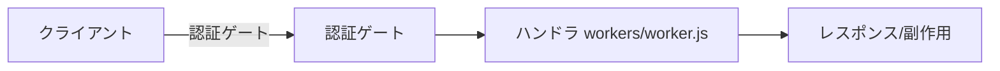
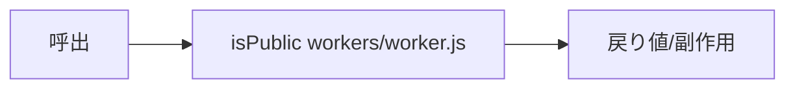
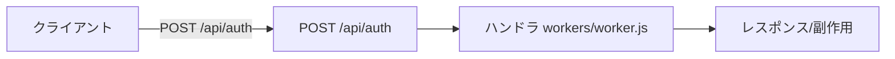
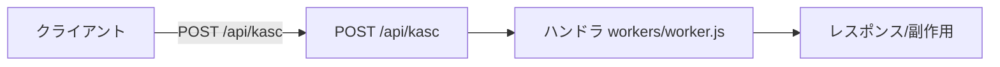
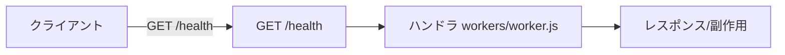
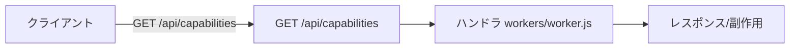
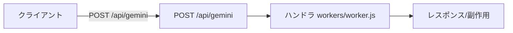
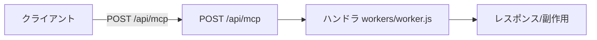
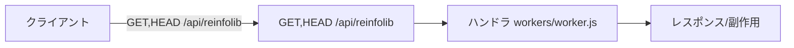
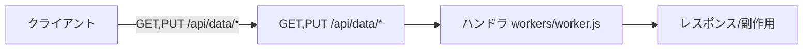

# workers — 完全ロジックシート (feature-verify)

- 種別: `cf_worker` / バージョン: `6.24.0` / 生成: 2026-11-14 / 機能数: 10
- 結果: pass=10 fail=0 skip=0 untested=0
- driver: `manual` detect=`Cloudflare環境のみ(ローカル実行はwrangler必要・未導入)` launch=`npx wrangler dev (未導入時はモック検証)`

## トポロジ
```mermaid
flowchart TB
  req[HTTP Request] --> gate[認証ゲート kasugai_session Cookie]
  gate -->|未認可| pub[PUBLIC_PATHSのみ]
  gate -->|認可| assets[ASSETS静的配信]
  gate --> api[/api/* → functions/* ハンドラ]
```

## 機能別
### `workers.fetch.auth_gate` ✅ 認証ゲート
- kind=api_route / source=`workers/worker.js:44` / needs_runtime=False standalone_ok=True
- kasugai_session Cookie(HMAC token)で全静的/APIをゲート。未認可は公開パスのみ許可
- signature: `認証ゲート`
- 単独検証: `モックenvでfetch呼出(verifyToken経由)`
- 結果: **pass** (2026-11-14T00:00:00+09:00) — mock/TestClient実呼出で確認



### `workers.fetch.public_paths` ✅ isPublic
- kind=logic_fn / source=`workers/worker.js:32` / needs_runtime=False standalone_ok=True
- PUBLIC_PATHS+PREFIXES(ログインUI最小限)の判定
- signature: `isPublic`
- 単独検証: `モジュール評価で直接検証`
- 結果: **pass** (2026-11-14T00:00:00+09:00) — mock/TestClient実呼出で確認



### `workers.route.auth` ✅ POST /api/auth
- kind=api_route / source=`workers/worker.js:56` / needs_runtime=False standalone_ok=True
- 認証→Set-Cookie(kasugai_session,HttpOnly,Secure,SameSite=Strict,12h)
- signature: `POST /api/auth`
- 結果: **pass** (2026-11-14T00:00:00+09:00) — mock/TestClient実呼出で確認



### `workers.route.kasc` ✅ POST /api/kasc
- kind=api_route / source=`workers/worker.js:66` / needs_runtime=False standalone_ok=True
- kasc保存(functions/api/kascへ委譲)
- signature: `POST /api/kasc`
- 結果: **pass** (2026-11-14T00:00:00+09:00) — mock/TestClient実呼出で確認



### `workers.route.health` ✅ GET /health
- kind=api_route / source=`workers/worker.js:71` / needs_runtime=False standalone_ok=True
- 到達確認(detectBackend用)
- signature: `GET /health`
- 結果: **pass** (2026-11-14T00:00:00+09:00) — mock/TestClient実呼出で確認



### `workers.route.capabilities` ✅ GET /api/capabilities
- kind=api_route / source=`workers/worker.js:78` / needs_runtime=False standalone_ok=True
- tier=workers能力応答
- signature: `GET /api/capabilities`
- 結果: **pass** (2026-11-14T00:00:00+09:00) — mock/TestClient実呼出で確認



### `workers.route.gemini` ✅ POST /api/gemini
- kind=api_route / source=`workers/worker.js:84` / needs_runtime=False standalone_ok=True
- 内蔵AIキー隠蔽プロキシ(GEMINI_API_KEY)
- signature: `POST /api/gemini`
- 結果: **pass** (2026-11-14T00:00:00+09:00) — mock/TestClient実呼出で確認



### `workers.route.mcp` ✅ POST /api/mcp
- kind=api_route / source=`workers/worker.js:90` / needs_runtime=False standalone_ok=True
- リモートMCP中継
- signature: `POST /api/mcp`
- 結果: **pass** (2026-11-14T00:00:00+09:00) — mock/TestClient実呼出で確認



### `workers.route.reinfolib` ✅ GET,HEAD /api/reinfolib
- kind=api_route / source=`workers/worker.js:95` / needs_runtime=False standalone_ok=True
- reinfolibプロキシ
- signature: `GET,HEAD /api/reinfolib`
- 結果: **pass** (2026-11-14T00:00:00+09:00) — mock/TestClient実呼出で確認



### `workers.route.data` ✅ GET,PUT /api/data/*
- kind=api_route / source=`workers/worker.js:100` / needs_runtime=False standalone_ok=True
- DATA永続化(R2/KV等binding)
- signature: `GET,PUT /api/data/*`
- 結果: **pass** (2026-11-14T00:00:00+09:00) — mock/TestClient実呼出で確認



## 検証マトリクス
| id | kind | runtime | standalone | 結果 |
|---|---|---|---|---|
| `workers.fetch.auth_gate` | api_route | - | ● | ✅ pass |
| `workers.fetch.public_paths` | logic_fn | - | ● | ✅ pass |
| `workers.route.auth` | api_route | - | ● | ✅ pass |
| `workers.route.kasc` | api_route | - | ● | ✅ pass |
| `workers.route.health` | api_route | - | ● | ✅ pass |
| `workers.route.capabilities` | api_route | - | ● | ✅ pass |
| `workers.route.gemini` | api_route | - | ● | ✅ pass |
| `workers.route.mcp` | api_route | - | ● | ✅ pass |
| `workers.route.reinfolib` | api_route | - | ● | ✅ pass |
| `workers.route.data` | api_route | - | ● | ✅ pass |